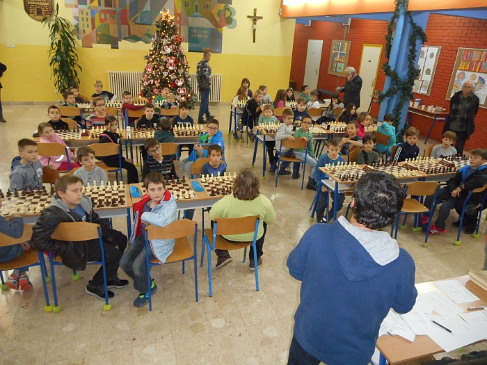
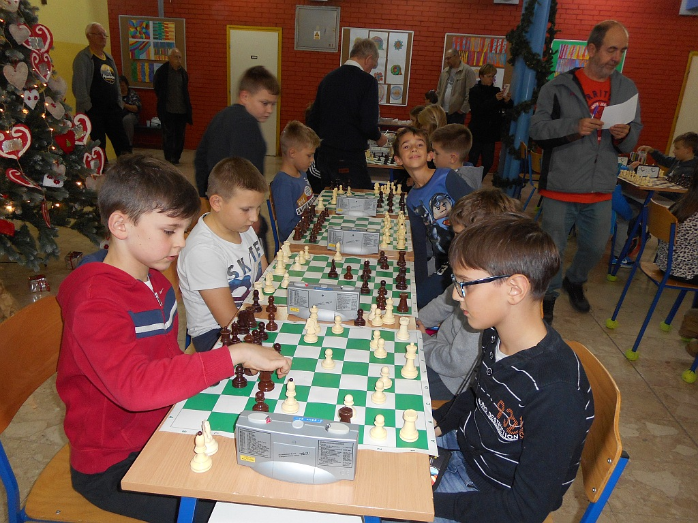
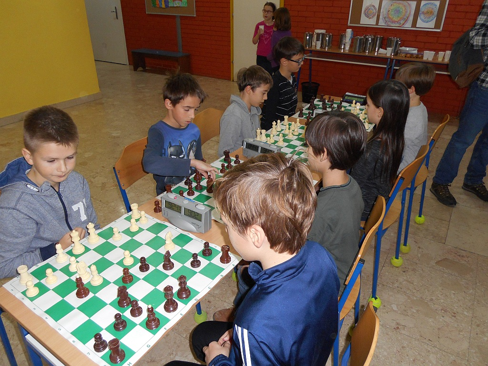
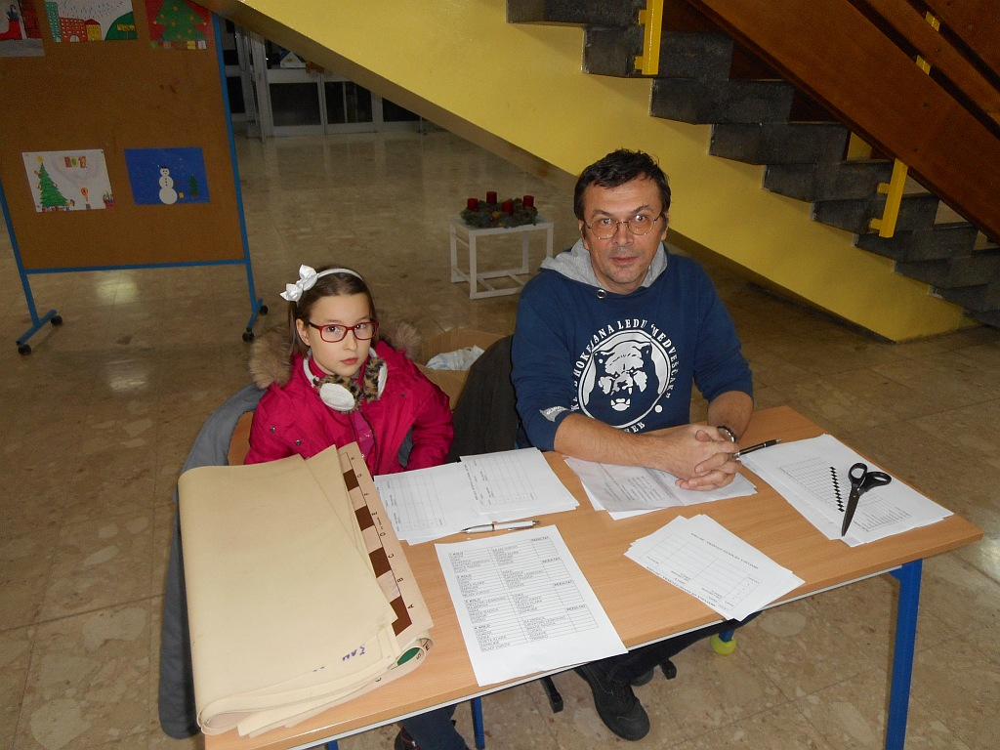
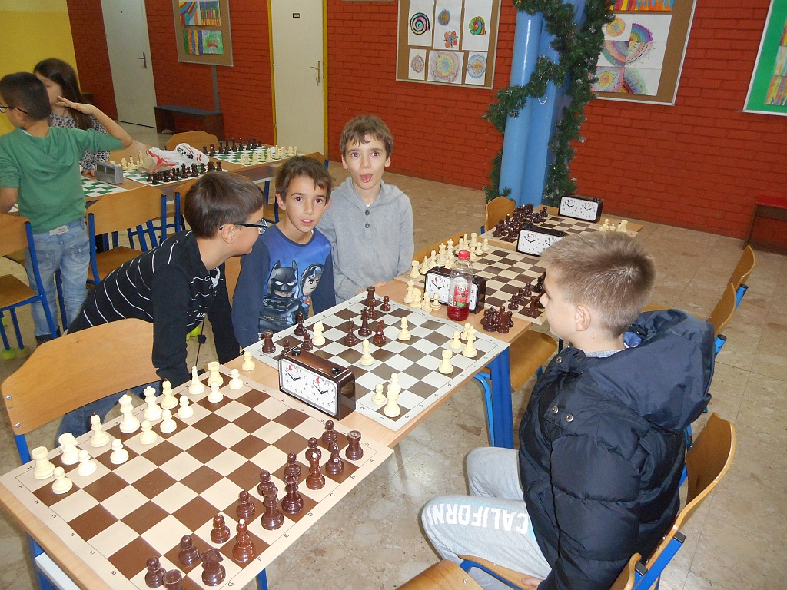
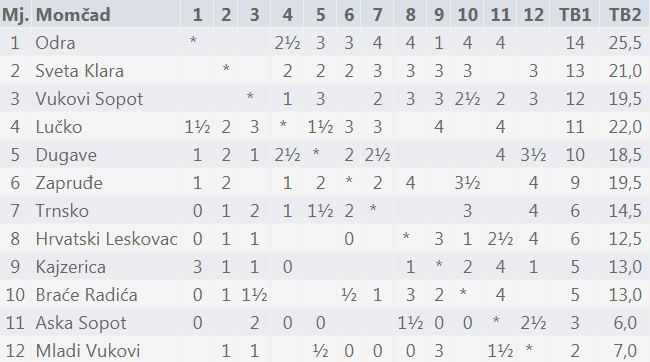
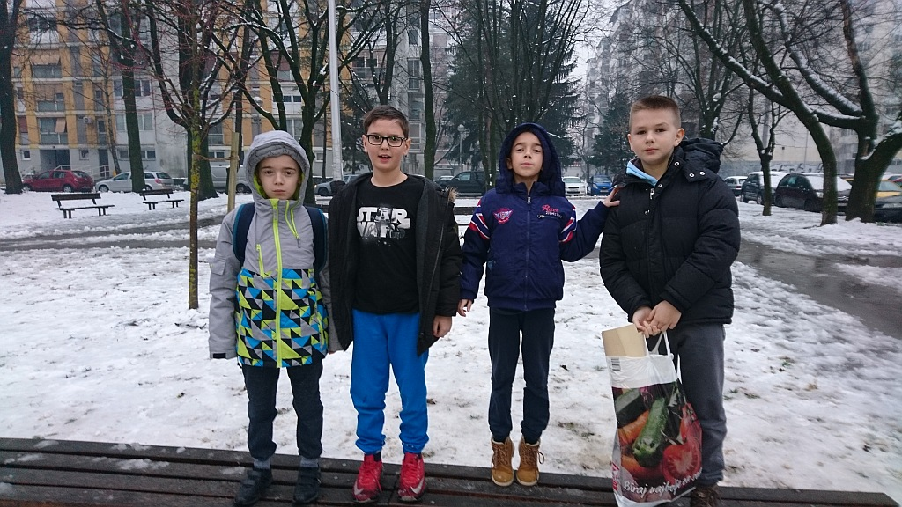
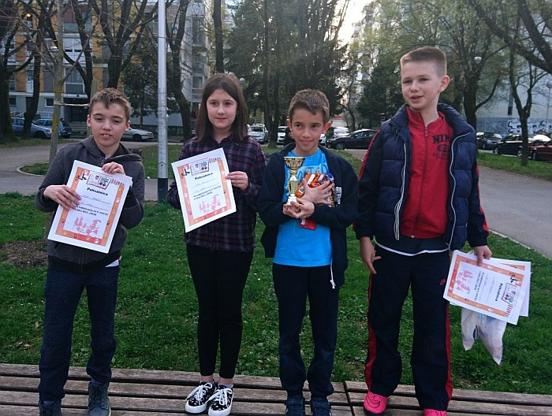
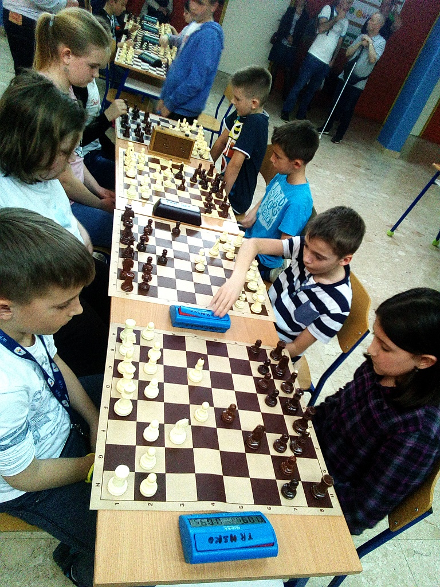

  
U srijedu, 13. prosinca 2017., u [OŠ Ive Andrića](http://os-iandrica-zg.skole.hr/) u Sopotu, započela je Mini liga 2017./2018., ekipno prvenstvo OŠ Novog Zagreba za učenike do četvrtog razreda. Prvenstvo se odigrava pod pokroviteljstvom ravnateljice osnovne škole Ive Andrića, gospođe Dubravke Miklec. Voditelj prvenstva je Jelenko Mikacinić, voditelj Šahovske škole OŠ Ive Andrića. Na turniru nastupa 12 ekipa iz deset osnovnih škola s područja Novog Zagreba. Tempo igre je 10+0, a mečevi se igraju na četiri ploče.

<table><tbody><tr><td bgcolor="#C0C0C0"><strong>Mj.</strong></td><td bgcolor="#C0C0C0"><strong>Momčad</strong></td><td bgcolor="#C0C0C0"><strong>1</strong></td><td bgcolor="#C0C0C0"><strong>2</strong></td><td bgcolor="#C0C0C0"><strong>3</strong></td><td bgcolor="#C0C0C0"><strong>4</strong></td><td bgcolor="#C0C0C0"><strong>5</strong></td><td bgcolor="#C0C0C0"><strong>6</strong></td><td bgcolor="#C0C0C0"><strong>7</strong></td><td bgcolor="#C0C0C0"><strong>8</strong></td><td bgcolor="#C0C0C0"><strong>9</strong></td><td bgcolor="#C0C0C0"><strong>10</strong></td><td bgcolor="#C0C0C0"><strong>11</strong></td><td bgcolor="#C0C0C0"><strong>12</strong></td><td bgcolor="#C0C0C0"><strong>&nbsp;Meč bodovi&nbsp;</strong></td><td bgcolor="#C0C0C0"><strong>&nbsp;Poj. bod.&nbsp;</strong></td></tr><tr><td>1</td><td>Vukovi Sopot</td><td>♦</td><td></td><td></td><td></td><td></td><td></td><td></td><td>3</td><td>2</td><td>3</td><td></td><td>3</td><td>7</td><td>11,0</td></tr><tr><td>2</td><td>Sveta Klara</td><td>0</td><td>♦</td><td></td><td></td><td></td><td>2</td><td></td><td>3</td><td></td><td></td><td>3</td><td>3</td><td>7</td><td>11,0</td></tr><tr><td>3</td><td>Dugave</td><td></td><td></td><td>&nbsp;♦</td><td></td><td>2</td><td>2½</td><td>2½</td><td></td><td></td><td>3½</td><td></td><td></td><td>7</td><td>10,5</td></tr><tr><td><strong>4</strong></td><td><strong>Odra</strong></td><td></td><td></td><td></td><td>&nbsp;♦</td><td>&nbsp;00</td><td></td><td></td><td>1</td><td>4</td><td></td><td>4</td><td>4</td><td><strong>6</strong></td><td><strong>13,0</strong></td></tr><tr><td>5</td><td>Zapruđe</td><td></td><td></td><td>2</td><td></td><td>&nbsp;♦</td><td>1</td><td></td><td></td><td></td><td></td><td>3½</td><td>4</td><td>5</td><td>10,5</td></tr><tr><td>6</td><td>Lučko</td><td></td><td>2</td><td>1½</td><td></td><td>3</td><td>&nbsp;♦</td><td>3</td><td></td><td></td><td></td><td></td><td></td><td>5</td><td>9,5</td></tr><tr><td>7</td><td>Trnsko</td><td></td><td></td><td>1½</td><td></td><td></td><td>1</td><td>&nbsp;♦</td><td></td><td></td><td>4</td><td>3</td><td></td><td>4</td><td>9,5</td></tr><tr><td>8</td><td>Kajzerica</td><td>1</td><td>1</td><td></td><td>3</td><td></td><td></td><td></td><td>&nbsp;♦</td><td>4</td><td></td><td></td><td></td><td>4</td><td>9,0</td></tr><tr><td>9</td><td>Aska Sopot</td><td>2</td><td></td><td></td><td>0½</td><td></td><td></td><td></td><td>0</td><td>&nbsp;♦</td><td>2½</td><td></td><td></td><td>3</td><td>4,5</td></tr><tr><td>10</td><td>Mladi Vukovi</td><td>1</td><td></td><td>½</td><td></td><td></td><td></td><td>0</td><td></td><td>1½</td><td>&nbsp;♦</td><td></td><td></td><td>0</td><td>3,0</td></tr><tr><td>11</td><td>Braće Radića</td><td></td><td>1</td><td></td><td>0</td><td>½</td><td></td><td>1</td><td></td><td></td><td></td><td>&nbsp;♦</td><td>&nbsp;</td><td>0</td><td>2,5</td></tr><tr><td>12</td><td>Hrvatski Leskovac</td><td>1</td><td>1</td><td></td><td>0</td><td>00</td><td></td><td></td><td></td><td></td><td></td><td></td><td>♦</td><td>0</td><td>2,0</td></tr></tbody></table>

Nakon odigranog prvog kruga tj. nakon četiri kola, ekipa OŠ Odra nalazi se na četvrtom mjestu, a vodeća je ekipa domaćina, Vukovi Sopot iz OŠ Ive Andrića. Ekipa iz Odre igra u sastavu; kapetan Luka Fiolić (4/4), Luka Matašić (3/4), Filip Matašić (3/4) i Roko Matić (3/4). Tri meča su dobili uvjerljivo  4:0, a jedan meč su izgubili. Filip i Luka Matašić se još uvijek ne snalaze u oskudici vremena, a Roko još nije savladao osnovne principe, iako se mora priznati da je ostvario impresivan rezultat. Nadam se da će biti redovitiji petkom. Trenutačno imamo osam igrača u ovoj dobnoj skupini, a uz navedene tu su još Tin, Antonio, Filip Mahin i Dora.  Teoretski smo mogli nastupiti i s dvije ekipe, ali onda ne bi imali rezervi. Nažalost, nije uspio pokušaj da složimo zajedničku ekipu s OŠ Savski Gaj pa rezervama za sada ostaje popravljanje forme petkom. Turnir se nastavlja 7. veljače 2018.  
[Rezultati.](http://chess-results.com/tnr320562.aspx?lan=13&art=0&wi=821)  
   

---

**Drugi krug, 7. veljače 2018.**

Danas je odigran drugi krug MINI LIGE i naši dečki su odradili izvrstan posao. Četiri pobjede u četiri meča! Istina, najteži protivnici ih tek čekaju u prestala tri kola, ali sve ovisi o njima samima.  
Čestitamo mladim nadama iz OŠ Odra na današnjim rezultatima, Luki Fioliću (3,5/4), Luki Matašiću (3/4), Filipu Matašiću (3/4) i Roku Matiću (3/4). Trenutačno su vodeća ekipa, ali je još daleko do kraja. Nastavak, tj. posljednja tri kola igrat će se 11. travnja.  
  

---

**Treći krug, 11. travnja 2018.  
Pobjednici!  
  
**

Konačni poredak sa partijama

<table><tbody><tr><td>Mj.</td><td>Momčad</td><td>1</td><td>2</td><td>3</td><td>4</td><td>5</td><td>6</td><td>7</td><td>8</td><td>9</td><td>10</td><td>11</td><td>12</td><td>&nbsp;TB1</td><td>&nbsp;TB2</td><td>&nbsp;TB3</td></tr><tr><td><strong>1</strong></td><td><strong>Odra</strong></td><td>&nbsp;*</td><td>2½</td><td>1</td><td>2</td><td>3</td><td>3</td><td>1</td><td>4</td><td>4</td><td>4</td><td>4</td><td>3</td><td>17</td><td>31,5</td><td>2</td></tr><tr><td>2</td><td>Lučko</td><td>1½</td><td>&nbsp;*</td><td>2</td><td>3</td><td>1½</td><td>3</td><td>4</td><td>3</td><td>4</td><td>3</td><td>4</td><td>2½</td><td>17</td><td>31,5</td><td>0</td></tr><tr><td>3</td><td>Sveta Klara</td><td>3</td><td>2</td><td>&nbsp;*</td><td>1</td><td>2</td><td>2</td><td>3</td><td>3</td><td>3</td><td>3</td><td>3</td><td>3</td><td>17</td><td>28,0</td><td>0</td></tr><tr><td>4</td><td>Vukovi Sopot</td><td>2</td><td>1</td><td>3</td><td>&nbsp;*</td><td>3</td><td>3</td><td>3</td><td>2</td><td>2½</td><td>3</td><td>2</td><td>3</td><td>17</td><td>27,5</td><td>0</td></tr><tr><td>5</td><td>Dugave</td><td>1</td><td>2½</td><td>2</td><td>1</td><td>&nbsp;*</td><td>2</td><td>2</td><td>2½</td><td>4</td><td>4</td><td>4</td><td>3½</td><td>15</td><td>28,5</td><td>0</td></tr><tr><td>6</td><td>Zapruđe</td><td>1</td><td>1</td><td>2</td><td>1</td><td>2</td><td>&nbsp;*</td><td>2</td><td>2</td><td>3½</td><td>4</td><td>3½</td><td>4</td><td>12</td><td>26,0</td><td>0</td></tr><tr><td>7</td><td>Kajzerica</td><td>3</td><td>0</td><td>1</td><td>1</td><td>2</td><td>2</td><td>&nbsp;*</td><td>4</td><td>2</td><td>1</td><td>4</td><td>1</td><td>9</td><td>21,0</td><td>0</td></tr><tr><td>8</td><td>Trnsko</td><td>0</td><td>1</td><td>1</td><td>2</td><td>1½</td><td>2</td><td>0</td><td>&nbsp;*</td><td>3</td><td>3</td><td>2</td><td>4</td><td>9</td><td>19,5</td><td>0</td></tr><tr><td>9</td><td>Braće Radića</td><td>0</td><td>0</td><td>1</td><td>1½</td><td>0</td><td>½</td><td>2</td><td>1</td><td>&nbsp;*</td><td>3</td><td>4</td><td>4</td><td>7</td><td>17,0</td><td>0</td></tr><tr><td>10</td><td>Hrvatski Leskovac</td><td>0</td><td>1</td><td>1</td><td>1</td><td>0</td><td>0</td><td>3</td><td>1</td><td>1</td><td>&nbsp;*</td><td>2½</td><td>4</td><td>6</td><td>14,5</td><td>0</td></tr><tr><td>11</td><td>Aska Sopot</td><td>0</td><td>0</td><td>1</td><td>2</td><td>0</td><td>½</td><td>0</td><td>2</td><td>0</td><td>1½</td><td>&nbsp;*</td><td>2½</td><td>4</td><td>9,5</td><td>0</td></tr><tr><td>12</td><td>Mladi Vukovi</td><td>1</td><td>1½</td><td>1</td><td>1</td><td>½</td><td>0</td><td>3</td><td>0</td><td>0</td><td>0</td><td>1½</td><td>&nbsp;*</td><td>2</td><td>9,5</td><td>0</td></tr></tbody></table>

Tie Break1: meč bodovi  
Tie Break2: pojedinačni bodovi  
Tie Break3: međusobni susret

Danas je odigran posljednji krug Mini-lige, a nakon teška tri susreta i krajnje neizvjesnosti do posljednjeg poteza, **ekipa OŠ Odre osvojila je prvo mjesto!** U posljednjem krugu u ekipi je umjesto Roka nastupila Dora i osvojila prevažan bod koji je donio meč pobjedu u desetom kolu. A Filip je nakon teške borbe u posljednjem kolu, u partiji koja se igrala do posljednjih sekundi na satu, uspio pobijediti i također donio meč bod koji je na kraju, uz dodatne kriterije, bio dovoljan za osvajanje prvog mjesta. Luka i Luka su igrali standardno dobro, ali su svi kiksali u devetom kolu kada su trošili previše vremena i izgubili zbog vremenske oskudice. Borbe su bile izjednačene do samog kraja, a na kraju je o pobjedniku turnira odlučivao treći kriterij tj. međusobni ogled. Čak su četiri ekipe na kraju turnira imale jednak broj meč bodova, a prve dvije i jednak broj pojedinačnih bodova. Tako je završena i ovogodišnja mini-liga koja je uistinu osvježenje među šahovskim turnirima jer pruža svim početnicima mjesto gdje mogu početi svoj šahovski razvoj u ravnopravnoj konkurenciji. Šteta je što nema i više ovakvih turnira. Još jednom velika hvala organizatorima i domaćinu, OŠ Ive Andrića.
