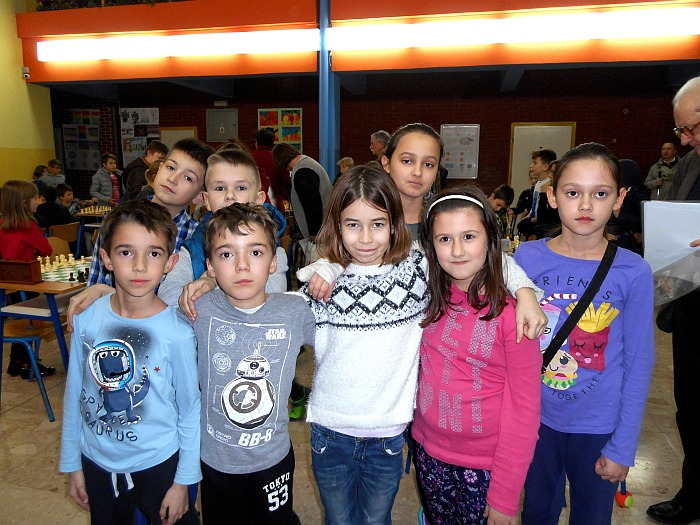
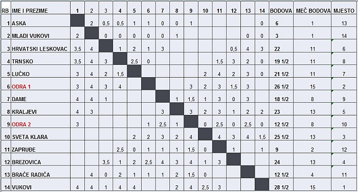
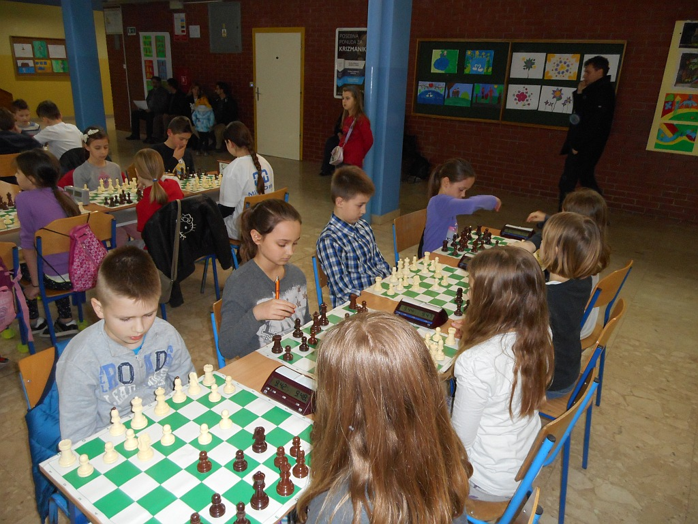
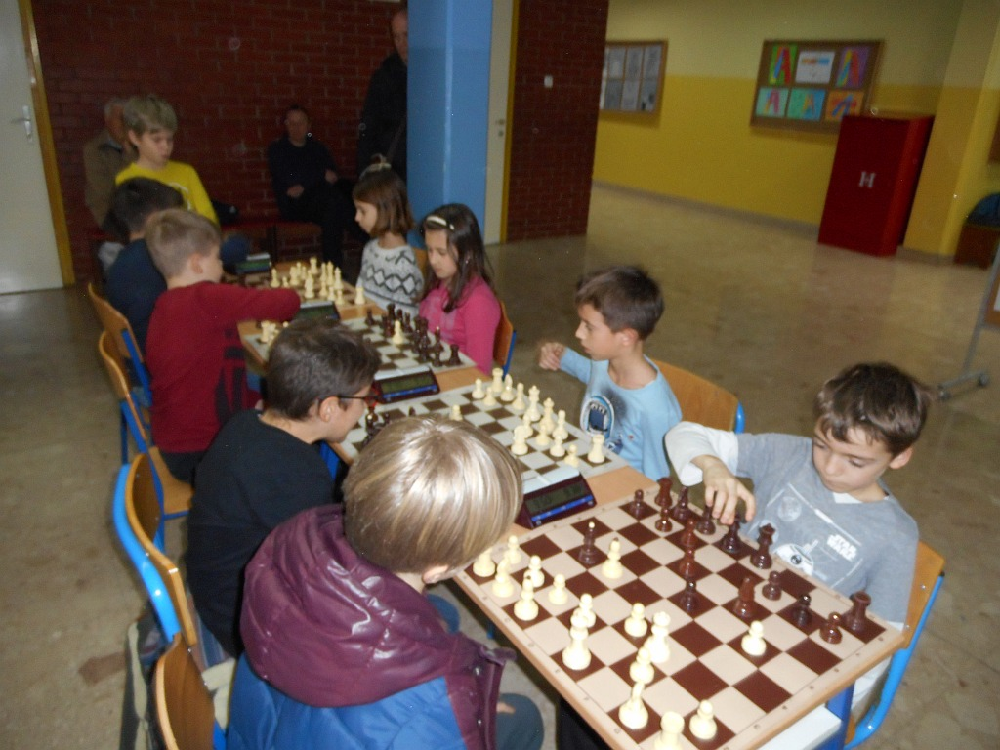
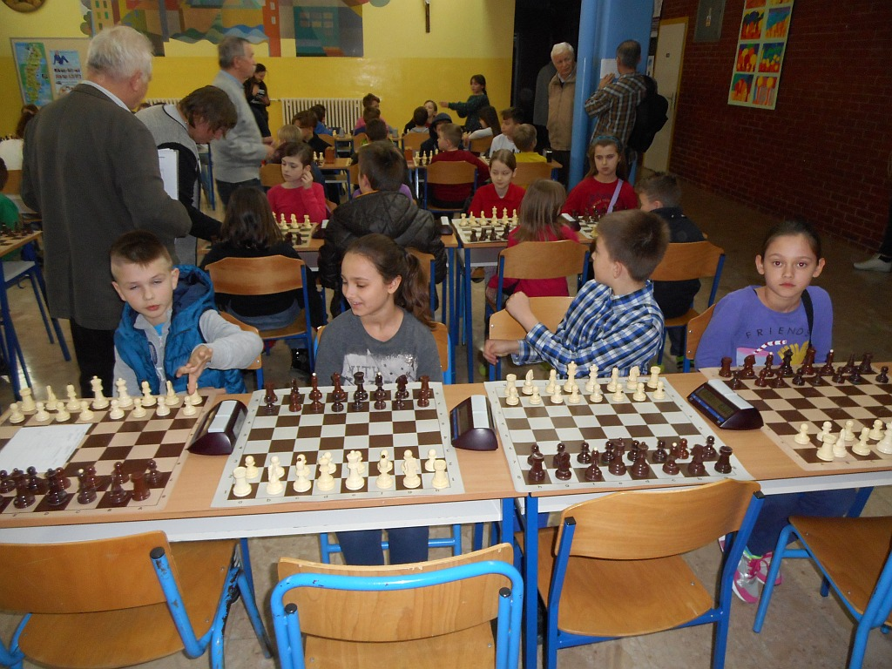
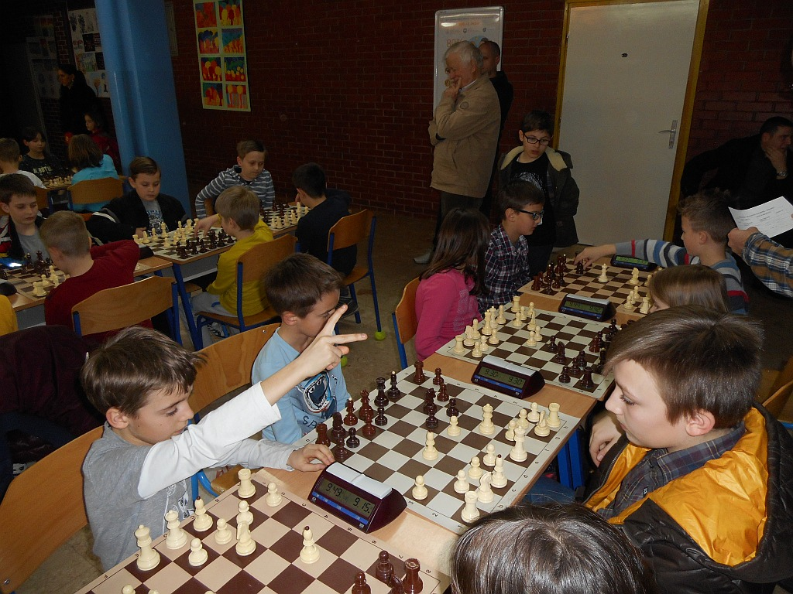
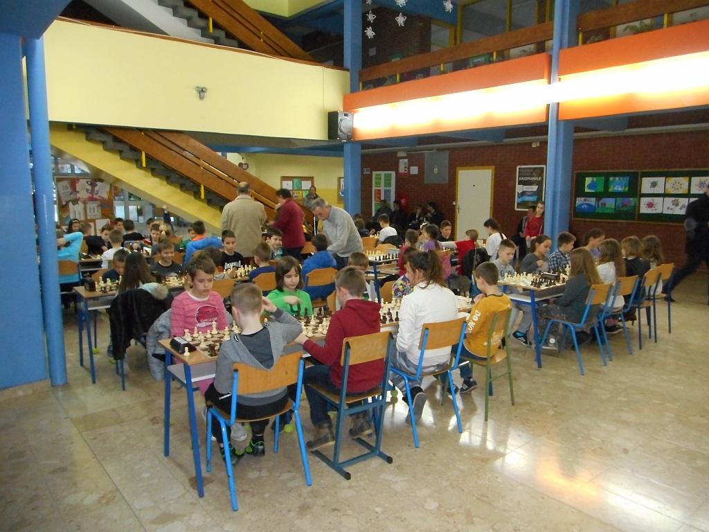
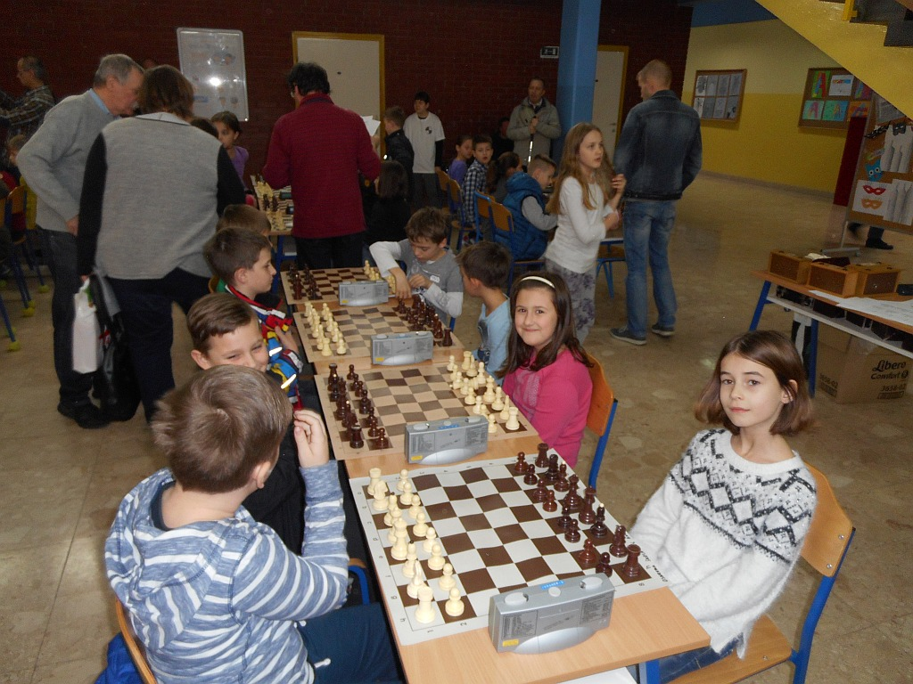

  
Jučer je u [OŠ Ive Andrića](http://os-iandrica-zg.skole.hr/) u Sopotu odigran drugi krug ekipnog prvenstva OŠ Novog Zagreba do četvrtog razreda. Borbe su bile nepoštedne, a remiji samo patom… Obje ekipe OŠ Odra popravile su položaj na tablici!  
**Prva ekipa** ostvarila je pet pobjeda iz pet kola, koliko se igralo, dok je druga ekipa pobijedila u tri meča, za razliku od prvoga kruga, kada su ostvarili samo jednu ekipnu pobjedu. U prvoj ekipi proigrala je i Monika. U prva četiri kola imala je samo poraze, a sada je ostvarila 100% učinak, kao i Luka Fiolić, 5/5! Lucija je postigla 4/5, a jedini je poraz bio na vrijeme. Josip je imao polovičan uspjeh, ali taman dovoljan da ekipa upiše 10 meč-bodova u ovom krugu.  
**Druga ekipa** također se znatno popravila i upisala tri meč-pobjede. U ovom krugu zaigrali su i Dora i Roko, kojemu je ovo prvi turnir. A svi su uspjeli ubilježiti barem po jednu pobjedu. Filip je pobijedio na prvoj ploči, Hana je dala mat i bila jako dobre volje, Roko je prvu partiju imao tremu i puno griješio, ali je iz trećeg pokušaja i on uspio pobijediti, Dora je prilično dekoncentrirana osvojila bod i pol, a Luka je bio očekivano najbolji s tri pobjede!  
Tablica  

Turnir se nastavlja 10. svibnja, kada će se igrati posljednja četiri kola.

     
    
[pojedinacni rezultati prvih devet kola](/files/wp/2017/03/pojedinacni-rezultati-prvih-devet-kola.docx)
