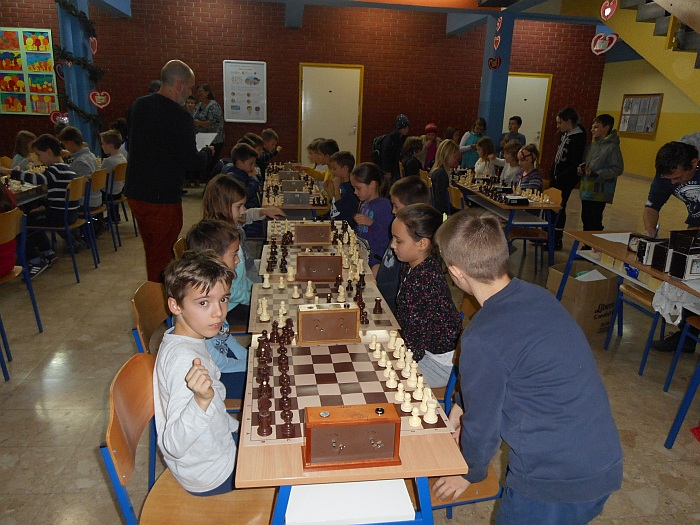
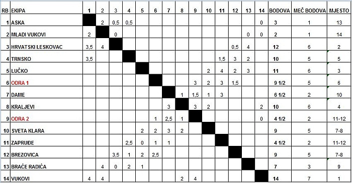
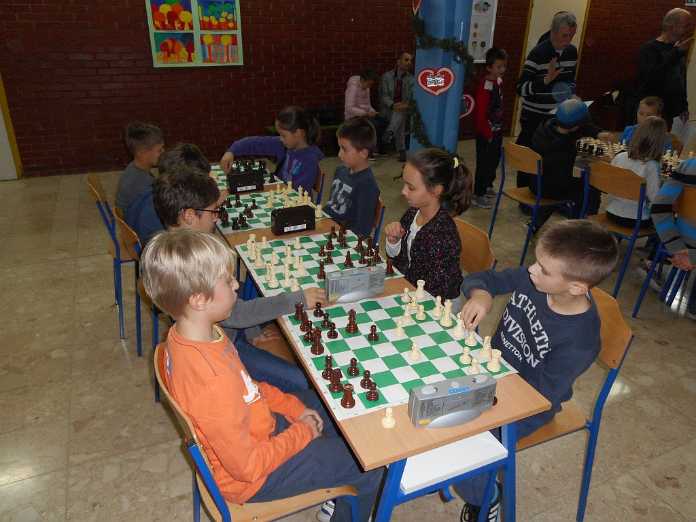
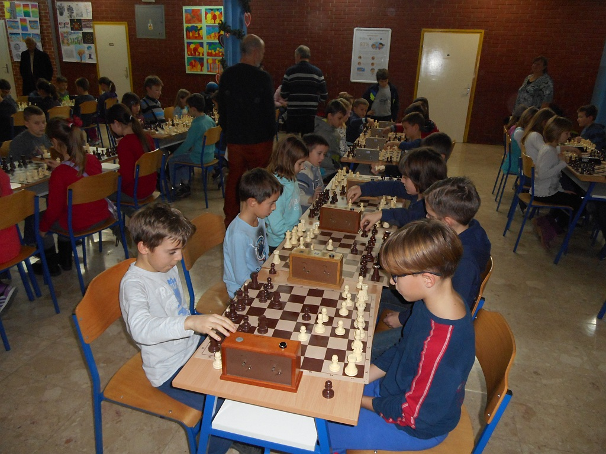
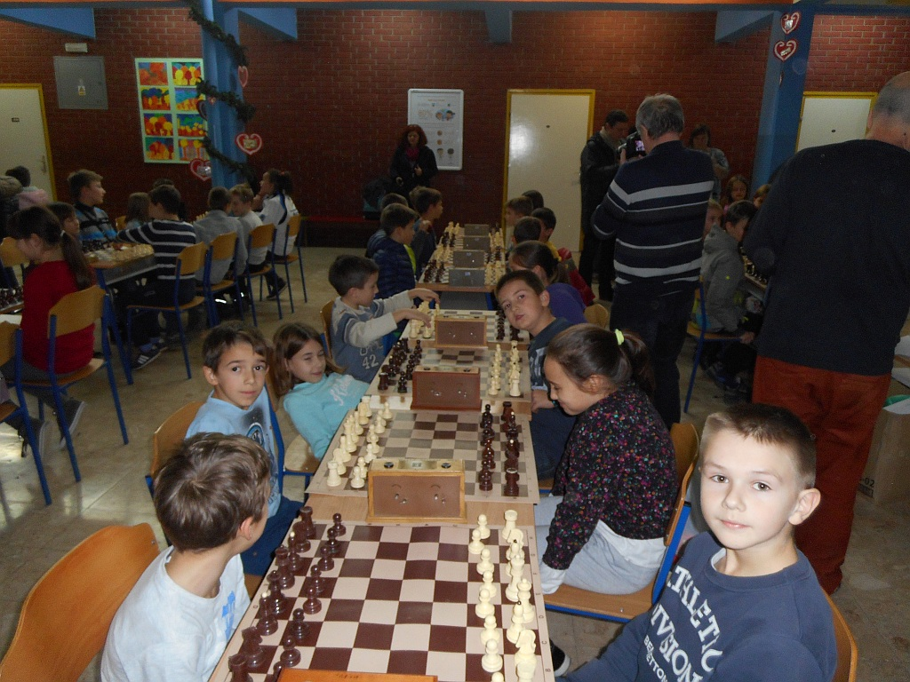
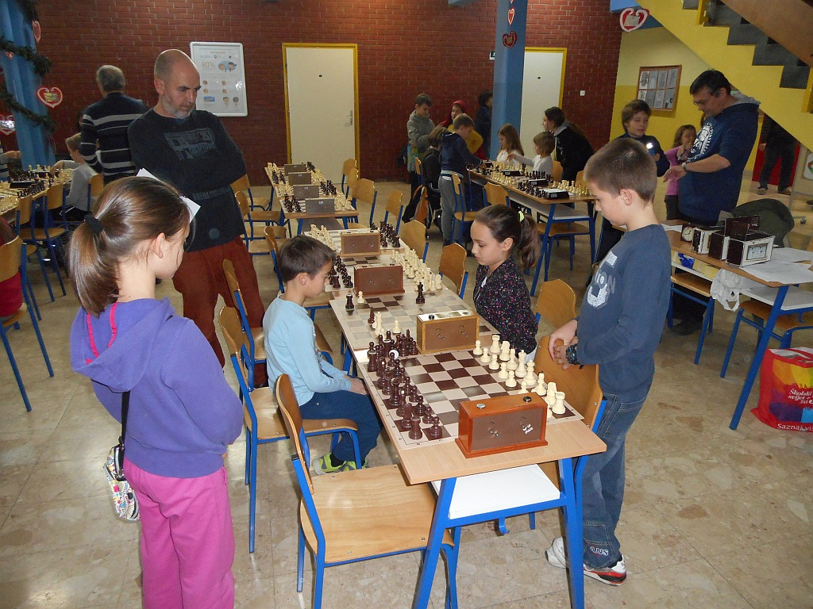

Jučer je u OŠ Ive Andrića u Sopotu odigran prvi krug Ekipnog prvenstva OŠ Novog Zagreba za učenike do četvrtog razreda. Naši mladi članovi predstavljali su OŠ Odra s dvije ekipe. U prvoj ekipi igrali su oni iskusniji, koji već dulje uče i igraju šah, Luka Fiolić, Monika Kolovrat (K), Josip Mahin i Lucija Kolovrat. Drugu ekipu činili su mlađi šahisti, Filip Matašić, Luka Matašić (K), Lucija Hana Kaić i Antonio Lorusso. Odigrana su prva četiri kola. Prva ekipa ostvarila je dvije pobjede i jedan neriješen rezultat, a druga ekipa imala je jednu, u kolu u kojem je i Hana ostvarila lijepu pobjedu. Hana i Lorusso još su na počecima i još se gnjave s pregledom i razumijevanjem igre, ali pokazuju čvrstoću i upornost na kojima im se može pozavidjeti. Na dobru su putu da ovladaju vještinom igranja šaha. Braća Matašić dobro se snalaze i, premda su i oni na počecima šahovskog razvoja, već uspijevaju i češće pobjeđivati. Luka je osvojio 2,5 boda i možda je zaslužio biti i u prvoj ekipi, a i Filip ima pobjedu iako igra na prvoj ploči s najjačim protivnicima. U prvoj ekipi Luka Fiolić bio je očekivano dobar i ubilježio tri pobjede iz četiri partije, Josip je također prebacio 50 posto, a sve zahvaljujući tomu što vježba šah i kod kuće. Monika je nažalost izgubila sve četiri partije. Vidio sam dvije, u jednoj je previdjela damu, ali je do kraja partije uspjela sve vratiti i ući u pješačku završnicu s figurom više, ali je nažalost potrošila vrijeme. U drugoj je pak ostvarila jak napad i onda previdjela dati mat u potezu. Uglavnom, igra i dalje dobro, ali je rezultat ne mazi. Lucija me itekako ugodno iznenadila. Postigla je stopostotni učinak s četiri pobjede! Čini mi se da joj samo nedostaje partija da joj se povežu neke stvari i da se ne muči s realizacijom.  
Na ovom turniru neke ekipe još nisu svladale pravilno igranje po pločama, ali naše nisu počinile takvu pogrešku pa je i to već dobar napredak. Nastavak turnira u drugom je polugodištu, drugi krug 8. ožujka, a treći krug 10. svibnja. Vjerujem da ćemo dotad biti još jači!  
TABLICA  

     
[rezultati-prva-cetiri-kola](/files/wp/2016/12/rezultati-prva-cetiri-kola.xlsx)  
[pojedinacni-rezultati-prva-cetiri-kola](/files/wp/2016/12/pojedinacni-rezultati-prva-cetiri-kola.docx)
