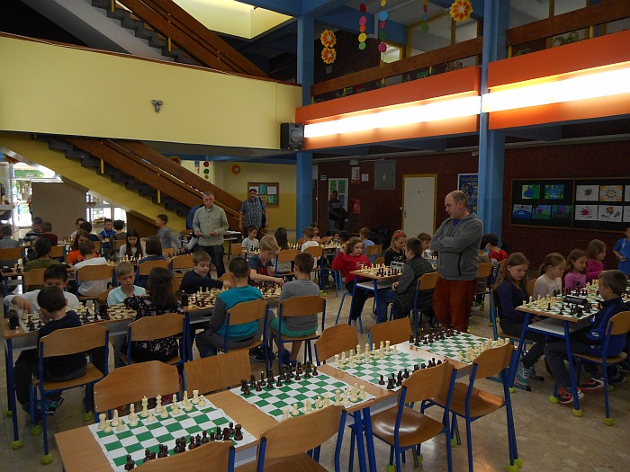  
Jučer je u OŠ Ive Andrića završeno Ekipno prvenstvo osnovnih škola Novog Zagreba. Igralo se na četiri ploče s tempom igre 10+0. Naši su dečki i cure nastupili u dvije ekipe i ostvarili pohvalan rezultat. Prva ekipa **OŠ Odra** **osvojila je treće mjesto**, a druga je ekipa OŠ Odra na kraju bila osma. Zasluženu pobjedu na turniru ostvarila je ekipa domaćina, **Vukovi – Sopot**, dok je drugo mjesto osvojila **OŠ Sveta Klara.  
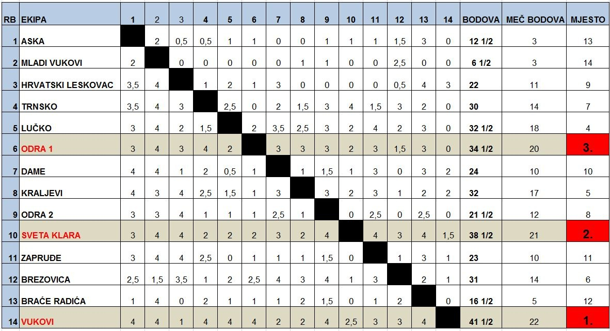  
**Za OŠ Odra u ovom su krugu igrali Luka Fiolić, Monika Kolovrat, Josip Mahin, Lucija Kolovrat, Filip i Luka Matašić, Dora Bačurin, Lucija Hana Kaić te Antonio Lorusso. Svi su zaslužni za ovaj uspjeh, a posebne pohvale za dobru igru i lijep napredak zaslužuju Luka Matašić i Lucija Kolovrat. Prvenstvo je proteklo bez incidenata, a nije bilo ni suza. 🙂 Voditelj i organizator turnira gospodin Jelenko Mikacinić pružio je mladim šahistima Novog Zagreba priliku ne samo da odmjere snage sa sebi ravnopravnim protivnicima nego i jedinstvenu priliku da svi napreduju kroz igru i druženje.  
A mi se nadamo da ćemo i dogodine imati dvije, ako ne i tri ekipe u ovoj dobnoj skupini!  
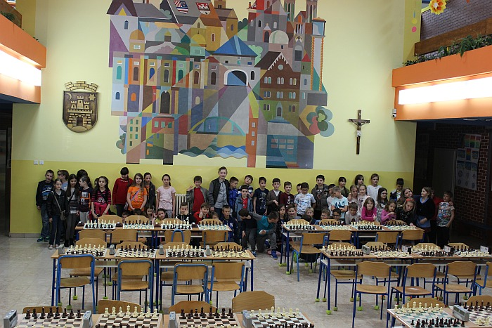  
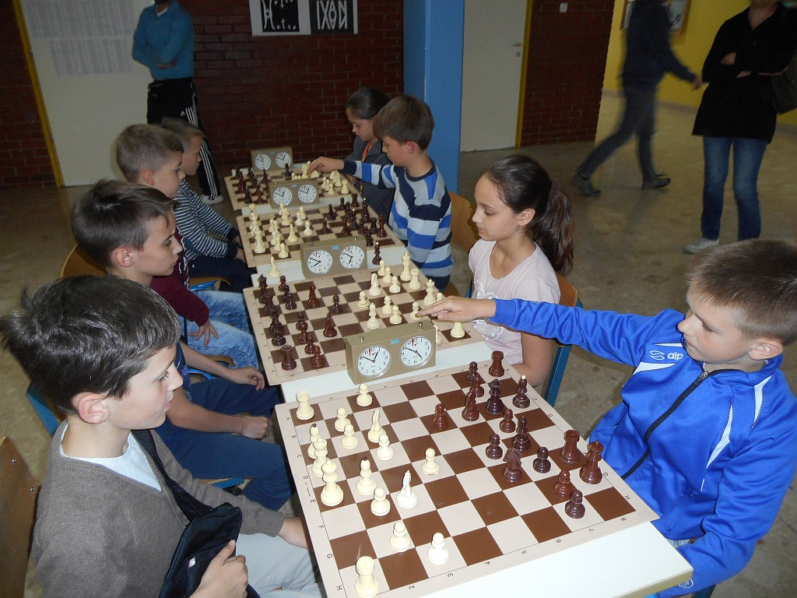 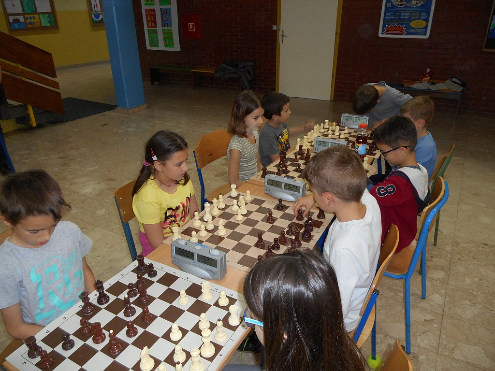 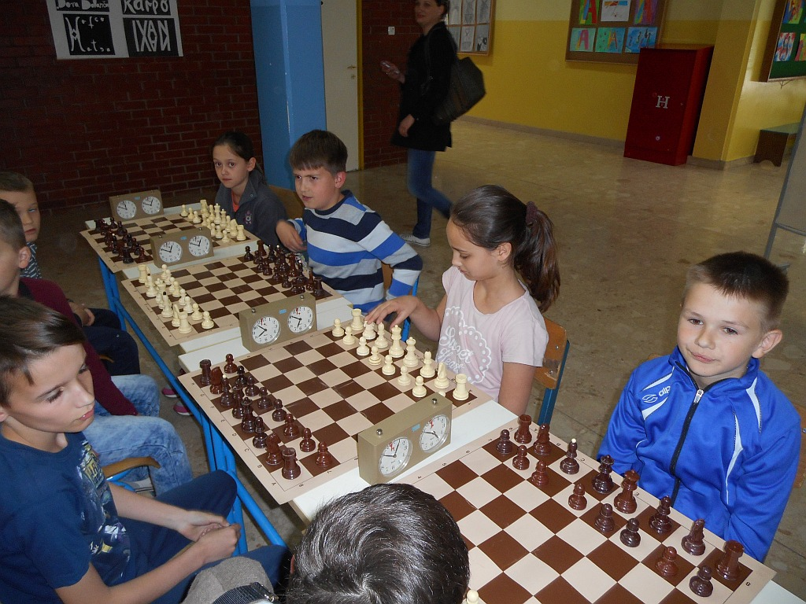 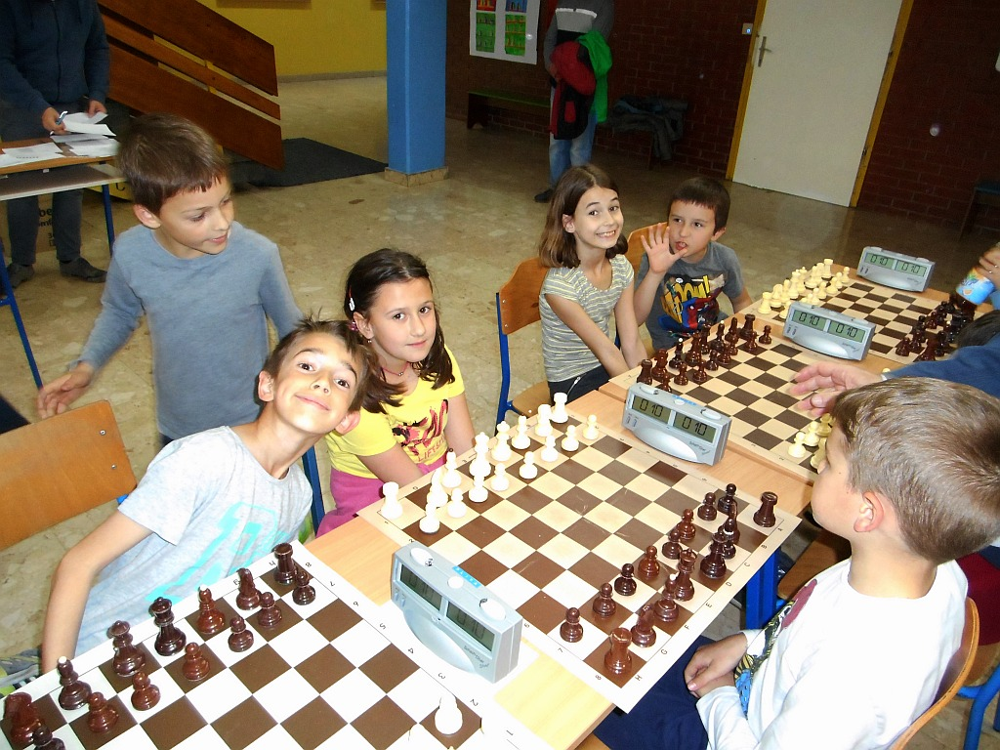  
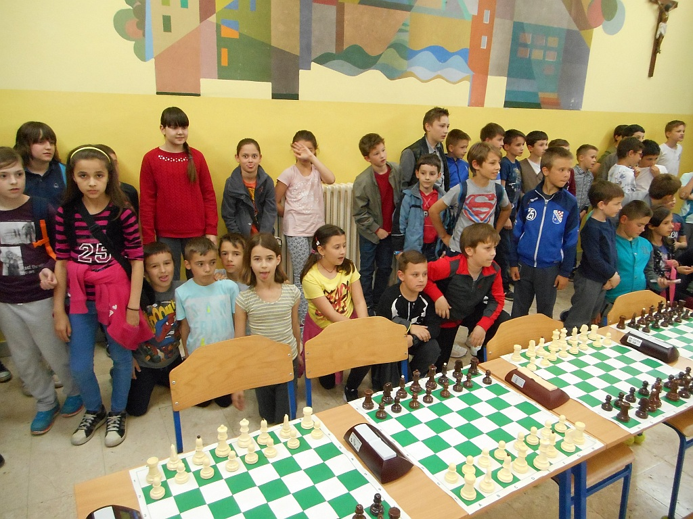 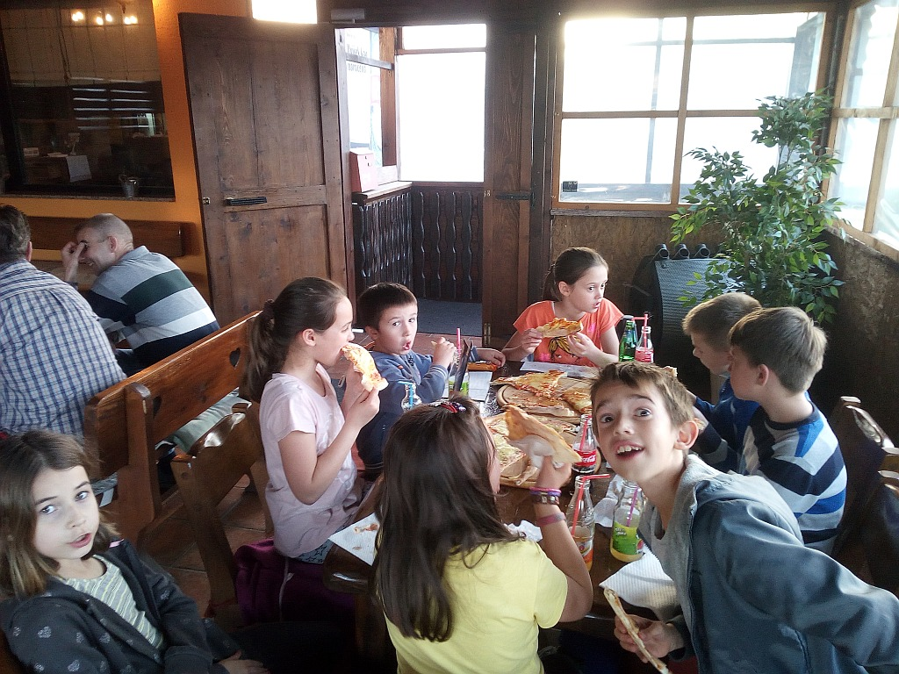 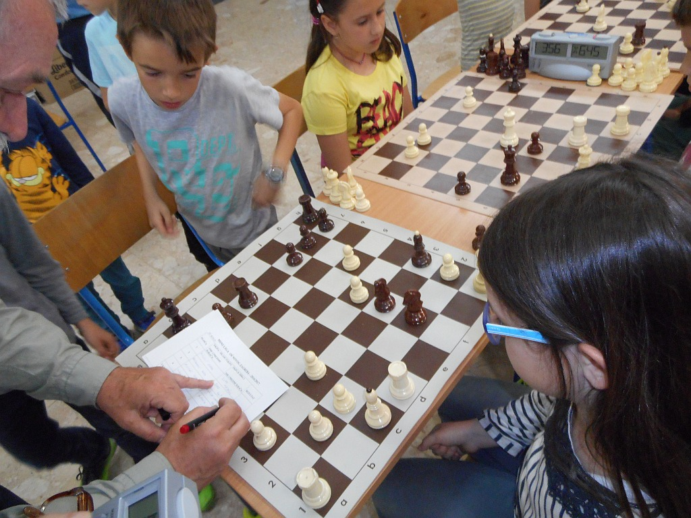 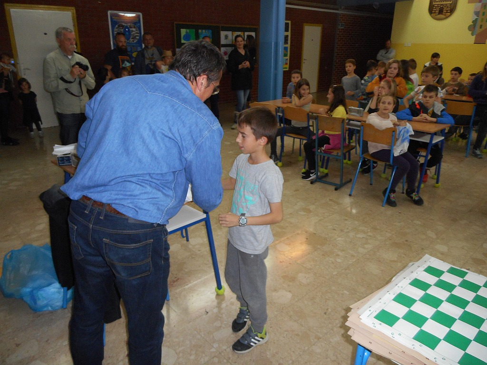  
[pojedinacni-rezultati](/files/wp/2017/05/pojedinacni-rezultati.docx)
