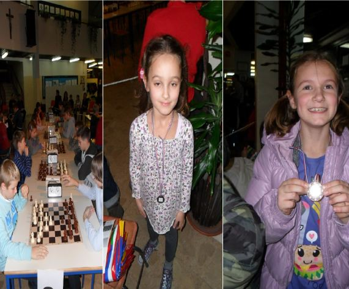
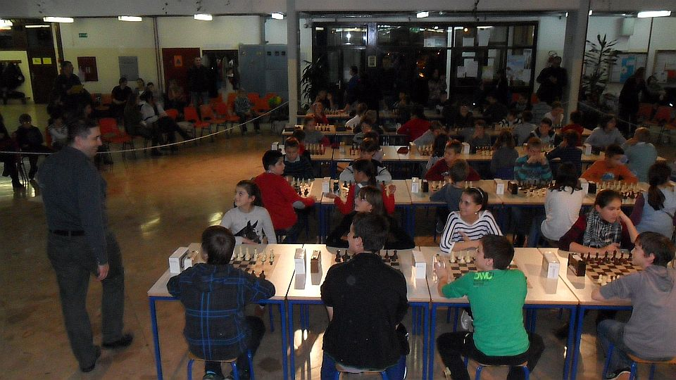
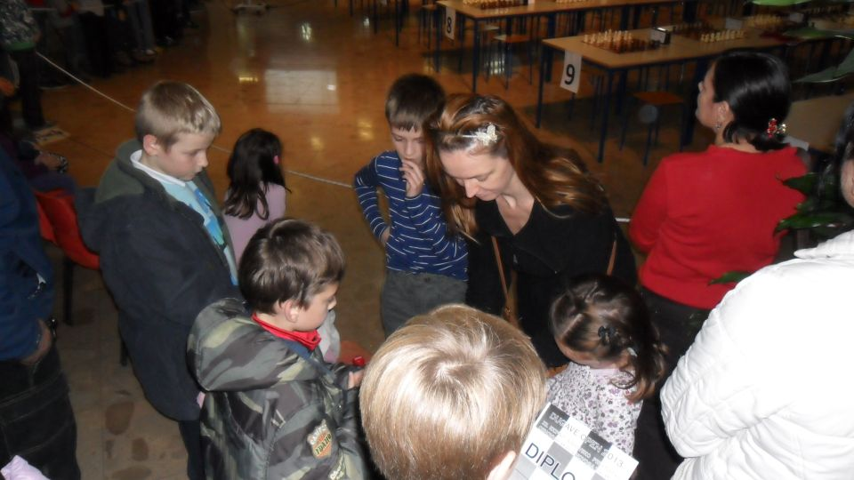
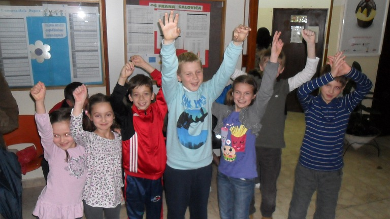
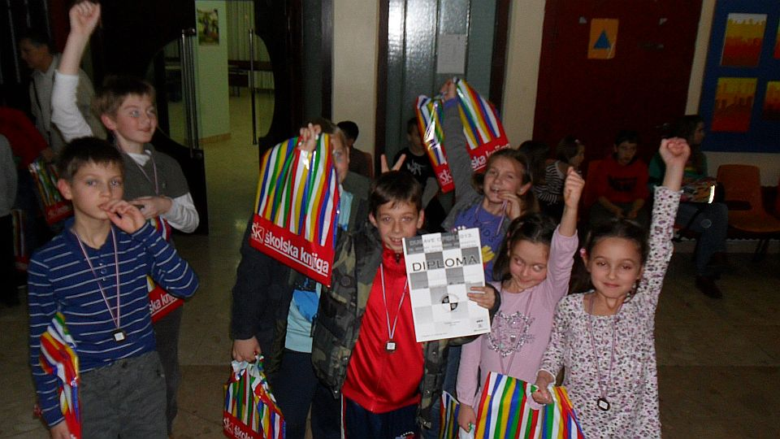
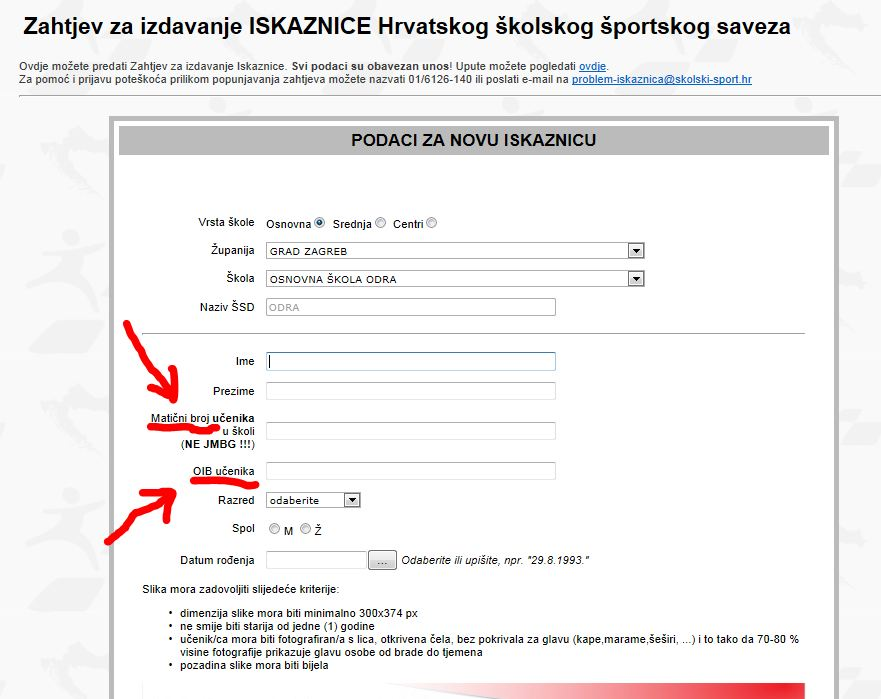

U petak 22. studenoga 2013. u OŠ Dugave odigrano je ekipno prvenstvo OŠ Novog Zagreba.Generalni sponzor bila je izdavačka kuća Školska knjiga. Ekipa OŠ Odre, sastavljena od članova Šahovskoga kluba, nastupila je prvi put i predstavljajući svoju školu i na ovom turniru! Inače, organizator ovog natjecanja veliki je šahovski entuzijast prof. Željko Brdal.

Iako je i prostor za igru prilično skučen za toliki broj ekipa (20 ekipa s po šest do sedam natjecatelja!), zahvaljujući dobroj organizaciji prof. Brdala i OŠ Dugave, turnir se odigrao bez ikakvih zastoja i problema.

Prije početka turnira, kada se u holu nalazilo više od stotinu djece, profesor se nekoliko puta tako izderao preko razglasa da sam se i ja uplašio! 🙂 Nasreću, članovi ekipe to su stoički podnijeli!

Prvo mjesto osvojila je ekipa OŠ Gustava Krkleca sa svih pet uvjerljivih pobjeda. Drugo mjesto pripalo je OŠ Frana Galovića, a treće je pripalo domaćinu, OŠ Dugave. Naša ekipa osvojila je 17. mjesto s dvije pobjede i tri poraza. [http://sah-dugave.org/2013/11/konacni-poredak-dugave-open-2013/](http://sah-dugave.org/2013/11/konacni-poredak-dugave-open-2013/ "POREDAK") Nadam se da će sljedeće godine biti barem pola boda više. Turnir se igrao na 10 minuta po igraču, što je u redu. Izgubili smo tri partije na vrijeme i time sam posebno zadovoljan. Tako su izgubili Vraneša, Monika i Ana te zaslužuju posebnu pohvalu jer su pokazali da nisu brzopleti i da razmišljaju za vrijeme partije. Ugodno me iznenadila i Lucija, koja je prvo kolo brzo izgubila, prišla mi i objasnila da nije dobro čuvala točku f7, o čemu sam govorio na treningu. A bio sam uvjeren da na treningu ne sluša. Sada me razuvjerila. 🙂

Bruno je pokazao da ima velik potencijal, šteta je što zbog drugih obveza nije češće na treningu. Vraneša je pokazao ozbiljnost u pristupu i čudi me da nije postigao i bolji rezultat. Božo je dosta taktizirao, što je tipično za njega, ali bi morao malo usporiti svoju igru. Ivan je bio najbolji, kao i dosad.

Svi sudionici dobili su prigodne nagrade, medalje, diplome i posebno diplomu za školu. Sve pohvale organizatoru! Također, pohvale idu i roditeljima koji su odvojili vrijeme i doveli natjecatelje ravno s nastave na turnir.

Posebno mi je drago da su svi dečki, i Ana s njima, nastupili i na pojedinačnom turniru dan poslije. Dobio sam izvještaj da su na tom turniru postigli sljedeće rezultate: Ivan 4,5, Vraneša 4, Ana, Bruno i Božo po 3,5!  [http://sah-dugave.org/2013/11/konacni-poredak-mikronis-2013/](http://sah-dugave.org/2013/11/konacni-poredak-mikronis-2013/ "POREDAK MIKRONIS") Ana i Bruno po rezultatima su stalno izjednačeni, a Ana je pobijedila Brunu na prvenstvu Kluba. Ne mogu procijeniti igra li već Bruno šah tako dobro kao Ana…

U nastavku nekoliko sličica s turnira, u privitku statistike nastupa.

[konacni poredak](/files/wp/2013/11/konacni-poredak.rtf)

[SastaviEkipaSOsvojenimBodovima](/files/wp/2013/11/SastaviEkipaSOsvojenimBodovima.rtf)

OBAVIJEST ZA RODITELJE: Ovo je bilo prvenstvo na nivou Novog Zagreba. Prvenstvo OŠ za Grad Zagreb održat će se u siječnju ili veljači i za to prvenstvo potrebne su iskaznice Hrvatskoga školskoga športskog saveza. Za dobivanje te iskaznice postupak je sljedeći. Treba ispuniti zahtjev na internetskim stranicama Saveza, nakon toga Savez šalje dokument koji trebaju potpisati roditelji i potvrditi škola. Ja mogu poslati zahtjev, ali su mi potrebni podaci označeni na slici ISKAZNICA u prilogu pa molim roditelje da mi ih dostave elektroničkom poštom.

