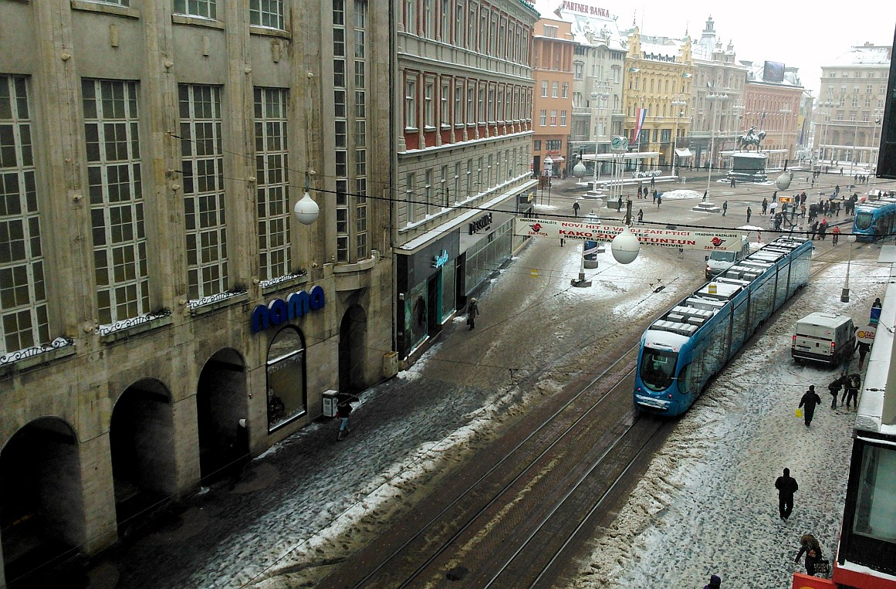
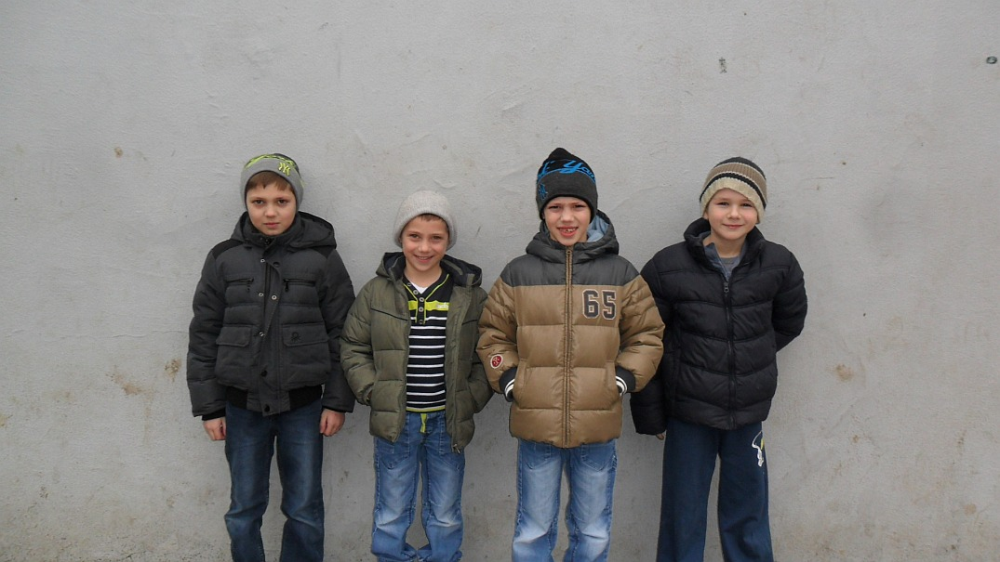

Danas je brzinski, u jednom danu, završeno ekipno prvenstvo OŠ Grada Zagreba za djevojčice. U finale su se plasirale OŠ Gustava Krkleca, OŠ Brestje, OŠ Sv. Klara i OŠ Dragutina Domjanića. Naše su djevojke imale malu otežavajuću okolnost da su nastupile u okrnjenom sastavu jer su igrale samo Monika i Franka, a drugi dio ekipe nije nastupio što zbog bolesti (Lucija), što zbog drugih obveza (Ana). Ove godine osvojile su drugo mjesto. Istina, odostraga, ali i to je uspjeh!  [REZULTATI.](http://www.chess-results.com/tnr160907.aspx?lan=13&art=0&fedb=CRO&turdet=YES&flag=NO&wi=984&group=1)  
Usprkos otežavajućim činjenicama, djevojke su uspjele zabilježiti i jednu ekipnu pobjedu! Čestitamo!

Sutra se nastavlja pojedinačno prvenstvo za skupine do 9 i 11 godina starosti te se nadamo uspješnom nastavku. Poslije tri kola imamo po jednog člana na drugome mjestu u konkurenciji [dječaka do 11](http://www.chess-results.com/tnr160265.aspx?lan=13&art=4&fed=CRO&wi=821) (Ivan), zatim jedno treće mjesto u konkurenciji [dječaka do 9](http://www.chess-results.com/tnr160264.aspx?lan=13&art=1&rd=3&wi=821) (Luka) i jedno treće mjesto u konkurenciji [djevojčica do 9](http://www.chess-results.com/tnr160266.aspx?lan=13&art=2&wi=821) (Franka). Sve pohvale i Ani, koja je počela zapisivati partije, a ove godine igra u konkurenciji [djevojčica do 11](http://www.chess-results.com/tnr160267.aspx?lan=13&art=1&wi=821). Nadamo se da će se uskoro i ostali ohrabriti i početi zapisivati poteze. Prema rasporedu dječaci do 9 trebali bi igrati tri kola i biti brzo gotovi, kao i djevojčice do 9. Malo dulje trajat će turnir djevojčica do 11 jer je predviđeno da se sutra odigraju četiri kola te će isto tako dulje trajati turnir dječaka do 11 jer oni ipak igraju malo sporije, kako bi svi trebali. Sretno!

Trenić D.
