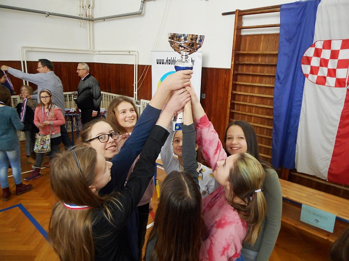
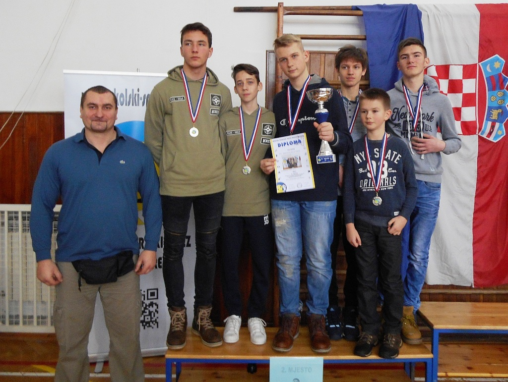
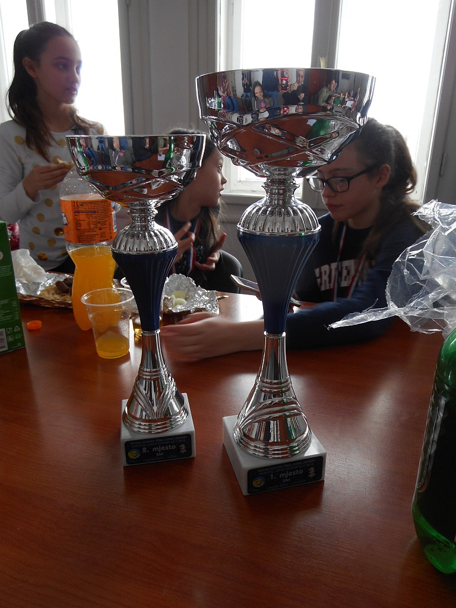
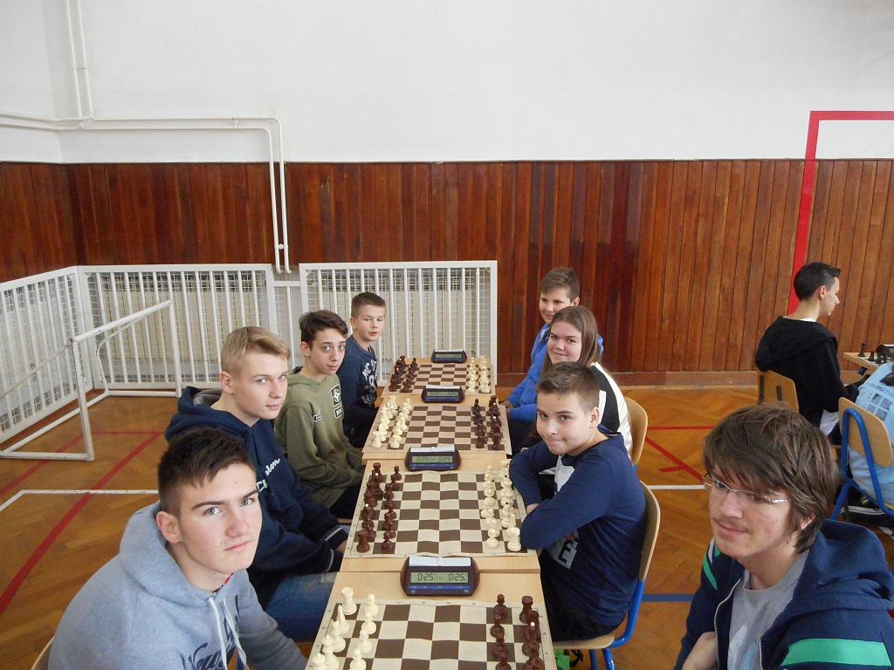
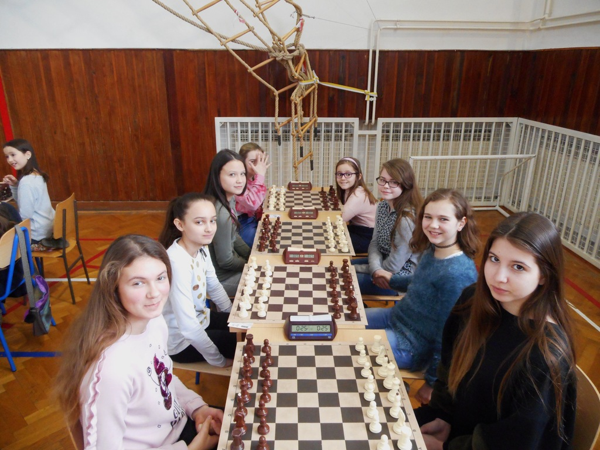

**Djevojke – zlatne, dečki – srebrni!**   
Na jučer završenom finalu Ekipnog prvenstva OŠ Grada Zagreba, djevojke iz OŠ Odra osvojile su prvo mjesto, a dečki su se popeli na postolje samo jednu stepenicu niže. Veliki je to uspjeh ove generacije šahista i šahistica. Djevojke su prije dvije godine uhvatile broncu, a dečki su broncu osvojili prošle godine. Sada je tu zlato i srebro što znači da su svi na dobrom putu i da napreduju. Ostaje mali žal kod ove generacije osmaša jer su završili natjecanje bez ijednog poraza, a prvo mjesto im je izmaklo za negdje, nekako, propuštenih pola boda. A za sve je kriv Kljujev. Jest da je imao 100% učinak u finalu, ali nekoga moramo okriviti. 🙂 Ostali imaju opravdanje. Luka i Bruno su na ovom prvenstvu imali sve pobjede, Ivan je imao teške protivnike i samo jedan jedini poraz, Vraneša je u finalu (napokon) pobijedio i igrača koji slovi za znatno jačeg, a Božo je morao igrati protiv cura koje su protivničke ekipe namjerno stavljali na treću ploču. A svi znamo da je protiv njih najteže igrati.  
Iskreno, svi su dobro igrali, ali su imali i jake protivnike. Došli su spremni, ove godine i naspavani. Ali u sportu uvijek treba i mrvica sreće.  Još jednom čestitke dečkima na ovom velikom uspjehu. A mi se možemo samo nadati da ćemo pod vodstvom mladog Luke već za tri do četiri godine imati ekipu koja će se ponovo boriti za medalju.  
Djevojke su također završile natjecanje bez poraza. Ali je bilo tijesno. Posljednje kolo trebao im je neodlučen rezultat protiv OŠ dr. Ivana Merza i uspjele su uhvatiti željeni rezultat. U drugom kolu tijesno su pobijedile OŠ Dragutina Domjanića, za pola boda, taman koliko im je trebalo. Ne bih rekao da ih je sreća mazila, trenutačno su najjača škola u Zagrebu, ali im konkurencija opasno puše za vratom.  One su još mlade, peti i šesti razred, ali budu li radile na šahu više od konkurencije, možda i ponove ovakav uspjeh.  Sve su pokazale čvrstinu, stabilnost i samouvjerenost. Niti jedna igračica nije kiksala u ključnim trenucima. I to je ono što ih je odvelo do vrha. Osvajanjem prvog mjesta plasirale su se i na Završnicu Državnog prvenstva koja se igra od 22.-24. travnja u Poreču. Na završnici nastupa šest najboljih škola iz Hrvatske. Možemo im samo poželjeti puno sreće!

POREDAK DEČKI:  
1\. OŠ Špansko Oranice  
**2\. OŠ ODRA**  
3\. OŠ Tituša Brezovačkog  
4\. OŠ Dragutina Domjanića

POREDAK DJEVOJKE:  
**1\. OŠ ODRA**  
2\. OŠ Dragutina Domjanića  
3\. OŠ dr. Ivana Merza  
4\. OŠ Ive Andrića

 

[Rezultati djevojke](/files/wp/2018/02/Bilten-ah58-.pdf)  
[Rezultati dečki](/files/wp/2018/02/Bilten-ah58M_zip.pdf)
