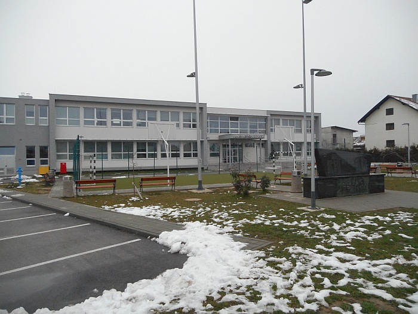

U OŠ Frana Krste Frankopana, u tijeku su kvalifikacije Ekipnog prvenstva OŠ Grada Zagreba. Organizator natjecanja je Školski sportski savez Grada Zagreba. OŠ Odra nastupa u obje konkurencije. Dečki igraju u sastavu Ivan Maravić, Ivan Vraneša, Božo Cvetković, Luka Fiolić, Ivan Kljujev i Bruno Kolovrat. Osnovu ekipe čine Ivan, Vraneša i Božo, dok se ostali dečki izmjenjuju. U ekipi djevojaka su Franka Kolovrat, Lucija Kolovrat, Anđela Mahin, Ana Kolovrat, Monika Kolovrat, Samanta Halužan i Ana Katarina Hačić.  Voditelj ekipa je prof. Krešimir Tomaško. Kvalifikacije se igraju na tempo 15+0, a igra se na četiri ploče. U kvalifikacijama dečki igraju devet kola, a djevojke pet. Prve četiri ekipe ulaze u finale i borbu za odličja. U muškoj konkurenciji nastupaju ekipe iz 31. škole, a u ženskoj iz 15 škola.  
Za sada sve ide po planu. Dečki su odigrali [šest kola](http://chess-results.com/tnr331997.aspx?lan=13&art=63&wi=821), imaju četiri pobjede i dva nerješena rezultata, dok su djevojke odigrale [tri kola](http://chess-results.com/tnr331998.aspx?lan=13&art=63&wi=821) i imaju tri pobjede. Sljedeće subote dečki igraju preostala tri kola i više i ne sumnjamo u njihov ulazak u finale. Djevojke igraju još dva kola i morat će se potruditi te ostvariti još barem jednu pobjedu za ulazak među četiri najbolje ekipe. Danas su se na prvoj ploči izmjenjivale Franka, Lucija i Anđela, i uz malo peripetija, uspjele ostvariti 100% učinak. Posljednja dva kola, ekipu će pojačati  Ana.

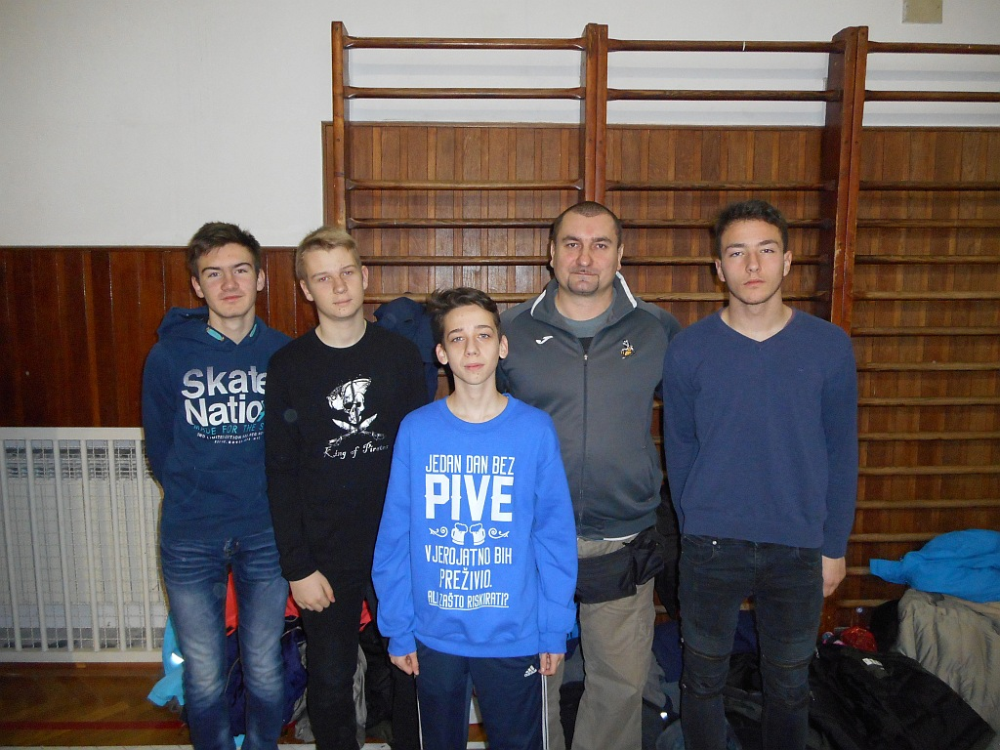 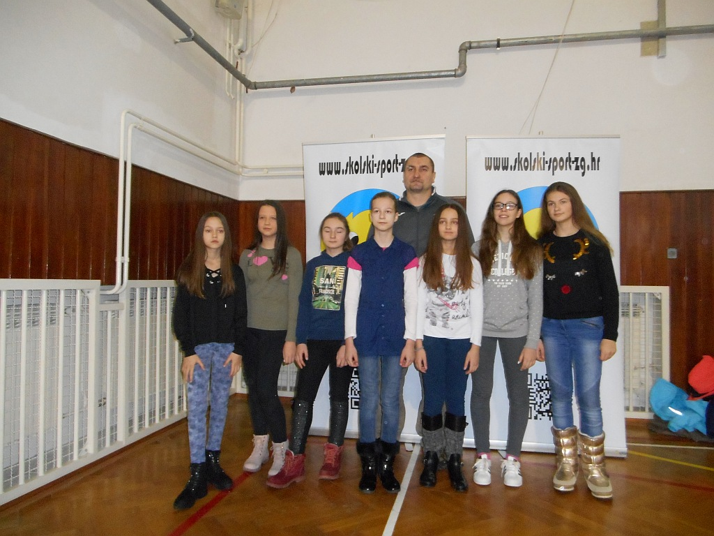 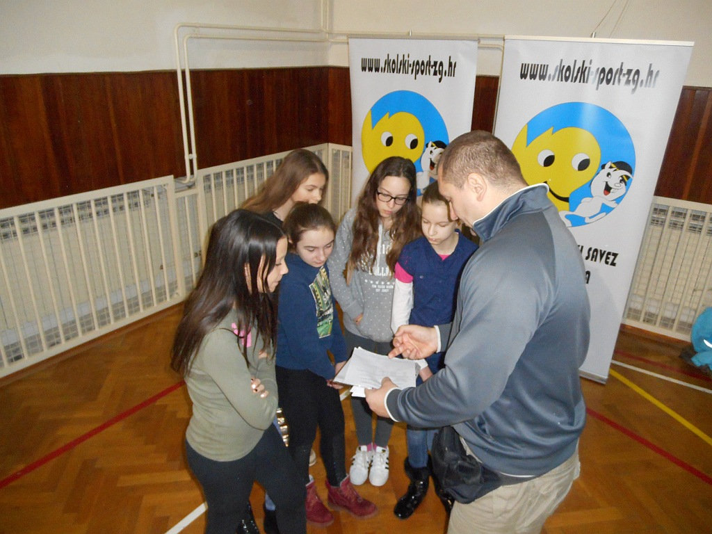 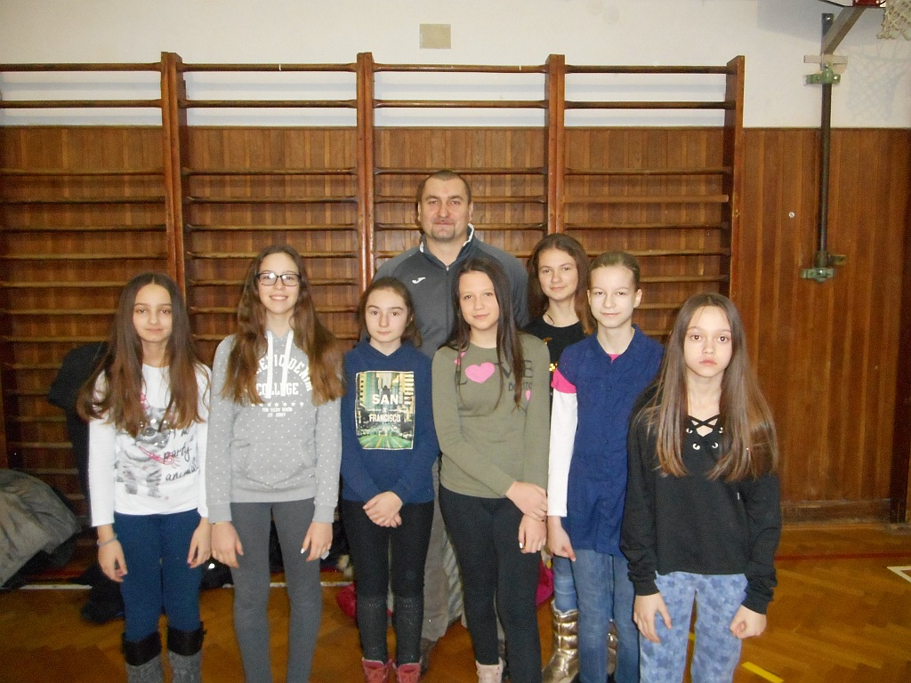  
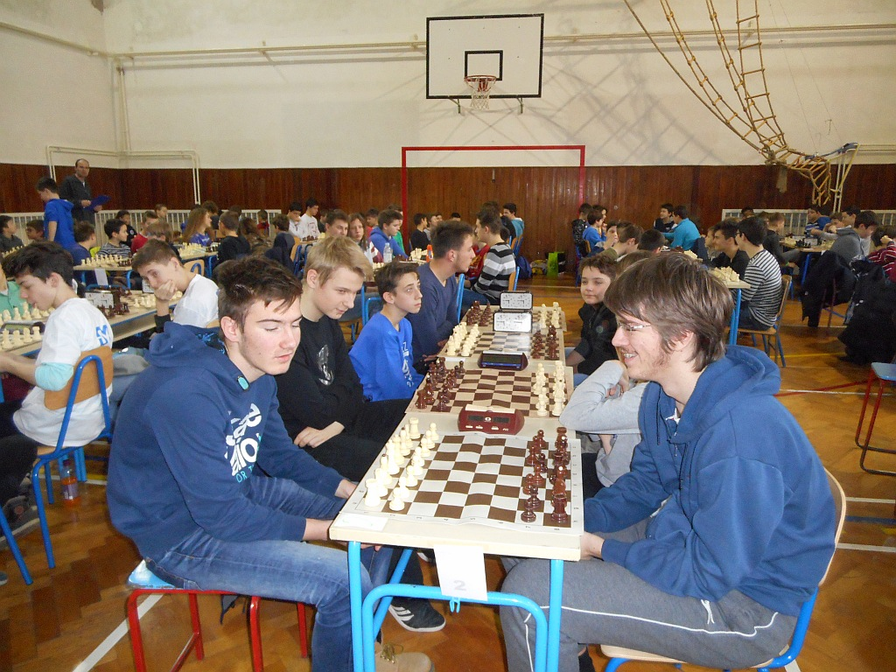  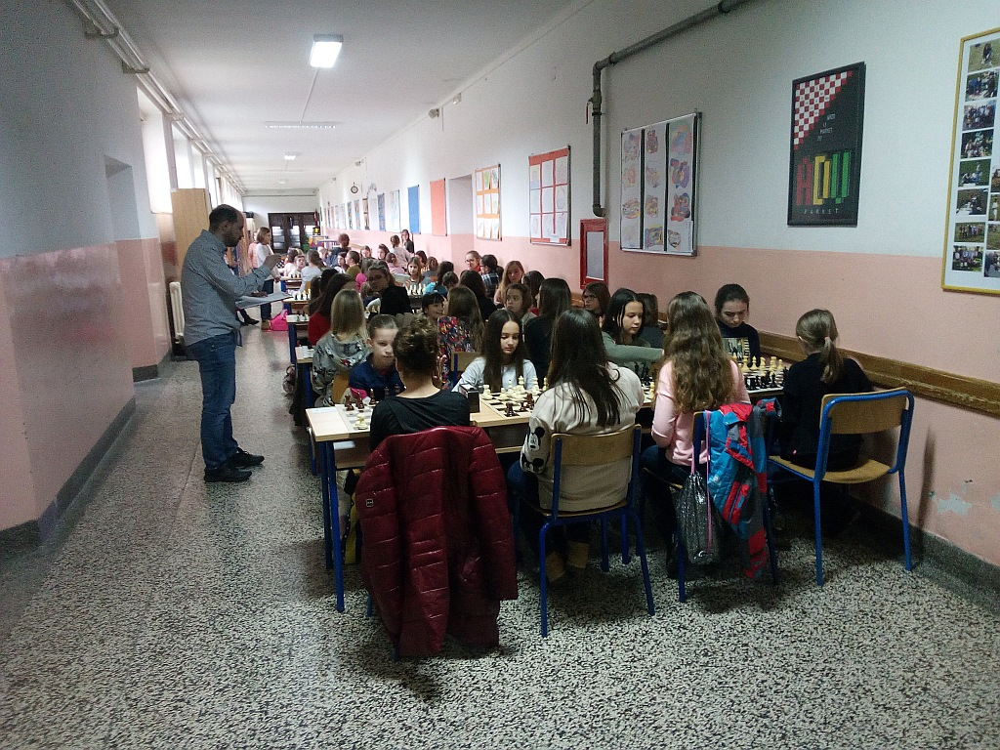

darko

---

**Treći krug, 17. veljače 2018.  
USPJELI!**

Obje ekipe uspješno su se plasirale u finale! I to s prvog mjesta. Dečki su zvaršili kvalifikacije sa sedam pobjeda i dva neodlučena ishoda, dok su cure ubilježile svih pet pobjeda. Danas su se ekipama priključili Ana i Bruno i oboje napravili 100% učinak. Dečki su danas igrali malo opuštenije nego inače, znajući da su već u prošlom krugu odradili mečeve s ozbiljnijim protivnicima. A i djevojke su igrale posljednje kolo opušteno, obzirom da su nakon četvrtog kola bile sigurne finalistice. Sada ostaje težak izbor kapetanima ekipa, Vraneši i Moniki, da izaberu igrače i igračice za finale. Neće im biti lako.  Finale se igra već za tjedan dana.  
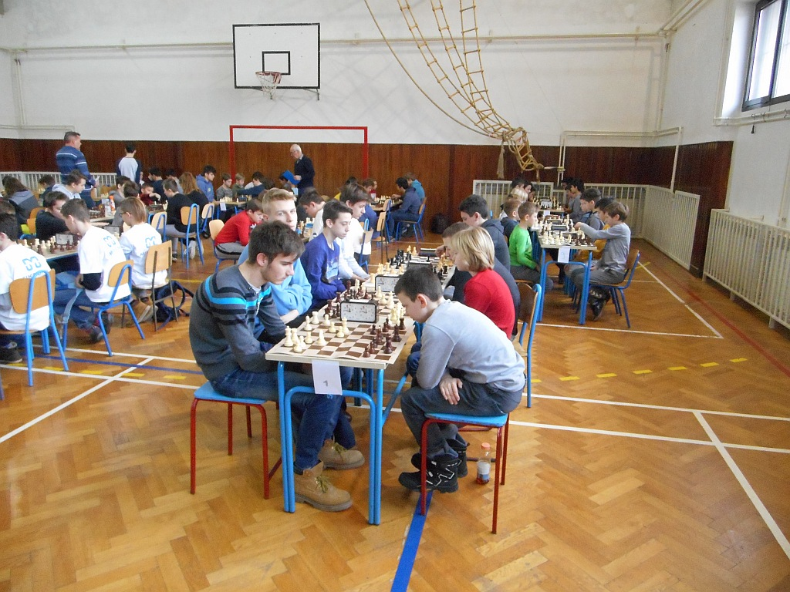 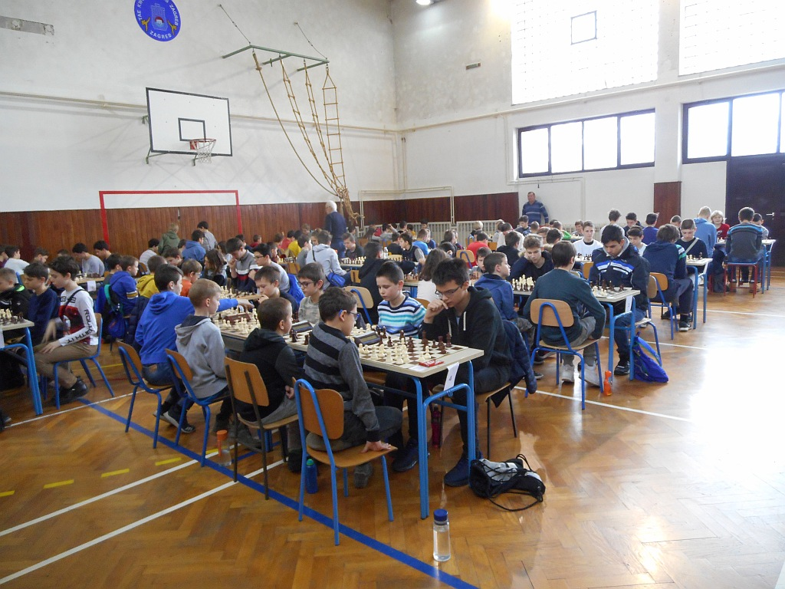  
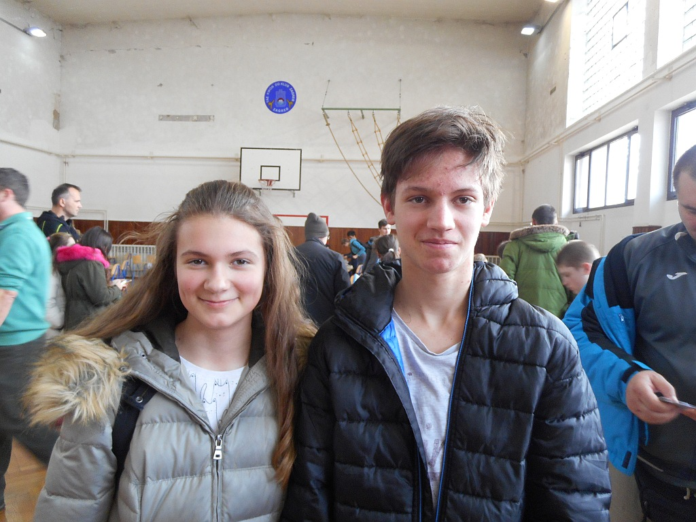 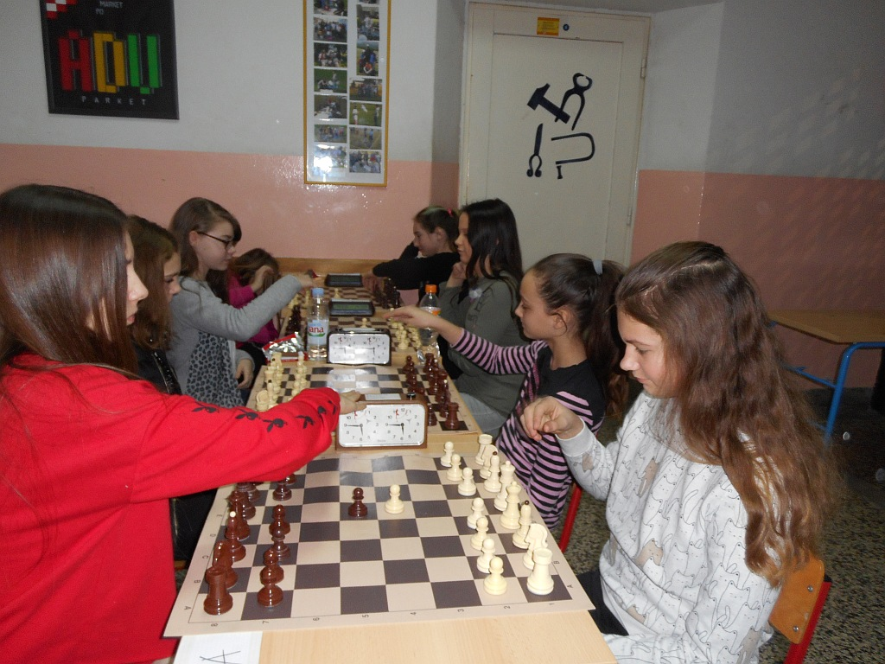  
darko  
[Rezultati kvalifikacija 2018. – dečki  
](/files/wp/2018/02/Rez-ah58M3.pdf)[Rezultati kvalifikacija 2018. – djevojke](/files/wp/2018/02/Rez-ah58-2.pdf)
