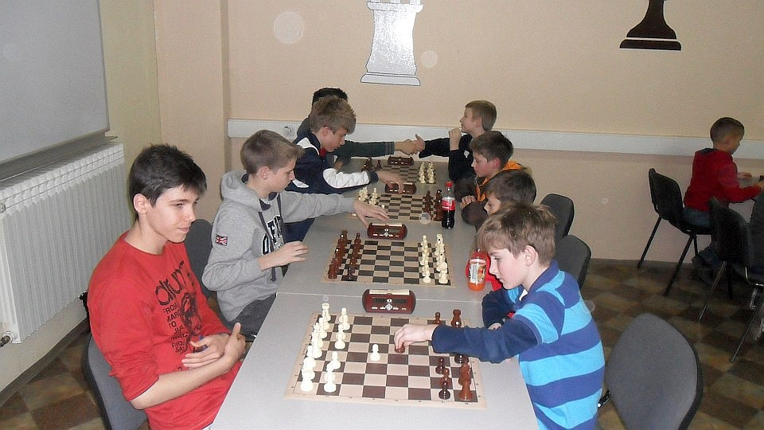

Večeras je završen prvi krug Ekipnog prvenstva Zagreba za osnovne škole.  
Ekipa OŠ Odra osvojila je treće mjesto!  
Time se plasirala u sljedeći krug među 16 ekipa. Bila je to nepoštedna borba između 22 ekipe, za prva četiri mjesta koja su vodila u daljnji tijek natjecanja. Prvi dan prošao je s polovičnim uspjehom, ali su dečki drugi dan natjecanja zaredali tri uzastopne pobjede, uključujući pobjedu nad prvoplasiranom ekipom OŠ Rudeš (na slici) te tako, usprkos porazu u posljednjem kolu, osvojili treće mjesto. Pojedinačno, rezultati su očekivani, Na prvi pogled, malo lošiji rezultat imao je Božo, ali je imao i dosta teže protivnike. Lijepo je igrao, imao ideje i pametno trošio vrijeme. Ivan na prvoj ploči bio je prebrz i griješio. Tako je nepotrebno odigrao jedan remi iako je imao dobivenu poziciju te propustio biti najbolji igrač turnira. Samo je posljednje kolo igrao sporije i bez pogreške te pobijedio igrača koji je bio ispred njega na nedavno završenome pojedinačnom prvenstvu. Bruno je igrao dobro, ali previše taktičarski usprkos upozorenju trenera. Rezultat je zadovoljavajući, a posljednje kolo imao je jedini neopravdan poraz. Vraneša je ostvario izvrstan rezultat na četvrtoj ploči i, vjerojatno zbog treme koju su svi osjećali kada im se otvorila mogućnost za prolaz, odigrao sedmo kolo malo lošije.  
Današnji dan ekipa će pamtiti po osvojenome trećem mjestu i po mogućnosti diskvalifikacije jer su zaboravili knjižice, koje su se ipak pojavile u posljednji trenutak!  
Ekipi želimo još više uspjeha i dobar nastup u sljedećem krugu (27. veljače i 5. ožujka).

[Rezultati](http://chess-results.com/tnr124505.aspx?lan=13&art=0&turdet=YES&flag=30&wi=984 "Ekipno prv OŠ ZG 2014, I krug")
