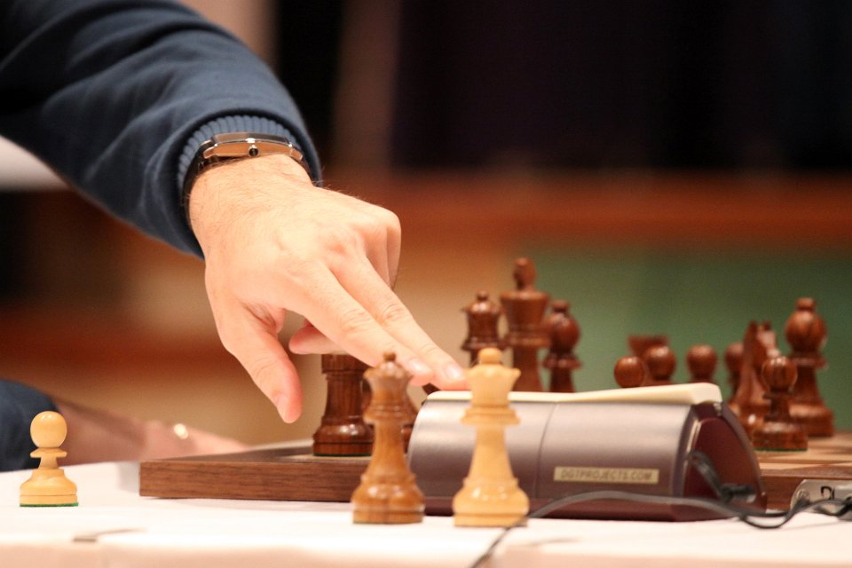

Danas u 15 h počinje prva od četiri partije finala. **Kramnik** je opravdao svoj status favorita na ovom turniru i uvjerljivo dospio do finala preko (…), Korobova i Vachier-Lagrave. O Kramnikovoj kvaliteti se sve već odavno zna, a da je izuzetno motiviran pokazala je i druga partija meča protiv, na ovom turniru fantastičnog (ako se izuzme neobjašnjiva pogreška u trećoj partiji meča protiv Kramnika) **Vachier-Lagrave**, u kojoj je Kramnik pedeset poteza uzaludno pokušavao ostvariti prednost u zavšnici top + skakač protiv topa.

**Andreikin** je do finala došao izbacivanjem (…), Karjakina, Svidlera i Tomashevskog, redom sve vrlo respektabilnih igrača. Najjača strana njegove igre bila je čvrsta obrana, a pokazalo se da mladom ruskom prvaku leži igranje po ubrzanom tempu,  jer je većinu pobjeda u mečevima ostvario na taj način.

Tako imamo rusko finale, ali i presedan – kao što je **Garry Kasparov** spomenuo na svom [blogu](https://www.facebook.com/GKKasparov "Facebook Blog - Garry Kaparov") – po prvi put nakon 1921. godine bez ruskog komentatora. Ali zato su tu simpatični, duhoviti i informativni – engleski velemajstor [**Nigel Short**](http://en.wikipedia.org/wiki/Nigel_Short "Wiki: Nigel Short") i **Dirk Jan ten** **Geuzendam**, nizozemski sportski novinar.

Danas, 15h! **[Live!](http://www.chessworldcup2013.com/live "Live: FIDE World Chess Cup 2013")**
