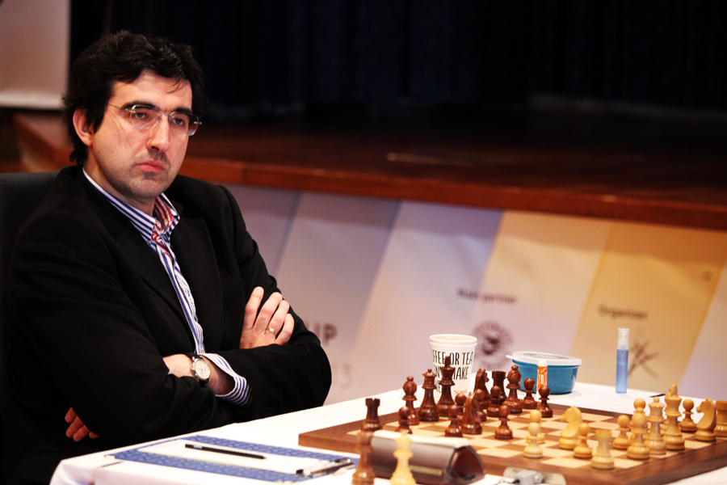

**Vladimir Kramnik** pobjednik je *FIDE Chess World Cup-a.* U finalu je (lako) pobjedio Dmitrija Andreikina ukupnim rezultatom 2.5:1.5. Jedina odlučena partija bila je prva, a možda bi bila i četvrta da Kramniku nije bio dovoljan remi. Dojam je da je bivši svjetski prvak uložio taman koliko je bilo potrebno napora za pobjedu koja niti u jednom trenutku nije došla u pitanje. No niti Andreikin ne bi trebao biti razočaran, ovo je odličan rezultat za dvadesetjednogodišnjeg prvaka Rusije i prema igri koju je pokazao – čini se da su pred njim velike stvari :).

https://www.youtube.com/watch?v=TvPfKEhKbwc
