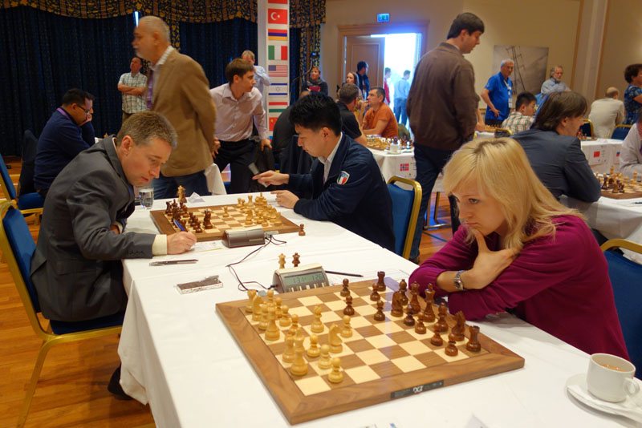

Kola 1.1 i 1.2 su gotova. Većih iznenađenja nije bilo previše, barem zasad. Od favorita po rejtingu i imenu ispali su velemajstori **Judit Polgar, Sergey Fedorchuk** i **Ian Nepomniachtchi.**

[**Judit Polgar**](http://en.wikipedia.org/wiki/Judit_Polg%C3%A1r "WIKI: Judit Polgar"), najjača igračica u povijesti šaha, propustila je brojne šanse za dobitak i izgubila je protiv kubanskog velemajstora **Reynaldo Ortiza**. Dugo neigranje turnirskog šaha ostavilo je trag na njenoj formi, za koju je i prije toga bilo naznaka da je u silaznoj putanji jer je početkom 2012 g. po prvi put u 20 godina izgubila od ženskog protivnika, tadašnje svjetske prvakinje **Hou Yifan**.

Ruski velemajstor **Daniil Dubov** uspio je nadigrati iskusnog ukrajinskog velemajstora **Sergeya Fedorchuka**.

Jedno od većih iznenađenja za one koji uspoređuju rejtinge protivnika dogodilo se u meču **Nepomniachtchi** – **Wei**. Najmlađi sudionik događaja, kineski velemajstor **Yi Wei** (nominiran od predsjednika FIDE Kirsana Ilyumzhinova za turnir), pobijedio je ruskog velemajstora sa 1,5-0,5

Od ostalih rezultata, zanimljiv je bio susret **Svidlera** i **Ushenine**. Ushenina je svjetska prvakinja, ušla je sa rejtingom 2500 na turnir i ustvari tek se nedavno vratila na listu +2500 – prilično kratku listu od 15 do 20 top igračica na kojoj je čak bila zadnja, no sad kad je napucala Svidlera u drugoj partiji rejting će joj malo skočiti. Možda je to bilo zato što ju je Svidler pohvalio da dobro igra nakon što ju je prilično lako dobio u prvoj partiji meča 😉

U 28 mečeva bio je neodlučen ishod nakon dvije partije i 56 igrača će se nastaviti boriti danas (13. kolovoza) u 15h po lokalnom vremenu.

**[Stay tuned](http://www.chessworldcup2013.com/live "Live: FIDE World Chess Cup 2013").**
