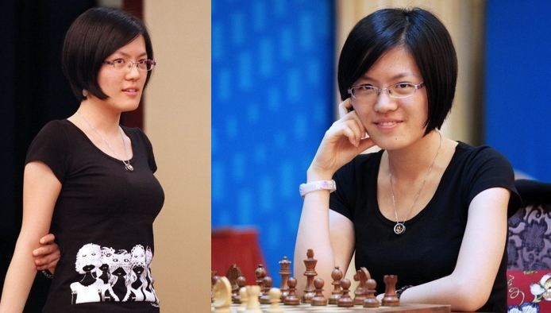

  
Prvi krug je uglavnom završio pobjedama favorita uz dvadeset i četiri tie-breaka, a možda najveće iznenađenje je ispadanje Gelfanda od IM Henriquez Villagra (2511).

Tie-break se igra na 25 min plus 10 sekundi po potezu ([pravila](http://www.bakuworldcup2015.com/content/20) točka 3.8 Tie-breaks).

Nažalost, hrvatski predstavnici su ispali nakon prvog kruga. Ivan Šarić je izgubio obje partije regularnog dijela, dok je Ante Brkić pružio častan otpor i pokleknuo tek u pripetavanju.  

Danas su odigrane i prve partije drugog kruga. Rezultati i partije mogu se pogledati [ovdje](http://www.bakuworldcup2015.com/content/5).

Samo još Kramnik i Caruana imaju stopostotni učinak (3/3), a u drugi krug se plasirala i svjetska prvakinja Hou Yifan.
