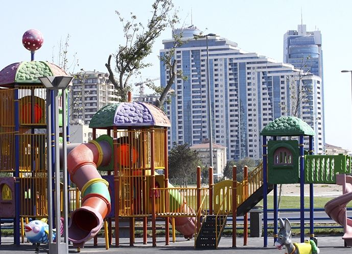

  
Svega nas nekoliko sati dijeli od početka Svjetskog šahovskog kupa 2015. koji se ove godine održava u [Bakuu](https://hr.wikipedia.org/wiki/Baku), glavnom gradu Azerbajdžana.

FIDE Svjetski šahovski kup održava se od 11. rujna do 5. listopada 2015.

128 igrača natječu se po nokaut sistemu, a finalistima je osigurano mjestu mjesto na turniru kandidata. Hrvatsku predstavljaju Ivan Šarić i Ante Brkić.  

[Startna lista (128 igrača)](http://www.bakuworldcup2015.com/content/25)

Caruana i Nakamura već su se ranije kvalificirali za turnir kandidata.
