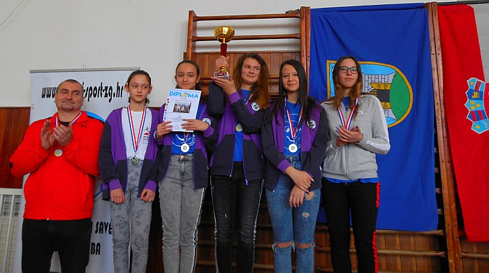
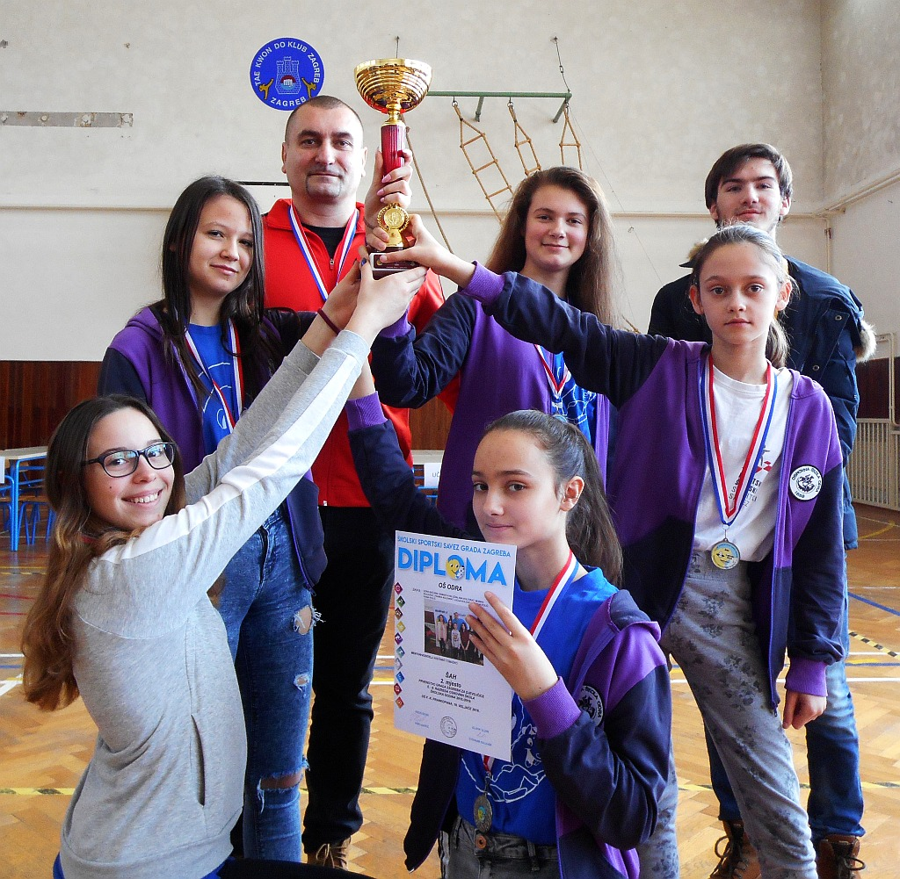
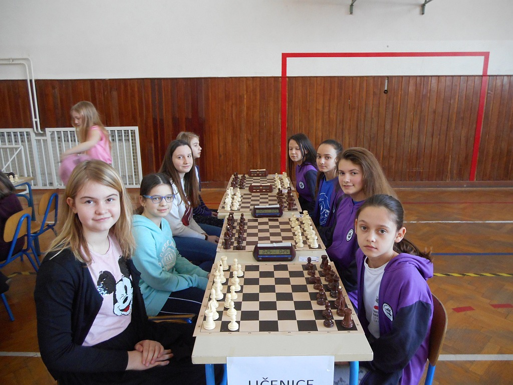
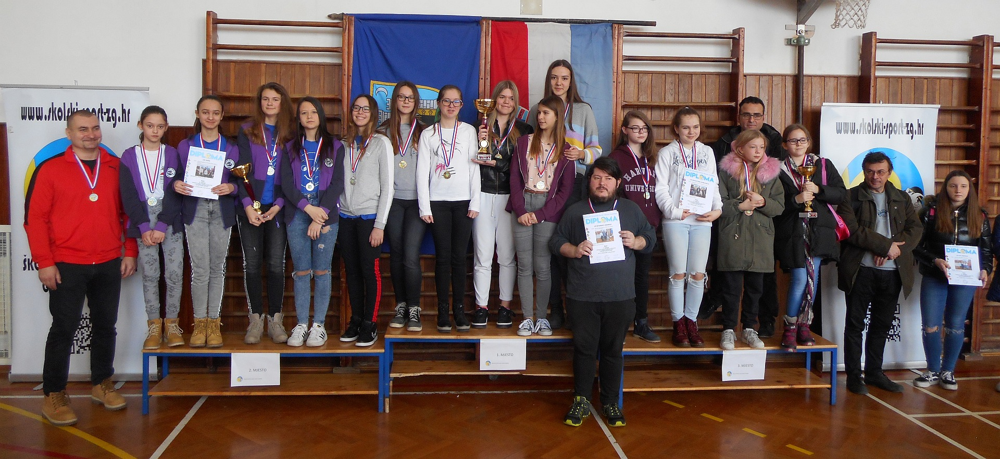
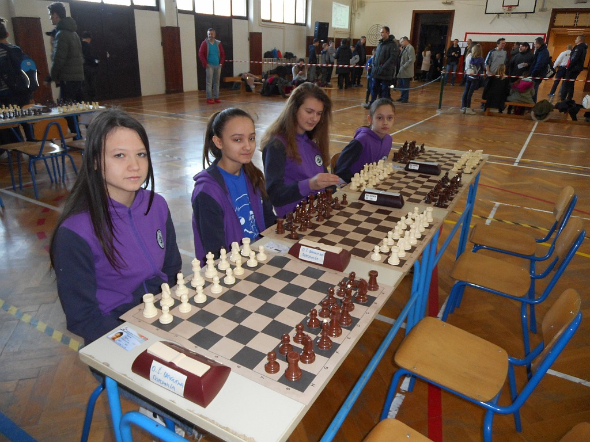
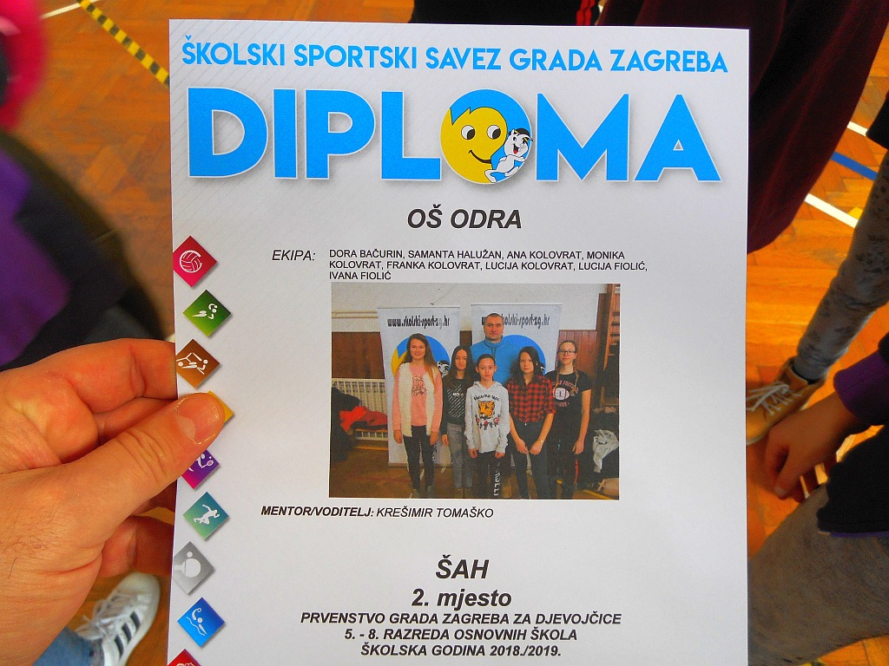

  
Djevojke su danas ostvarile još jedan veliki uspjeh i osvajanjem **drugog mjesta** na [finalu](http://chess-results.com/tnr413663.aspx?lan=13&art=3&turdet=YES&flag=30) ekipnog prvenstva osnovnih škola Grada Zagreba  plasirale se na završnicu državnog prvenstva koje će se igrati u Vinkovcima od 12. do 14. ožujka 2019. Samo prve dvije ekipe prolaze dalje, tj. stječu pravo nastupa na završnici. Ovaj uspjeh rezultat je njihovog velikog truda, vježbe i zalaganja kojeg ni svi njihovi roditelji nisu svjesni. Ovogodišnjim srebrom upotpunile su kolekciju, bronca iz 2016., zlato iz 2018. i  srebro 2019! Djevojke su igrale u sastavu: Lucija, Ana (K), Monika, Samanta i Franka. U finale su ušle suvereno s pet pobjeda iz pet kvalifikacijskih mečeva. Danas su ostvarile dvije pobjede i jedan neriješeni rezultat te su na kraju dvije ekipe bile izjednačene, i po meč bodovima i po pojedinačnim bodovima i po bodovima u istoj skupini, ali je ekipa OŠ Špansko bila bolja po četvrtom kriteriju, pobjede na višoj ploči te su naše djevojke na kraju uzele srebro.  Nakon poduže i pomne analize stručnog stožera, ustanovili smo da je za ovaj neuspjeh, a za njih je sve osim zlata neuspjeh ;), ipak najviše kriva Samanta koja je napravila 8/8, jer da je napravila samo pola boda više, djevojke bi ponovile prošlogodišnji uspjeh i bile zlatne! Svi se nadamo da će se Samanta popraviti. Djevojke nemaju još puno vremena do završnice i vjerujem da će nastaviti sa marljivim radom i treninzima te se na državnom prvenstvu možda popeti i stepenicu više. Ili barem stepenicu više nego prošle godine kada su na državnom prvenstvu bile četvrte. Iskreno se nadam da će i seoski političari iznaći rješenje velikog problema i pronaći osobu koja bi mogla otključati prostor u Društvenom domu u kojem su djevojke do prije dva tjedna trenirale, ali im je otad zabranjen pristup jer su političari zaključili da jednostavno nema osobe koja bi im mogla otključati vrata. Držimo im fige.  
A djevojkama ČESTITKE i želja za što bolju pripremu i što bolji rezultat na državnom prvenstvu! SRETNO u Vinkovcima!

Finale ekipnog prvenstva u šahu za učenice  
osnovnih škola grada Zagreba za 2019. godinu

<table><tbody><tr><td>Mj.</td><td>Ekipa</td><td>1</td><td>2</td><td>3</td><td>4</td><td>&nbsp;TB1</td><td>&nbsp;TB2</td><td>&nbsp;TB3</td><td>&nbsp;TB4</td></tr><tr><td>1</td><td>OŠ ŠPANSKO – ORANICE</td><td>&nbsp;*</td><td>2</td><td>3</td><td>3½</td><td><strong>5</strong></td><td>8,5</td><td>1</td><td>1</td></tr><tr><td>2</td><td>OŠ ODRA</td><td>2</td><td>&nbsp;*</td><td>2½</td><td>4</td><td><strong>5</strong></td><td>8,5</td><td>1</td><td>2</td></tr><tr><td>3</td><td>OŠ DRAGUTINA DOMJANIĆA</td><td>1</td><td>1½</td><td>&nbsp;*</td><td>2</td><td><strong>1</strong></td><td>4,5</td><td>0</td><td>0</td></tr><tr><td>4</td><td>OŠ IVE ANDRIĆA</td><td>½</td><td>0</td><td>2</td><td>&nbsp;*</td><td><strong>1</strong></td><td>2,5</td><td>0</td><td>0</td></tr></tbody></table>

  

darko
