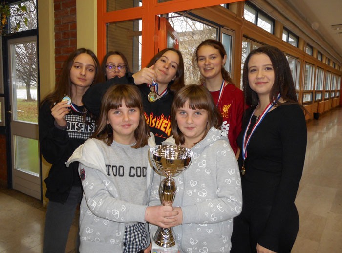
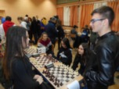
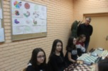
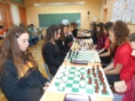
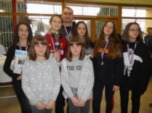

  
PRVAKINJE!  
Kako su dečki u kvalifikacijama završili šesti, nisu se plasirali u finale. Djevojke su i u kvalifikacijama bile prve, a [finale](https://chess-results.com/tnr505495.aspx?lan=13) su rutinski odradile. Tri pobjede 4:0. Ana je bila malo neodgovorna pa je prije finala išla na nogomet i dobila loptom u glavu. Lucija i Franka se nisu mučile na četvrtoj ploči, ali su i Ana i Monika i Samanta imale po jedan iscrpljujući meč. Sa pozitivnim ishodom. Djevojkama su podršku na turniru davale sestre Fiolić, prof. Tomaško, Kuhar i Ivan Maravić. Bilo je ovo jedno od najmanje stresnih finala do sada, obzirom da su djevojke prerasle gradske okvire.  
Ovo im je drugo gradsko zlato, i nadamo se da će visoko dogurati i na državnom prvenstvu koje se igra od 4. do 6. veljače u Trogiru. Imaju još puno za učiti i nadam se da će preostalo vrijeme iskoristiti za vježbu i učenje. Čestitamo!

**Poredak sa partijama**

<table><tbody><tr><td><strong>Mj.</strong></td><td><strong>Momčad</strong></td><td><strong>1</strong></td><td><strong>2</strong></td><td><strong>3</strong></td><td><strong>4</strong></td><td><strong>&nbsp;TB1&nbsp;</strong></td><td><strong>&nbsp;TB2&nbsp;</strong></td><td><strong>&nbsp;TB3&nbsp;</strong></td></tr><tr><td>1.</td><td>OŠ ODRA</td><td>&nbsp;*</td><td>4</td><td>4</td><td>4</td><td>6</td><td>12,0</td><td>12,0</td></tr><tr><td>2.</td><td>OŠ IVE ANDRIĆA</td><td>0</td><td>&nbsp;*</td><td>2</td><td>3½</td><td>3</td><td>5,5</td><td>4,5</td></tr><tr><td>3.</td><td>OŠ DR. IVANA MERZA</td><td>0</td><td>2</td><td>&nbsp;*</td><td>2</td><td>2</td><td>4,0</td><td>4,0</td></tr><tr><td>4.</td><td>I. OŠ DUGAVE</td><td>0</td><td>½</td><td>2</td><td>&nbsp;*</td><td>1</td><td>2,5</td><td>2,0</td></tr></tbody></table>

————————————————————————————————————————————————————————-  
**1\. OŠ ODRA (RtgAvg:1, Kapetan: Ana Kolovrat / TB1: 6 / TB2: 12)**

<table><tbody><tr><td><strong>Bo.</strong></td><td><strong>Ime</strong></td><td><strong>&nbsp;</strong></td><td><strong>Sk.</strong></td><td><strong>1</strong></td><td><strong>2</strong></td><td><strong>3</strong></td><td><strong>Bod.</strong></td><td><strong>Partije</strong></td></tr><tr><td>1.</td><td>Kolovrat Ana</td><td></td><td>8</td><td>1</td><td>+</td><td>1</td><td>3,0</td><td>3</td></tr><tr><td>2.</td><td>Kolovrat Monika</td><td></td><td>7</td><td>1</td><td>1</td><td>1</td><td>3,0</td><td>3</td></tr><tr><td>3.</td><td>Halužan Samanta</td><td></td><td>8</td><td>1</td><td>1</td><td>1</td><td>3,0</td><td>3</td></tr><tr><td>4.</td><td>Kolovrat Lucija</td><td></td><td>7</td><td>1</td><td>1</td><td></td><td>2,0</td><td>2</td></tr><tr><td>5.</td><td>Kolovrat Franka</td><td></td><td>7</td><td></td><td></td><td>1</td><td>1,0</td><td>1</td></tr></tbody></table>

Na završnicu Državnog prvenstva plasirale su se, u konkurenciji djevojčica OŠ Odra i OŠ Ive Andrića, dok su u muškoj konkurenciji završnicu izborile OŠ Josipa Račića i OŠ Dragutina Domjanića.

   
