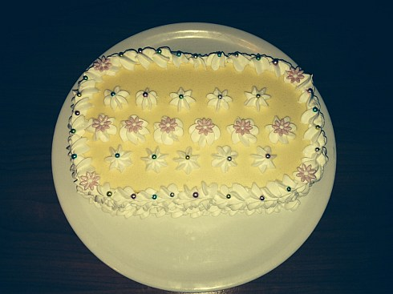

**N**ašoj **Franki**, jednoj od najmlađih članica kluba, želimo **sretan rođendan! ** Prošle godine pokazala je veliki šahovski napredak, a uvjeren sam da će ove godine biti još bolja!  
Iskoristit ću ovaj post da podsjetim i na sljedeće.  
**V**eć **sljedeće subote** počinje **ekipno prvenstvo osnovnih škola Zagreba** za dječake. Prvenstvo će se igrati 17., 24. i 31. siječnja u OŠ Frana Krste Frankopana, **Ivanićgradska 24, Zagreb, u 9 sati.** Prvenstvo za djevojčice igrat će se 7. i 15. veljače. Ako se neka od ekipa plasira u sljedeći krug (prošle godine dečki su prošli u završnicu!), igrat će i 21. veljače.  
**D**o kraja mjeseca potrebno je obaviti registraciju Kluba i članova pri HŠS-u za 2015. Molit ću sve kadete koji imaju želju biti i registrirani igrači, a još nisu, tj. prvi put se registriraju pri HŠS-u (Bačurin, Pisačić, Markulin…) da do sljedećeg petka dostave kopije domovnica u papirnatome ili digitalnom obliku.  
**Š**ahovska škola nastavlja se u petak 16. siječnja prema uobičajenom rasporedu, mlađa skupina u 18.30, a starija u 19.30.
