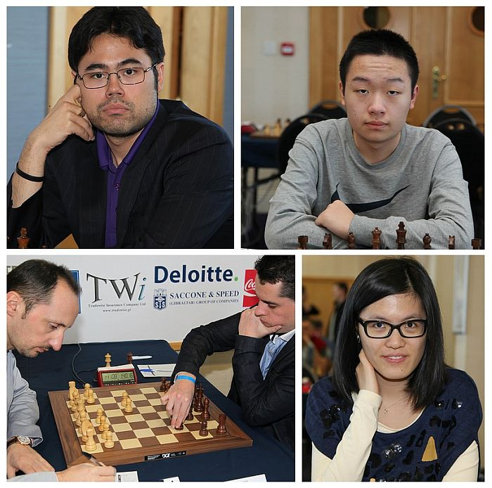

Ovo sigurno niste znali o [Gibraltaru](http://hr.wikipedia.org/wiki/Gibraltar "Wiki: Gibraltar"):

U ožujku 1969\. (jako zanimljiva godina) **John Lennon** i **Yoko Ono** vjenčali su se u Gibraltaru u desetminutnoj ceremoniji u britanskom konzulatu. To je bilo jedino mjesto u Ujedinjenom Kraljevstvu gdje su se mogli vjenčati u tako kratkom vremenu. Unutar sat vremena krenuli su za Amsterdam gdje su u Hiltonu proveli medeni mjesec i iz kreveta pozivali na mir u svijetu, a sve je dobro popratio svjetski tisak. Gibraltar to očito ne smatra nevažnim jer su obilježili tridesetgodišnjicu tog događaja posebnim izdanjem maraka.

A evo malo i o šahu: u tijeku je [*Gibraltar Masters Open 2015*](http://www.gibraltarchesscongress.com/ "Gibraltar Masters Open 2015 - službeni web"), a tko bi htio zaviriti u partije može to na [ovom linku](http://www.gibraltarchesscongress.com/live2015/cloud.htm "Gibraltar Masters Open 2015"). Turnir je to prilično bogate tradicije, a i nagradni fond je takav [(175.000 funti)](http://www.gibraltarchesscongress.com/prizes.htm "Gibraltar Masters Open 2015 - nagradni fond"), pa svake godine privuče i neke top igrače. Ove godine su tu **Topalov**, **Nakamura**, **Svidler**, **Vitiugov**… [ovdje](http://www.gibraltarchesscongress.com/entrants/m15_1.htm "Gibraltar Masters Open 2015 - lista natjecatelja") je cijela lista. Na glavnom turniru sudjeluje preko 250 igrača, a tu je još i Challenger A i B i još dva amaterska turnira – stvarno masovno okupljanje šahista.

Ali ustvari ovo sam krenuo pisati iz drugog razloga.

A razlog je petnaestogodišnji **[Wei Yi](http://en.wikipedia.org/wiki/Wei_Yi "Wiki: Wei Yi")** koji se na ovom turniru probio na 2700+ listu, dakle među 50ak najboljih svjetskih igrača (ustvari nakon četvrtog kola je 41.). Prvi puta sam čuo za tog malog  😮 kad ga je **Carslen** spomenuo u nekom svom intervjuu, nema tome tako davno. Otada nije prošlo puno, a on i dalje [krupnim koracima](http://ratings.fide.com/id.phtml?event=8603405 "FIDE Chess ratings - krupni koraci Wei Yia") grabi prema vrhu. Prije nekoliko dana osvojio je Tata Steel Challenger (turnir koji je prošle godine osvojio naš Ivan Šarić) te se tako kvalificirao za glavni turnir sljedeće godine. A i na ovom Gibraltaru ide mu dobro – trenutno dijeli prvu poziciju s Nakamurom sa 4/4 boda, slijede… ostali. 🙂 Pa šta, reći će netko, to je samo još jedan [*chess prodigy*](http://en.wikipedia.org/wiki/Chess_prodigy "Wiki: Chess Prodigy"). Meni je zanimljiv zato što očekujem da će se u skorijoj budućnosti boriti za svjetski naslov 😮

Spomenimo još da sudjeluje i [Hou Yifan](http://en.wikipedia.org/wiki/Hou_Yifan "Wiki: Hou Yifan"), svjetska prvakinja koja je skinula neponovljivu [Judith Polgar](http://en.wikipedia.org/wiki/Judit_Polg%C3%A1r "Wiki: Judith Polgar") s prvog mjesta ženske top liste.

*A propos* rejtinga općenito, nisam više siguran da gospodin [Elo](http://en.wikipedia.org/wiki/Elo_rating_system "Wiki: Arpad Elo - tvorac šahovskog rejtinga") nije previdio nešto u toj svojoj formuli obračuna, ali to je samo moje mišljenje. 😎
