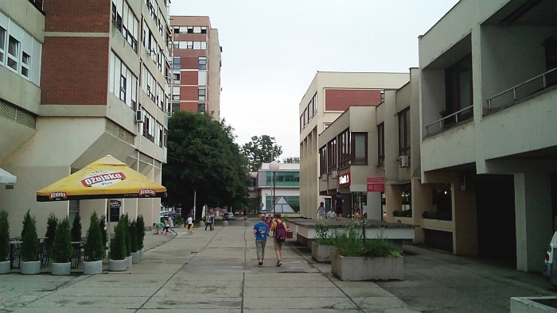
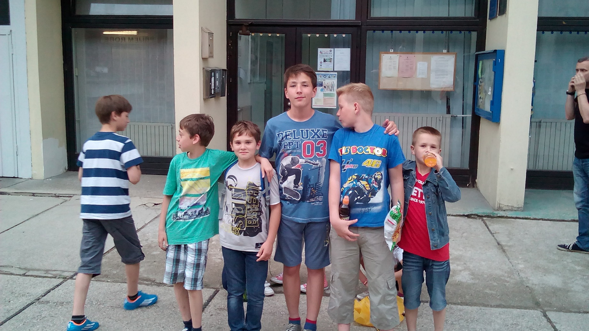
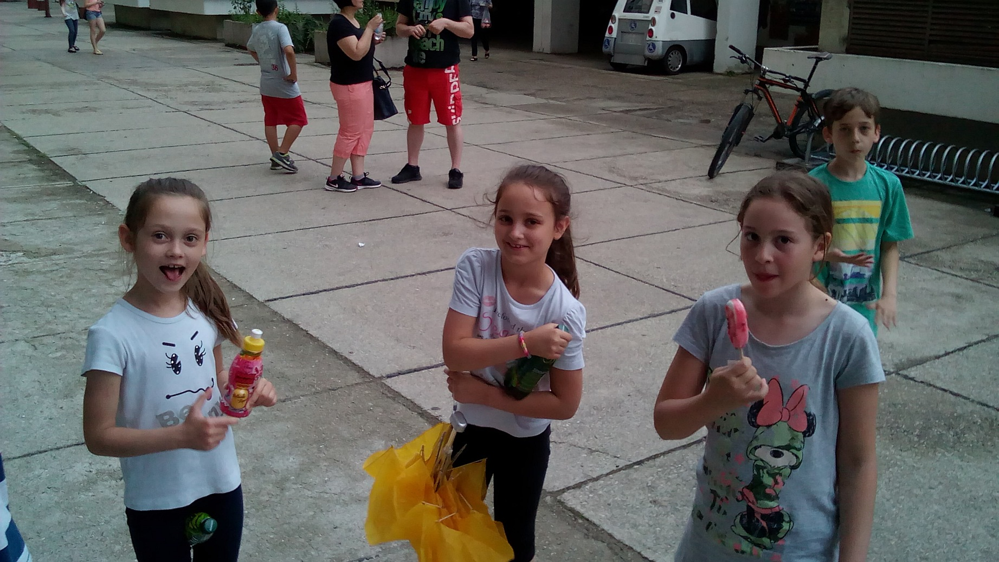
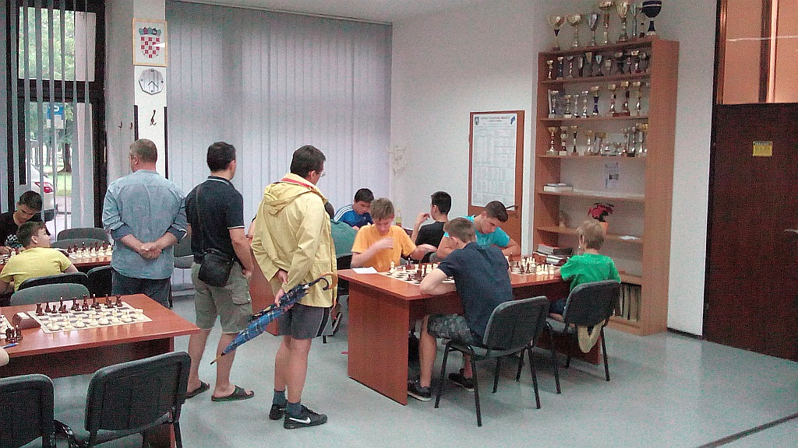
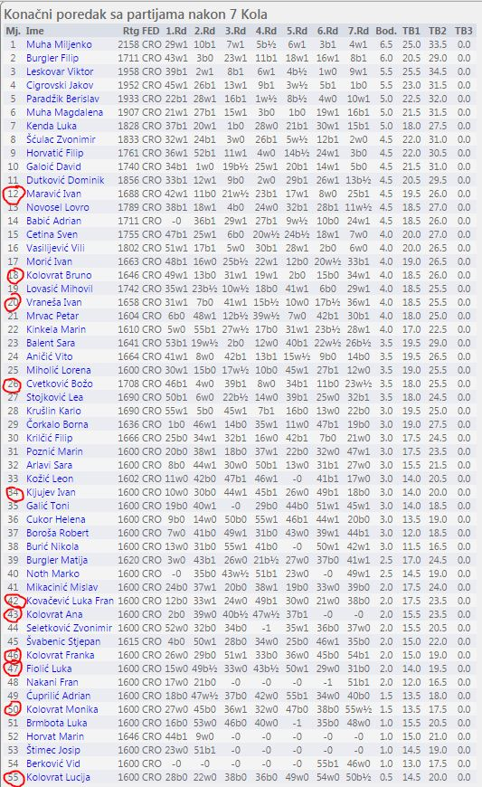
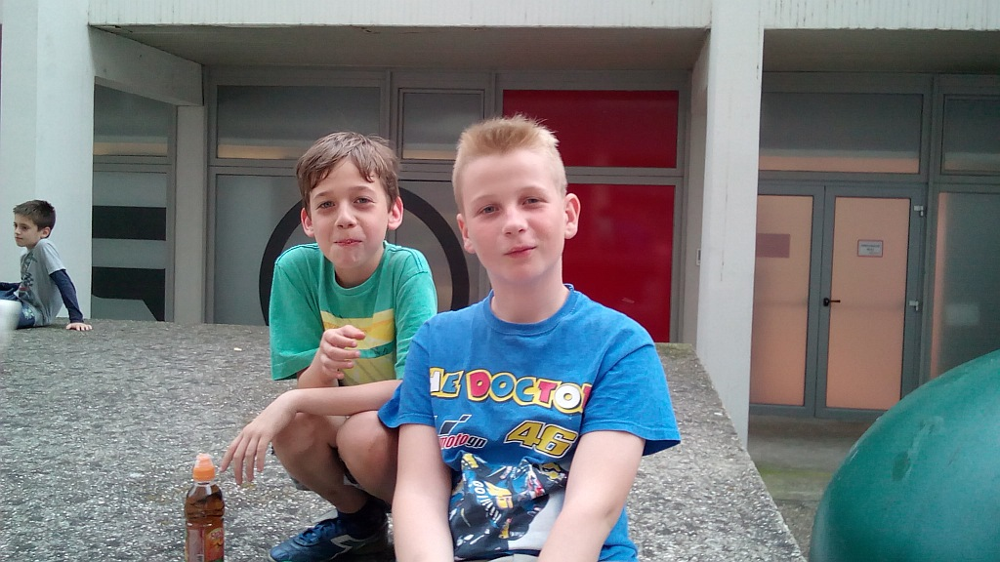
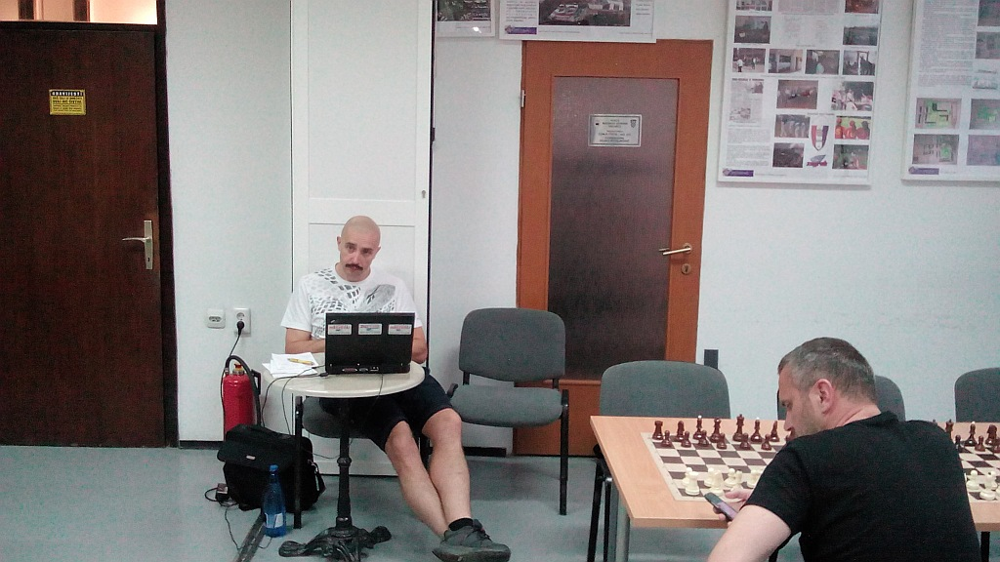

Središće, Novi Zagreb, 5., 7. i 9. lipnja 2015.

Jučer je u prostorijama MS Središće – Ivana Šibla 8, Novi Zagreb, u organizaciji [Šahovskoga kluba Novi Zagreb](http://www.sknovizagreb.hr/), završen 3. pozivni kadetski turnir GRAND PRIX 2015. Bila je to posljednja prilika/priprema za nadolazeće prvenstvo Hrvatske, a očekivano, najbolji rezultat od kadeta iz ŠK Odra ostvario je Ivan Maravić osvojivši 12. mjesto. Turnir je uvjerljivo osvojio Miljenko Muha iz ŠK Zagreb. Glavni sudac turnira Vjekoslav Novak smršavio je i pustio brkove! Zahvaljujemo Vjekoslavu za rezultate te organizatoru na pozivu. Vidimo se dogodine!  
[Rezultati  
](http://chess-results.com/tnr176965.aspx?lan=13&art=4&wi=821 "Rezultati.")           
