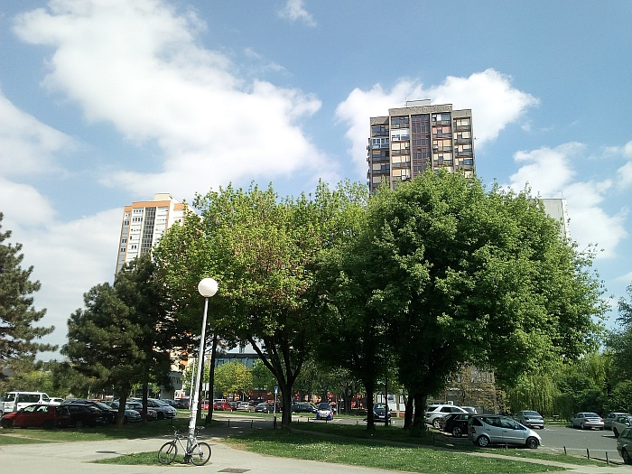
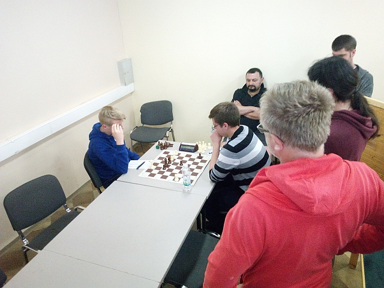

**Seniori, 4. kolo  
  
**Teško je povjerovati, ali su seniori ŠK Odra ubilježili još jednu pobjedu. Ne zaslugom seniora, ali o tome malo poslije. Kolo je počelo zavrzlamom jer su domaćini promijenili mjesto igre u posljednji trenutak. Očito i oni imaju svojih organizacijskih problema. Premjestili su mjesto igre iz Masarykove u Dom sportova, ali se onda ispostavilo da u Domu nema garnitura pa je Stipe išao s domaćinima u Masarykovu po šahove itd… Uglavnom, meč je ipak počeo sa samo 45 minuta zakašnjenja. Darko je na prvoj ploči uspio odigrati samo deset poteza, u jedanaestom je imao već figuru manje i mogao je odmah predati, ali je ipak povukao još nekoliko poteza. Na drugoj ploči Stipe je uspio doći u topovsku završnicu i tu previdjeti jedini top koji je imao u igri. U ovom kolu zaigrao je i Cvetko i, premda nismo mnogo očekivali od njega, odigrao je lijepu partiju, iskoristio previd protivnika i osvojio pješaka te brzo priveo partiju kraju. Tako su seniori na prve tri ploče ubilježili cijeli bod. Nasreću, klinci počinju igrati sve bolje. Ivan je opet divljao i pokrenuo sumnjiv juriš pješacima ispred svoje rokade, a završio partiju matom nakon žrtve lovca i topa! Tin je odigrao solidnu partiju, pokušavao nešto iscijediti u pješačkoj završnici, ali više od remija nije uspio postići. Vraneša je igrao najdulje, gotovo četiri sata. Propustio je u otvaranju taktiku kojom je mogao osvojiti materijal, a poslije se partija pretvorila u obostrani napad s mnogo komplikacija u kojemu smo svi predviđali loš završetak. Ipak, Vraneša je opet ugodno iznenadio, nalazio najbolja rješenja te minimalnu materijalnu prednost pretvorio u cijeli bod i meč-pobjedu. Tako je ovaj seniorski meč pozitivno završio zahvaljujući bodovima koje su ostvarili kadeti.

**HAŠK MLADOST II – ŠK Odra 2,5:3,5  
**1\. NM Mihaela Blažeka – MK Darko Vidaković  1:02. I Đuro Blažeka – MK Stjepan Maravić 1:0  
3\. IV Stjepan Tomić – MK Ivan Cvetković 0:1  
4\. VK Marko Roce – III Ivan Maravić 0:1  
5\. III Vili Vasilijević – VK Tin Furčić 1/2  
6\. IV Andrej Pipalović – IV Ivan Vraneša 0:1

Sljedeće kolo igra se 30. travnja, a ŠK Odra domaćin je u meču s Karlovačkim šahovskim klubom.

darko
