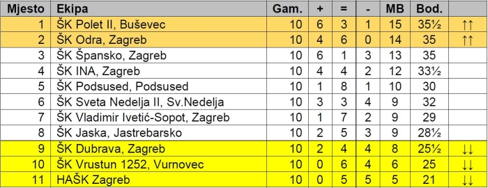

**IV. A liga, 11. kolo  
  
**Nakon dugo vremena, seniorska ekipa ŠK Odra **vratila se u treću ligu**. U posljednjem kolu, [pobjedom](http://chess-results.com/tnr549409.aspx?lan=13&art=3&rd=11) nad ekipom HAŠK Zagreb i uz malo sreće, tj. uz kiks ŠK Špansko koji je izgubio od ŠK Dubrava, uprkos činjenici da je Dubrava igrala bez druge ploče. Već “klasično”, seniori su igrali sa tri juniora u ekipi, i premda pobjeda djeluje rutinski, bilo je tu puno preokreta u partijama, a ekipa HAŠK Zagreba je pokazala da je potpuno ravnopravan protivnik. Lijepu partiju odigrao je Boris na četvrtoj ploči i to je vjerojatno pobjeda koja nas je uvela u viši rang.

<table><tbody><tr><td>Pl.</td><td></td><td><strong>HAŠK Zagreb</strong></td><td>–</td><td></td><td><strong>ŠK Odra</strong></td><td><strong>2-4</strong></td></tr><tr><td>1.</td><td>I</td><td>Damić, Dalibor 1924</td><td>–</td><td>MK</td><td>Karlić Zvjezdan 2072</td><td>1-0</td></tr><tr><td>2.</td><td>&nbsp;I</td><td>Trempetić, Mladen 1916</td><td>–</td><td>MK</td><td>Maravić Stjepan 2120</td><td>1-0</td></tr><tr><td>3.</td><td>II</td><td>Božičević, Josip 1837</td><td>–</td><td>MK</td><td>Maravić Ivan 2009</td><td>0-1</td></tr><tr><td>4.</td><td>III</td><td>Kraljević, Mijo 1771</td><td>–</td><td>IV</td><td>Kobali Boris 1666</td><td>0-1</td></tr><tr><td>5.</td><td>III</td><td>Pejić, Ante 1741</td><td>–</td><td>III</td><td>Cvetković Božo 1431</td><td>0-1</td></tr><tr><td>6.</td><td>VK</td><td>Tanković, Šemso 1529</td><td>–</td><td>VK</td><td>Pischiutta, Nikola 1417</td><td>0-1</td></tr></tbody></table>

---

```pgn
[Event "IV A liga centar"]
[Date "2021.11.14"]
[Round "11"]
[White "Kobali, Borislav"]
[Black "Kraljević, Mijo"]
[Result "1-0"]
[WhiteElo "1666"]
[BlackElo "1771"]
[Variant "Standard"]
[TimeControl "-"]
[ECO "A25"]
[Opening "English Opening: King's English Variation, Reversed Closed Sicilian"]
[Termination "Normal"]

1. c4 e5 2. Nc3 Nc6 3. g3 Nf6 4. Bg2 Bc5 5. e3 O-O 6. Nge2 {  a3 je bilo jače. } d6 7. d3 Bg4 8. O-O Rb8 9. b3 a6 10. Bb2 Qd7 11. Qd2 h6 12. a3 Nh7 13. f3 Be6 14. Kh1 f5??{  Previd. Ne7 je bilo bolje. } (14... Ne7 15. d4 Ba7 16. a4 Rbd8 17. e4 f5 18. f4 fxe4 19. Nxe4 Bg4 20. dxe5 dxe5 21. Qxd7) 15. d4 Ba7 16. d5 Ne7 17. dxe6 Qxe6 18. e4 Nf6 19. Nd5 Nfxd5 20. cxd5 Qf7 21. f4 fxe4 22. Bxe4 Qh5 23. Qd3 Rf7 24. fxe5 Rbf8 25. Nf4 Qg4 26. exd6 cxd6 27. Bd4 Bxd4 28. Qxd4 g5 29. Bf3 Rxf4 30. gxf4 Qh4 31. Qe4 Nf5 32. Qe6+ Kg7 33. Rg1 Qh3 34. Bg4{ Crni predaje. } 1-0
```

---

Pojedinačni učinak:

<table><tbody><tr><td><strong>Bo.</strong></td><td></td><td><strong>Ime</strong></td><td><strong>RtgI</strong></td><td><strong>RtgN</strong></td><td><strong>1</strong></td><td><strong>2</strong></td><td><strong>3</strong></td><td><strong>4</strong></td><td><strong>5</strong></td><td><strong>6</strong></td><td><strong>7</strong></td><td><strong>8</strong></td><td><strong>9</strong></td><td><strong>10</strong></td><td><strong>11</strong></td><td><strong>Bod.</strong></td><td><strong>Partije</strong></td><td><strong>Rp</strong></td></tr><tr><td>1</td><td>MK</td><td>Karlić Zvjezdan</td><td>2087</td><td>2116</td><td>½</td><td></td><td>1</td><td>½</td><td>½</td><td>½</td><td></td><td>½</td><td>½</td><td></td><td>0</td><td>4,0</td><td>8</td><td>1990</td></tr><tr><td>2</td><td>MK</td><td>Maravić Stjepan</td><td>2136</td><td>2119</td><td>½</td><td>1</td><td>1</td><td>+</td><td>½</td><td>½</td><td></td><td>½</td><td></td><td>1</td><td>0</td><td>6,0</td><td>9</td><td>2079</td></tr><tr><td>4</td><td>I</td><td>Maravić Ivan</td><td>2023</td><td>2067</td><td>½</td><td>1</td><td>½</td><td>1</td><td></td><td></td><td></td><td>½</td><td>1</td><td>1</td><td>1</td><td>6,5</td><td>8</td><td>2211</td></tr><tr><td>5</td><td>MK</td><td>Bačurin Juraj</td><td>2015</td><td>2017</td><td>½</td><td></td><td></td><td></td><td></td><td></td><td></td><td></td><td>½</td><td></td><td></td><td>1,0</td><td>2</td><td>0</td></tr><tr><td>6</td><td>MK</td><td>Cvetković Ivan</td><td>1966</td><td>1949</td><td>½</td><td>½</td><td></td><td></td><td></td><td></td><td></td><td>½</td><td>1</td><td>1</td><td></td><td>3,5</td><td>5</td><td>2077</td></tr><tr><td>7</td><td>II</td><td>Vraneša Ivan</td><td>1668</td><td>1919</td><td>½</td><td>1</td><td>1</td><td>½</td><td>½</td><td>½</td><td></td><td>½</td><td></td><td>0</td><td></td><td>4,5</td><td>8</td><td>1897</td></tr><tr><td>8</td><td></td><td>Furčić Tin</td><td>1623</td><td>1704</td><td></td><td>0</td><td></td><td>1</td><td>½</td><td>½</td><td></td><td></td><td>0</td><td></td><td></td><td>2,0</td><td>5</td><td>1701</td></tr><tr><td>9</td><td>IV</td><td>Kobali Borislav</td><td>1652</td><td>1751</td><td></td><td></td><td>½</td><td></td><td></td><td></td><td></td><td></td><td></td><td>0</td><td>1</td><td>1,5</td><td>3</td><td>1833</td></tr><tr><td>10</td><td>III</td><td>Cvetković Božo</td><td>1378</td><td>1792</td><td></td><td>½</td><td>0</td><td>1</td><td>½</td><td>½</td><td></td><td>½</td><td>0</td><td>0</td><td>1</td><td>4,0</td><td>9</td><td>1651</td></tr><tr><td>11</td><td>IV</td><td>Fiolić Luka</td><td>1296</td><td>1778</td><td></td><td></td><td></td><td></td><td>½</td><td>½</td><td></td><td></td><td></td><td></td><td></td><td>1,0</td><td>2</td><td>0</td></tr><tr><td>13</td><td></td><td>Pischiutta Nikola</td><td>0</td><td>1647</td><td></td><td></td><td></td><td></td><td></td><td></td><td></td><td></td><td></td><td></td><td>1</td><td>1,0</td><td>1</td><td>0</td></tr></tbody></table>

Kratki osvrt na ovogodišnju ligu. Sam početak i raspored odredio je povjerenik Bejuk bez ikakve konzultacije s klubovima.I to je razumljivo jer se ne može svakome ugoditi. Termini su bili takovi da mnogi klubovi, posebno u ljetnim terminima nisu uspijevali skupiti ekipe pa su mnogi mečevi odgađani. Nasreću za ligu, to je bilo tolerirano ove godine. Uz to, HŠS nije određivao nikakove posebne epidemiološke uvjete, što je isto razumljivo, jer se isti mijenjaju svako malo. Ali je to ostavilo previše prostora nekim klubovima da fantaziraju te provode i zahtijevaju svoje mjere prilikom odigravanja mečeva. Uz to, “mudro” zaboravljaju da je šah sport. Niti jedan sport se ne igra s maskom, ni nogomet, ni košarka pa ni šah. Floret je izuzetak. Takve nebuloze mogu se nametati samo djeci i to HŠS uspješno radi na kadetskim prvenstvima. Većina klubova je bila svjesna da su zbog toga moguće, (a i bile) razne trzavice te je zbog toga velik broj mečeva prijateljski remizirano. To je uvelike urušilo kvalitetu lige. I u našem Klubu ima pojedinaca  (npr. Darko) koji se toliko boje zaraze da nisu odigrali niti jedan meč. I zato savjet sličnima, cijepite se, održavajte higijenu, nosite rukavice, ne skidajte masku i najvažnije, ostanite doma! Nemojte riskirati vlastiti život i maltretirati ostale. Šah se može igrati i na internetu.

darko
