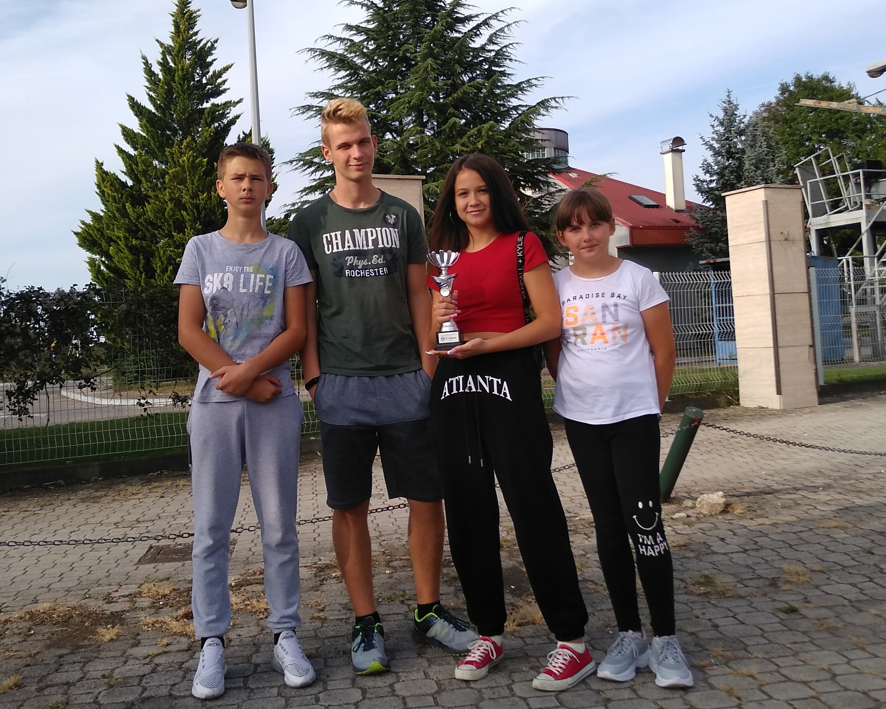
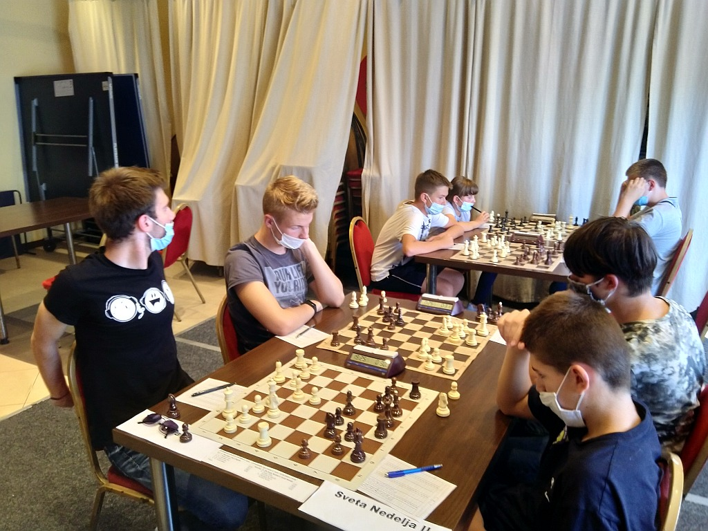
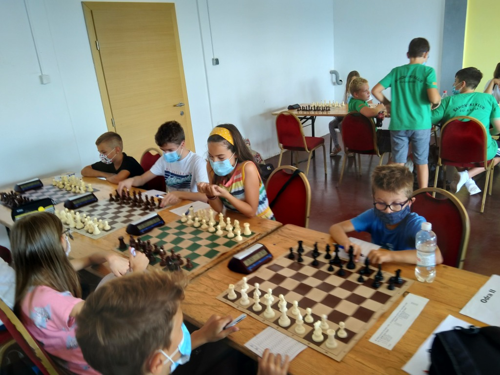
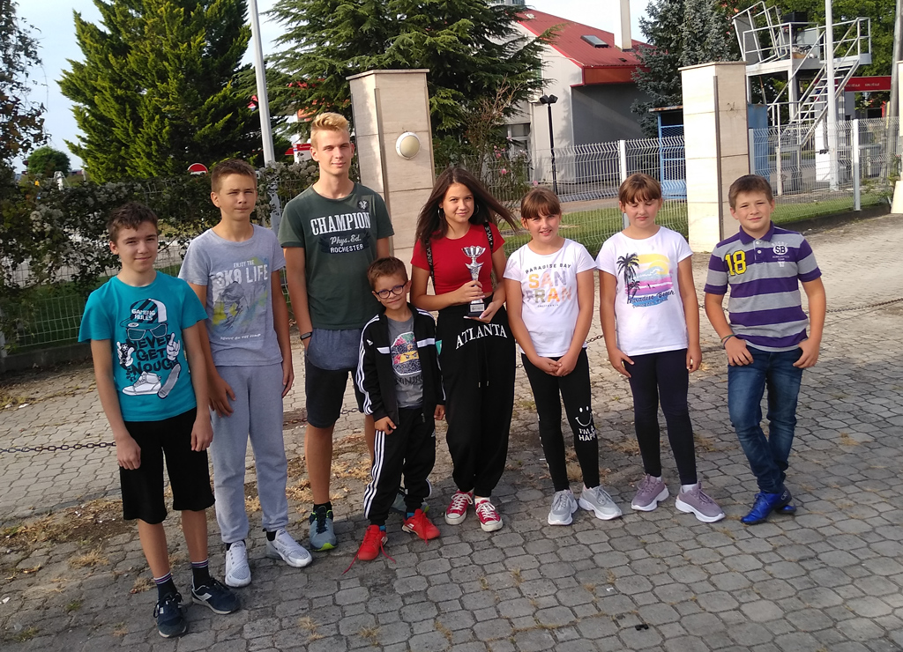
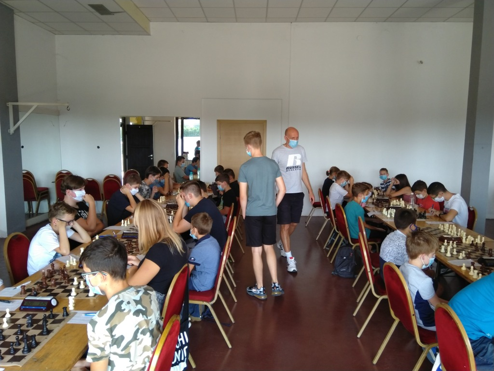

  
Kadetska ekipa ŠK Odra I osvojila je prvo mjesto u II. A kadetskoj ligi 2020!

[II. A kadetska liga](https://chess-results.com/tnr532858.aspx?lan=13) igrana je u Sportskom centru Sv. Nedelja, tri subote za redom, 5., 12. i 19. rujna 2020. Nastupilo je 18 ekipa, a tempo igre bio je 30+30. Mečevi su igrani na četiri ploče. Klubovi su mogli prijavljivati po dvije ekipe. Partije su rejtingirane za nacionalni rejting. Uprkos tome što nismo nastupili u nominalno najjačem sastavu jer je dio mlađih igračica odbio sudjelovanje, i činjenici da su prva tri kola nastupili sa samo tri igrača, ekipa ŠK Odra I  lagano se “prošetala” i sa 6 pobjeda i tri neriješena susreta osvojila prvo mjesto. Čestitamo! Kapetani ekipa bili su Ivan Maravić i Slavko Biondić. Maraviću i Luciji Botici ovaj turnir se djelomično preklapao sa Online rapid prvenstvom Europe za mlade pa su propustili neke partije, kao i proglašenje. Prva ekipa igrala je u sastavu Ivan Maravić (K), Ivan Vraneša, Samanta Halužan, Luka Fiolić i Ivana Fiolić.  Ekipa Odra II nastupila je u sastavu Višeslav Botica, Lucija Botica, Filip Matašić, Slavko Biondić (K), Ivan Pisačić i Lucija Fiolić. Druga ekipa zabilježila je tri pobjede i jedan neodlučen rezultat te ostavila dobar dio drugih ekipa iza sebe. Čestitamo mlađoj ekipi i želimo im što brži napredak, jer već sljedeće godine dio njih prelazi u  prvu ekipu. Osvajanjem prvog mjesta kadetska ekipa ŠK odra plasirala se u prvu ligu i bude li volje i hrabrosti, sljedeće godine pomlađena ekipa može se okušati i na višoj stepenici. Lijep napredak su na ovom turniru pokazali Luka Fiolić, Slavko Biondić i Ivana Fiolić. Zahvaljujemo se roditeljima na organizaciji prijevoza i nadzoru (mlađe) ekipe.

<table><tbody><tr><td><strong>Mj.</strong></td><td><strong>SNo</strong></td><td><strong>Momčad</strong></td><td><strong>Partije</strong></td><td><strong>&nbsp; +&nbsp;</strong></td><td><strong>&nbsp; =&nbsp;</strong></td><td><strong>&nbsp; –&nbsp;</strong></td><td><strong>&nbsp;TB1&nbsp;</strong></td><td><strong>&nbsp;TB2&nbsp;</strong></td><td><strong>&nbsp;TB3&nbsp;</strong></td></tr><tr><td>1</td><td>2</td><td>ŠK Odra I</td><td>9</td><td>6</td><td>3</td><td>0</td><td>15</td><td>26,0</td><td>239,5</td></tr><tr><td>2</td><td>4</td><td>ŠK Oroslavje</td><td>9</td><td>6</td><td>2</td><td>1</td><td>14</td><td>22,5</td><td>208,5</td></tr><tr><td>3</td><td>8</td><td>ŠK Ban Jelačić, Zaprešić</td><td>9</td><td>6</td><td>1</td><td>2</td><td>13</td><td>24,0</td><td>216,5</td></tr><tr><td>4</td><td>13</td><td>ŠK Sveta Nedelja II</td><td>9</td><td>5</td><td>3</td><td>1</td><td>13</td><td>23,5</td><td>201,5</td></tr><tr><td>5</td><td>5</td><td>ŠK Travno I</td><td>9</td><td>5</td><td>2</td><td>2</td><td>12</td><td>20,0</td><td>177,0</td></tr><tr><td>6</td><td>3</td><td>ŠK Zagreb I</td><td>9</td><td>5</td><td>1</td><td>3</td><td>11</td><td>21,5</td><td>188,5</td></tr><tr><td>7</td><td>15</td><td>ŠK Samobor 2</td><td>9</td><td>4</td><td>1</td><td>4</td><td>9</td><td>19,0</td><td>109,5</td></tr><tr><td>8</td><td>7</td><td>ŠK Duga Resa</td><td>9</td><td>3</td><td>2</td><td>4</td><td>8</td><td>18,5</td><td>131,0</td></tr><tr><td>9</td><td>9</td><td>ŠK Sveta Nedelja III</td><td>9</td><td>4</td><td>0</td><td>5</td><td>8</td><td>18,0</td><td>126,5</td></tr><tr><td>10</td><td>1</td><td>ŠK Polet I, Buševec</td><td>9</td><td>3</td><td>2</td><td>4</td><td>8</td><td>17,0</td><td>123,5</td></tr><tr><td>11</td><td>6</td><td>ŠKRM Caissa, Zagreb</td><td>9</td><td>3</td><td>2</td><td>4</td><td>8</td><td>17,0</td><td>97,0</td></tr><tr><td>12</td><td>10</td><td>ŠK Donja Stubica</td><td>9</td><td>4</td><td>0</td><td>5</td><td>8</td><td>16,0</td><td>131,5</td></tr><tr><td>13</td><td>11</td><td>ŠK Samobor 1</td><td>9</td><td>2</td><td>3</td><td>4</td><td>7</td><td>17,5</td><td>116,0</td></tr><tr><td>14</td><td>17</td><td>ŠK Odra II</td><td>9</td><td>3</td><td>1</td><td>5</td><td>7</td><td>16,0</td><td>116,5</td></tr><tr><td>15</td><td>12</td><td>ŠK Polet II, Buševec</td><td>9</td><td>2</td><td>3</td><td>4</td><td>7</td><td>16,0</td><td>92,5</td></tr><tr><td>16</td><td>14</td><td>ŠK Zagreb II, Zagreb</td><td>9</td><td>2</td><td>3</td><td>4</td><td>7</td><td>15,0</td><td>98,5</td></tr><tr><td>17</td><td>16</td><td>ŠK Travno II, Zagreb</td><td>9</td><td>2</td><td>3</td><td>4</td><td>7</td><td>14,5</td><td>78,5</td></tr><tr><td>18</td><td>18</td><td>ŠK Jakovlje, Jakovlje</td><td>9</td><td>0</td><td>0</td><td>9</td><td>0</td><td>2,0</td><td>15,0</td></tr></tbody></table>

---

**ŠK Odra I**

<table><tbody><tr><td><strong>Bo.</strong></td><td></td><td><strong>Ime</strong></td><td><strong>RtgN</strong></td><td><strong>1</strong></td><td><strong>2</strong></td><td><strong>3</strong></td><td><strong>4</strong></td><td><strong>5</strong></td><td><strong>6</strong></td><td><strong>7</strong></td><td><strong>8</strong></td><td><strong>9</strong></td><td><strong>Bod.</strong></td><td><strong>Partije</strong></td><td><strong>RtgAvg</strong></td></tr><tr><td>1</td><td>I</td><td>Maravić Ivan (K)</td><td>2065</td><td>1</td><td>1</td><td>½</td><td>1</td><td>1</td><td>1</td><td>0</td><td></td><td></td><td>5,5</td><td>7</td><td>1838</td></tr><tr><td>2</td><td>III</td><td>Vraneša Ivan</td><td>1817</td><td>1</td><td>1</td><td>½</td><td>1</td><td>1</td><td>0</td><td>1</td><td>1</td><td>+</td><td>7,5</td><td>9</td><td>1774</td></tr><tr><td>3</td><td></td><td>Bez igrača</td><td></td><td>–</td><td>–</td><td>–</td><td></td><td></td><td></td><td></td><td></td><td></td><td>0,0</td><td>3</td><td>0</td></tr><tr><td>5</td><td>III</td><td>Halužan Samanta</td><td>1682</td><td></td><td></td><td></td><td></td><td></td><td></td><td></td><td>1</td><td>1</td><td>2,0</td><td>2</td><td>1780</td></tr><tr><td>6</td><td>IV</td><td>Fiolić Luka</td><td>1694</td><td>1</td><td>1</td><td>1</td><td>1</td><td>½</td><td>1</td><td>0</td><td>½</td><td>1</td><td>7,0</td><td>9</td><td>1697</td></tr><tr><td>9</td><td>III</td><td>Fiolić Ivana</td><td>1698</td><td></td><td></td><td></td><td>1</td><td>0</td><td>0</td><td>1</td><td>1</td><td>1</td><td>4,0</td><td>6</td><td>1629</td></tr></tbody></table>

---

**ŠK Odra II**

<table><tbody><tr><td><strong>Bo.</strong></td><td></td><td><strong>Ime</strong></td><td><strong>RtgN</strong></td><td><strong>1</strong></td><td><strong>2</strong></td><td><strong>3</strong></td><td><strong>4</strong></td><td><strong>5</strong></td><td><strong>6</strong></td><td><strong>7</strong></td><td><strong>8</strong></td><td><strong>9</strong></td><td><strong>Bod.</strong></td><td><strong>Partije</strong></td><td><strong>RtgAvg</strong></td></tr><tr><td>1</td><td>IV</td><td>Botica Višeslav</td><td>1683</td><td>0</td><td>0</td><td>0</td><td>½</td><td>0</td><td>1</td><td>0</td><td>0</td><td>0</td><td>1,5</td><td>9</td><td>1798</td></tr><tr><td>2</td><td>II</td><td>Botica Lucija</td><td>1764</td><td></td><td></td><td></td><td>1</td><td>1</td><td>1</td><td></td><td></td><td></td><td>3,0</td><td>3</td><td>1671</td></tr><tr><td>3</td><td></td><td>Matašić Filip</td><td>1600</td><td>0</td><td>0</td><td>½</td><td>1</td><td>1</td><td>1</td><td>0</td><td>0</td><td>0</td><td>3,5</td><td>9</td><td>1717</td></tr><tr><td>5</td><td></td><td>Biondić Slavko</td><td>1600</td><td>0</td><td>1</td><td>1</td><td></td><td></td><td></td><td>0</td><td>½</td><td>+</td><td>3,5</td><td>6</td><td>1637</td></tr><tr><td>6</td><td></td><td>Pisačić Ivan</td><td>1600</td><td>0</td><td>1</td><td>0</td><td>1</td><td>1</td><td>0</td><td></td><td></td><td></td><td>3,0</td><td>6</td><td>1638</td></tr><tr><td>10</td><td></td><td>Fiolić Lucija</td><td>1600</td><td></td><td></td><td></td><td></td><td></td><td></td><td>1</td><td>½</td><td>0</td><td>1,5</td><td>3</td><td>1637</td></tr></tbody></table>

---

   
