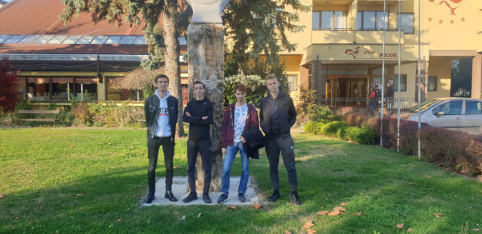
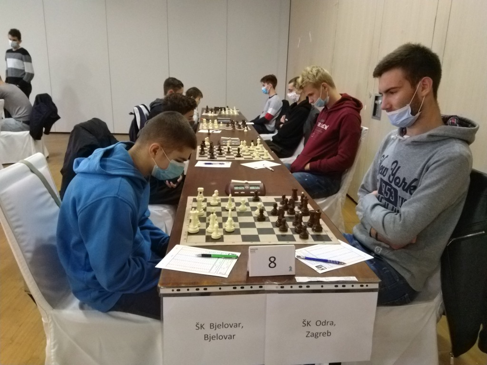
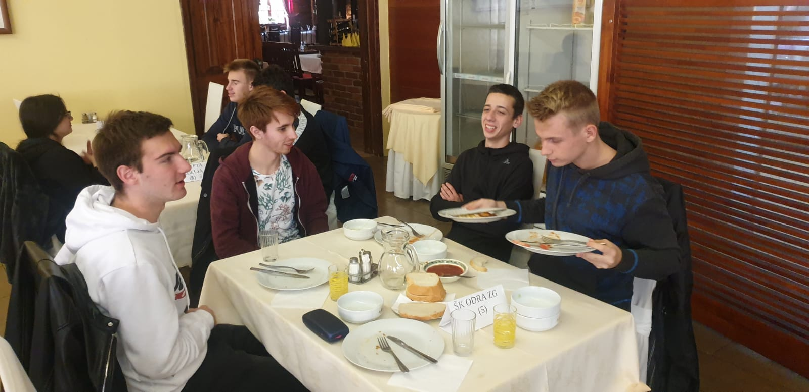

  
**O**vogodišnja [II. juniorska liga](https://chess-results.com/tnr514833.aspx?lan=13) odigrana je kroz četiri subote u 10. i 11. mjesecu. Jednom se igralo u Karlovcu i tri puta u Đurđevcu. Natjecalo se 16 ekipa, tempo igre bio je 90’+30″. Mečevi su igrani na četiri ploče. Partije su bile rejtingirane za međunarodni i nacionalni rejting.  
Sljedeći igrači su nastupali za ŠK Odra: Ivan Maravić(K), Ivan Vraneša, Božo Cvetković, Luka Fiolić i Nikola Pischiutta. Ekipa je osvojila 7. mjesto upisavši tri pobjede, tri remija i dva poraza. Bili smo blizu postolja, trebala nam je 3:1 pobjeda u zadnjemu kolu, nažalost, to nismo uspjeli ostvariti, ali generalan dojam je veoma dobar. Oba poraza bila su minimalna, s puno dobrih ekipa smo odigrali ujednačene mečeve i bilo je puno zanimljivih partija.  
  
**N**ikoli je ovo bilo prvo ozbiljno natjecanje, jako je puno oscilirao u partijama, ali pokazao je dosta dobre igre. Trošio je vrijeme, nakon početne treme se nije bojao, mora malo više raditi na završnicama i otvaranjima, 3,5 iz 6 za prvi nastup je više nego dobro.  
**L**uka je igrao dvije partije i obje izgubio. Odigrao ih je solidno, ali u obje je napravio po jednu nerazumljivu odluku koja je dovela njegovu poziciju iz balansa do izgubljene. Jako je dobar, malo više strpljivosti mu treba i vjerujem da će već iduće godine popraviti rezultat.  
**B**oži je ovo bio prvi ozbiljni nastup u dugo vremena i zaslužio je pohvale za njega. Pravilno je raspoređivao vrijeme, vadio figure, rokirao… Dosta partija koje je odigrao su bile na visokoj razini, grubi previdi  
 su ga dijelili od boljega rezultata, a to će samo postići praksom.  
**I**van Vranšea je rezultatima u ovoj ligi osvojio **II. kategoriju**!! Bravo! Nakon što su prošli mjesec to uspjele Samanta i Ivana u kadetskoj ligi, ovo je još jedan lijepi uspjeh. Samo još jednom je pokazao koliko je dobar igrač, može se “žilaviti” u nekim pozicija kao što vjerujem nitko u Klubu ne može. Nije lako na drugoj ploči imati više od 50%, a on je debelo prešao tu granicu.  
**I**van Maravić je odigrao solidan turnir. Izgubio je samo od najjačeg igrača cijelog natjecanja i remizirao dvije partije. Par puta mu je nedostajao osjećaj u kritičnim pozicijama, ali generalno mu je ovo jedan od boljih nastupa u zadnje vrijeme.  
**L**igu je uvjerljivo osvojila ekipa Koprivnice. Čestitamo! Zahvaljujemo roditeljima i Kuharu na prijevozu.

## **Konačni poredak nakon 8. kola**

<table><tbody><tr><td><strong>Mj.</strong></td><td><strong>SNo</strong></td><td><strong>Momčad</strong></td><td><strong>Partije</strong></td><td><strong>+</strong></td><td><strong>=</strong></td><td><strong>–</strong></td><td><strong>TB1</strong></td><td><strong>TB2</strong></td><td><strong>TB3</strong></td></tr><tr><td>1</td><td>1</td><td>ŠŠK Koprivnica, Koprivnica</td><td>8</td><td>7</td><td>1</td><td>0</td><td>15</td><td>25,5</td><td>198,0</td></tr><tr><td>2</td><td>2</td><td>ŠK Samobor, Samobor</td><td>8</td><td>3</td><td>4</td><td>1</td><td>10</td><td>20,5</td><td>151,0</td></tr><tr><td>3</td><td>7</td><td>ŠK Polet, Buševec</td><td>8</td><td>4</td><td>2</td><td>2</td><td>10</td><td>19,5</td><td>140,5</td></tr><tr><td>4</td><td>3</td><td>ŠKRM Ivan Dvoržak, Rovišće-Z. Topolovac</td><td>8</td><td>4</td><td>2</td><td>2</td><td>10</td><td>19,0</td><td>119,5</td></tr><tr><td>5</td><td>6</td><td>ŠŠK Mladost, Varaždinske Toplice</td><td>7</td><td>4</td><td>2</td><td>1</td><td>10</td><td>17,5</td><td>110,5</td></tr><tr><td>6</td><td>5</td><td>ŠK Sveta Nedelja II, Sveta Nedelja</td><td>8</td><td>4</td><td>1</td><td>3</td><td>9</td><td>19,0</td><td>118,5</td></tr><tr><td><strong>7</strong></td><td><strong>8</strong></td><td><strong>ŠK Odra, Zagreb</strong></td><td><strong>8</strong></td><td><strong>3</strong></td><td><strong>3</strong></td><td><strong>2</strong></td><td><strong>9</strong></td><td><strong>18,0</strong></td><td><strong>121,5</strong></td></tr><tr><td>8</td><td>4</td><td>ŠK Picok, Đurđevac</td><td>8</td><td>4</td><td>1</td><td>3</td><td>9</td><td>16,5</td><td>106,0</td></tr><tr><td>9</td><td>10</td><td>ŠK Čakovec, Čakovec</td><td>8</td><td>2</td><td>2</td><td>4</td><td>6</td><td>15,0</td><td>67,0</td></tr><tr><td>10</td><td>13</td><td>ŠK Križevci, Križevci</td><td>8</td><td>2</td><td>2</td><td>4</td><td>6</td><td>10,0</td><td>50,5</td></tr><tr><td>11</td><td>14</td><td>KŠK Karlovac, Karlovac</td><td>6</td><td>2</td><td>0</td><td>4</td><td>5</td><td>12,0</td><td>52,0</td></tr><tr><td>12</td><td>9</td><td>ŠŠK Konaki, Novo Virje</td><td>7</td><td>1</td><td>2</td><td>4</td><td>5</td><td>10,0</td><td>46,5</td></tr><tr><td>13</td><td>16</td><td>ŠK Bjelovar, Bjelovar</td><td>7</td><td>0</td><td>2</td><td>5</td><td>3</td><td>9,0</td><td>45,0</td></tr><tr><td>14</td><td>15</td><td>ŠK Ban Jelačić, Zaprešić</td><td>3</td><td>0</td><td>2</td><td>1</td><td>2</td><td>4,0</td><td>30,0</td></tr><tr><td>15</td><td>11</td><td>ŠK Novi Zagreb, Zagreb</td><td>3</td><td>0</td><td>0</td><td>3</td><td>1</td><td>3,5</td><td>22,0</td></tr><tr><td>16</td><td>12</td><td>ŠK Zaprešić, Zaprešić</td><td>1</td><td>0</td><td>0</td><td>1</td><td>0</td><td>0,0</td><td>0,0</td></tr></tbody></table>

##### 7\. ŠK Odra, Zagreb (RtgAvg:1544, TB1:9 / TB2:18,0)

<table><tbody><tr><td><strong>Bo.</strong></td><td></td><td><strong>Ime</strong></td><td><strong>1</strong></td><td><strong>2</strong></td><td><strong>3</strong></td><td><strong>4</strong></td><td><strong>5</strong></td><td><strong>6</strong></td><td><strong>7</strong></td><td><strong>8</strong></td><td><strong>Bod.</strong></td><td><strong>Partije</strong></td></tr><tr><td>1</td><td>I</td><td>Maravić Ivan</td><td>1</td><td>0</td><td>1</td><td>1</td><td>½</td><td>1</td><td>1</td><td>½</td><td>6,0</td><td>8</td></tr><tr><td>2</td><td>III</td><td>Vraneša Ivan</td><td>1</td><td>1</td><td>½</td><td>½</td><td>1</td><td>0</td><td>+</td><td>0</td><td>5,0</td><td>8</td></tr><tr><td>3</td><td>III</td><td>Cvetković Božo</td><td>1</td><td>1</td><td>0</td><td>0</td><td>0</td><td>1</td><td>0</td><td>½</td><td>3,5</td><td>8</td></tr><tr><td>7</td><td>IV</td><td>Fiolić Luka</td><td></td><td></td><td></td><td></td><td>0</td><td>0</td><td></td><td></td><td>0,0</td><td>2</td></tr><tr><td>10</td><td></td><td>Pischiutta Nikola</td><td>1</td><td>0</td><td>1</td><td>0</td><td></td><td></td><td>½</td><td>1</td><td>3,5</td><td>6</td></tr></tbody></table>
