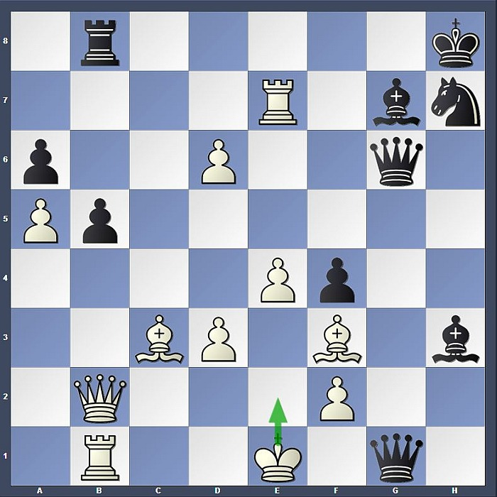

| # | Ime | Bod. | SB |
| --- | --- | --- | --- |
| 1 | Duda, Jan-Krzysztof 2724 | 6.5 | 28 |
| 2 | Piorun, Kacper 2633 | 5.5 | 21.75 |
| 3 | Tomczak, Jacek 2589 | 5 | 22.5 |
| 4 | Mista, Aleksander 2590 | 4.5 | 19.75 |
| 5 | Krasenkow, Michal 2628 | 4.5 | 19 |
| 6 | Wojtaszek, Radoslaw 2750 | 4.5 | 19 |
| 7 | Gajewski, Grzegorz 2599 | 4 | 18 |
| 8 | Bartel, Mateusz 2604 | 4 | 16.5 |
| 9 | Socko, Bartosz 2593 | 3.5 | 15.5 |
| 10 | Sadzikowski, Daniel 2588 | 3 | 13.5 |

Jan-Krzystof Duda, kao najmlađi igrač na turniru, osvojio je [LOTTO Pojedinačno prvenstvo Poljske 2018.](http://mp2018.pzszach.pl/) u šahu. Dvadesetogodišnji Duda jedan je od dvojice poljskih igrača u klubu 2700. Prvenstvo se igralo u Waršavi, od 12. do 20. svibnja. Nagrada za prvo mjesto je 20.000 zl. (oko 40.000 kn), a uz nagradu, uz drugoplasiranog Kacpera, kvalificirao se u poljsku ekipu za nadolazeću olimpijadu. Na turniru su bili zabranjeni remiji prije 30. poteza crnoga. Duda je započeo turnir sa četiri remija, da bi zatim upisao četiri pobjede. Preokrenuo je partiju protiv Wojtaszeka, a u zadnjem kolu spasio je remi protiv Bartela. Nagradu za najljepšu partiju odnijela je partije prvog kola između Bartela i Miste.  
U nastavku donosimo nekoliko partija s turnira.

---

```pgn
[Event "LOTTO Polish Championship"]
[Date "2018.05.19"]
[Round "8.1"]
[White "Krasenkow, Michal"]
[Black "Wojtaszek, Radoslaw"]
[Result "0-1"]
[ECO "E51"]
[WhiteElo "2628"]
[BlackElo "2750"]
[PlyCount "57"]
[TimeControl "6000+1160"]
[WhiteClock "0:20:07"]
[BlackClock "0:34:56"]

1. d4 Nf6 2. c4 e6 3. Nc3 Bb4 4. Nf3 d5 5. e3 O-O 6. Bd2 b6 7. cxd5 exd5 8. Rc1
Bb7 9. Bd3 Be7 10. Ne5 c5 11. O-O Nc6 12. f4 cxd4 13. Nxc6 Bxc6 14. exd4 b5 15.
f5 Qb6 16. Ne2 b4 17. Bg5 h6 18. Bxf6 Bxf6 19. Kh1 Rac8 20. Nf4 Bb7 21. Rxc8
Rxc8 22. Nh5 Qxd4 23. Nxf6+ Qxf6 24. Qb3 a5 25. a3 d4 26. Rd1 Qg5 27. Bf1 Rc1
28. axb4 axb4 29. Rxc1 0-1
```

---

```pgn
[Event "LOTTO Polish Championship"]
[Date "2018.05.17"]
[Round "6.2"]
[White "Wojtaszek, Radoslaw"]
[Black "Duda, Jan-Krzysztof"]
[Result "0-1"]
[ECO "D24"]
[WhiteElo "2750"]
[BlackElo "2724"]
[PlyCount "110"]
[TimeControl "6000+1320"]
[WhiteClock "0:10:38"]
[BlackClock "0:08:54"]

1. d4 Nf6 2. c4 e6 3. Nf3 d5 4. Nc3 dxc4 5. e4 b5 6. e5 Nd5 7. Nxb5 Nb6 8. Be2
Be7 9. O-O Nc6 10. Be3 O-O 11. Qd2 Rb8 12. Rfd1 Bb7 13. b3 a6 14. Nc3 cxb3 15.
axb3 Nb4 16. Bg5 Nd7 17. Qf4 c5 18. Rac1 cxd4 19. Bxe7 Qxe7 20. Rxd4 Bxf3 21.
Bxf3 Nc5 22. Rcd1 Nbd3 23. R4xd3 Nxd3 24. Rxd3 Rxb3 25. Bd1 Qb4 26. Qxb4 Rxb4
27. g3 a5 28. h4 Rc8 29. Kg2 Kf8 30. f4 Ke7 31. Kf3 Rcc4 32. Ke3 h6 33. h5 Ke8
34. Bc2 Kf8 35. Bd1 Ke7 36. Bc2 Rc7 37. Bd1 Rcc4 38. Bc2 Rc7 39. Bd1 Rd7 40.
Rxd7+ Kxd7 41. g4 Ke7 42. f5 Rc4 43. Na4 Rc1 44. Kd2 Rc8 45. Ke3 Rc1 46. Kd2
Rc7 47. Ke3 f6 48. exf6+ Kxf6 49. fxe6 Kxe6 50. Nb2 Kf6 51. Nd3 Kg5 52. Ne5 Rc1
53. Kd2 Rc5 54. Nd3 Rc4 55. Ne5 Re4 {(56. Nd3 Rxg4…)} 0-1
```

---

```pgn
[Event "LOTTO Polish Championship"]
[Date "2018.05.19"]
[Round "8.5"]
[White "Socko, Bartosz"]
[Black "Tomczak, Jacek"]
[Result "1-0"]
[ECO "B90"]
[WhiteElo "2593"]
[BlackElo "2589"]
[PlyCount "79"]
[TimeControl "6000+1135"]
[WhiteClock "1:06:12"]
[BlackClock "0:01:30"]

1. e4 c5 2. Nf3 d6 3. d4 cxd4 4. Nxd4 Nf6 5. Nc3 a6 6. Be3 e5 7. Nb3 Be6 8. Qd2
Nbd7 9. O-O-O Rc8 10. f4 b5 11. f5 Bc4 12. Kb1 Be7 13. Rg1 Ng4 14. Bxc4 bxc4
15. Nc1 O-O 16. N1e2 Nxh2 17. Nd5 Ng4 18. Nec3 Ndf6 19. Nxf6+ Bxf6 20. Qe2 Nxe3
21. Qxe3 Bg5 22. Qa7 Rc6 23. Nd5 Qb8 24. Qxb8 Rxb8 25. c3 Kf8 26. Kc2 Ke8 27.
b4 cxb3+ 28. axb3 a5 29. Ra1 Bd8 30. Rh1 h6 31. f6 Bxf6 32. Rxa5 Bd8 33. Ra7
Bb6 34. Ra6 Kd7 35. b4 Bd8 36. Ra7+ Ke6 37. Rf1 f6 38. Rxg7 Ra8 39. Kb3 Rca6
40. Rxf6+ 1-0
```

---

```pgn
[Event "LOTTO Polish Championship"]
[Date "2018.05.18"]
[Round "7.4"]
[White "Duda, Jan-Krzysztof"]
[Black "Sadzikowski, Daniel"]
[Result "1-0"]
[ECO "D38"]
[WhiteElo "2724"]
[BlackElo "2588"]
[PlyCount "63"]
[TimeControl "6000+2610"]
[WhiteClock "0:15:28"]
[BlackClock "0:05:52"]

1. d4 d5 2. c4 e6 3. Nc3 Bb4 4. Nf3 Nf6 5. Qa4+ Nc6 6. e3 O-O 7. Qc2 Re8 8. a3
Bxc3+ 9. Qxc3 e5 10. Nxe5 Nxe5 11. dxe5 Ne4 12. Qd4 Qh4 13. g3 Qh5 14. Be2 Bg4
15. Bxg4 Qxg4 16. O-O Qf3 17. cxd5 Ng5 18. h4 Nh3+ 19. Kh2 Nxf2 20. Qf4 Ng4+
21. Kh3 Qe2 22. Qxf7+ Kh8 23. e6 h6 24. Qf3 Qxf3 25. Rxf3 Nf6 26. Rxf6 gxf6 27.
e4 c6 28. Be3 Rad8 29. Bd4 Kg7 30. Rf1 Rxe6 31. dxe6 Rxd4 32. e5 1-0
```

---

```pgn
[Event "LOTTO Polish Championship"]
[Date "2018.05.14"]
[Round "3.2"]
[White "Bartel, Mateusz"]
[Black "Sadzikowski, Daniel"]
[Result "1-0"]
[ECO "B50"]
[WhiteElo "2604"]
[BlackElo "2588"]
[PlyCount "37"]
[TimeControl "6000+1060"]
[WhiteClock "1:17:05"]
[BlackClock "0:48:22"]

1. e4 c5 2. Nf3 d6 3. Nc3 Nf6 4. e5 dxe5 5. Nxe5 a6 6. g3 Qc7 7. d4 cxd4 8.
Qxd4 Nc6 9. Nxc6 Qxc6 10. Bg5 Bg4 11. Bxf6 gxf6 12. Qxg4 Qxh1 13. Qa4+ b5 14.
Nxb5 axb5 15. Qxb5+ Kd8 16. O-O-O+ Kc7 17. Rd7+ Kc8 18. Rd5 Bh6+ 19. f4 1-0
```

---

```pgn
[Event "LOTTO Polish Championship"]
[Date "2018.05.14"]
[Round "3.1"]
[White "Piorun, Kacper"]
[Black "Krasenkow, Michal"]
[Result "1-0"]
[ECO "B30"]
[WhiteElo "2633"]
[BlackElo "2628"]
[PlyCount "69"]
[TimeControl "6000+1115"]
[WhiteClock "0:00:33"]
[BlackClock "0:01:11"]

1. e4 c5 2. Nf3 Nc6 3. Bb5 e6 4. O-O Nge7 5. d4 cxd4 6. Nxd4 Qb6 7. Nxc6 Nxc6
8. Bd3 Be7 9. Nc3 O-O 10. Kh1 Rd8 11. f4 d5 12. exd5 Nb4 13. dxe6 Bxe6 14. Qe2
Nxd3 15. cxd3 Bf6 16. f5 Bd5 17. Be3 Qa6 18. Rad1 Bc6 19. Rd2 h6 20. Rfd1 Rd7
21. Qg4 Kh7 22. d4 Re8 23. Qg3 Qc4 24. h3 b5 25. d5 Bxc3 26. bxc3 Rxd5 27. Rxd5
Bxd5 28. Bd4 g5 29. fxg6+ fxg6 30. Re1 Qc6 31. Rf1 Qe6 32. Kh2 g5 33. h4 Qe4
34. hxg5 Rg8 {(Qg6 =)} 35. g6+ 1-0
```

---

```pgn
[Event "LOTTO Polish Championship"]
[Date "2018.05.12"]
[Round "1.3"]
[White "Bartel, Mateusz"]
[Black "Mista, Aleksander"]
[Result "1-0"]
[ECO "B51"]
[WhiteElo "2604"]
[BlackElo "2590"]
[PlyCount "113"]
[TimeControl "6000+1345"]
[WhiteClock "0:07:46"]
[BlackClock "0:00:59"]

1. e4 c5 2. Nf3 d6 3. Bb5+ Nd7 4. Ba4 Ngf6 5. O-O a6 6. c4 g6 7. Nc3 Bg7 8. d3
O-O 9. h3 b6 10. Be3 Bb7 11. Rb1 e6 12. b4 Qc7 13. Qd2 Rfd8 14. Rfc1 Rab8 15.
Bg5 Rdc8 16. a3 Nf8 17. Nh2 e5 18. Nd5 Nxd5 19. cxd5 f5 20. bxc5 dxc5 21. Qa2
Kh8 22. Bd2 f4 23. Bd1 h5 24. a4 Nd7 25. g4 Nf6 26. Bc3 Re8 27. Qb2 Bc8 28. Nf3
Nh7 29. a5 b5 30. Bb4 hxg4 31. Rxc5 Qf7 32. hxg4 Bxg4 33. Kf1 Bh3+ 34. Ke1 g5
35. d6 g4 36. Nxe5 Rxe5 37. Rxe5 g3 38. Bf3 Qg6 39. Bc3 g2 40. Re7 g1=Q+ 41.
Ke2 Q1g5 42. Rxg7 Qxg7 43. Rh1 Be6 44. Bxg7+ Qxg7 45. e5 Re8 46. Be4 f3+ 47.
Kd2 Qg5+ 48. Kc2 Rc8+ 49. Kb1 Qg2 50. Rxh7+ Kg8 51. Rc7 Rxc7 52. dxc7 Kf7 53.
Qd2 Ke7 54. Qe3 Qf1+ 55. Kc2 Kd7 56. Qd4+ Kxc7 57. Qd6+ 1-0
```
