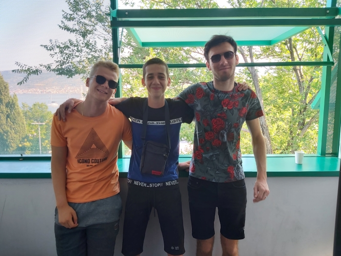

  
Od 25.7. do 31.7. u Splitu igrala su se Juniorska prvenstva Hrvatske. U konkurenciji do [17](https://chess-results.com/tnr569387.aspx?lan=13&art=1&rd=9) i do [19](https://chess-results.com/tnr571196.aspx?lan=13&art=1&rd=9) godina.  
Nastupila su tri naša člana Božo, Ivan Vraneša i Ivan Maravić. Božo do 19 godina, a dva Ivana do 17.  
Božo je osvojio 3.5 boda. Igra nije bila loša, pravilno je raspoređivao vrijeme, nije previše previđao, fali mu samo hrabrosti i samopouzdanja da počne osvajati više bodova.  
Ivan Vraneša je igrao solidno. Donosio je neke čudne odluke (ulazak u raznobojce u dobivenoj poziciji), ali nije previše toga ostavljao i uspio je doći do 5 bodova.  
Ivanu Maraviću je ovo jedan od lošijih turnira u zadnje vrijeme, puno je previđao, protivnici su ga lako nadigravali, par puta ga je samo snalažljivost spasila od poraza, ali budući da je izgubio samo jednu partiju je osvojio solidnih 5.5 bodova.  
Sve u svemu, lijepo je vidjeti da ove godine više naših članova igra ovo natjecanje te se nadamo da će ih iduće godine biti i više te da će biti i više bodova 🙂

Medalje po konkurencijama:

Ž17:

1.Kokša Jelena, ŠŠK Konaki, 7.5 iz 9

2.Trgovac Marta, ŠK Polet, 7

3.Bevanda Ema, ŠK Picok, 7

O17:

1.Jurakić Lukas, ŠK Đuro Đaković, 7.5 iz 9

2.Karlušić Luka, ŠKRM Caissa, 7.5

3.Novosel Lovro, ŠK Sveta Nedelja, 7

Ž19:

1.Dejanović Tereza, ŠK Polet, 4 iz 5

2.Radiković Anamarija, ŠK Draga, 4

3.Randić Petra, HAŠK Mladost, 3

O19:

1.Čotić Borna, ŠK Mornar, 7.5 iz 9

2.Jakrlin Mihael, ŠŠK Konaki, 7

3.Tuković Dario, ŠK Đuro Đaković, 6

*IvanM*
