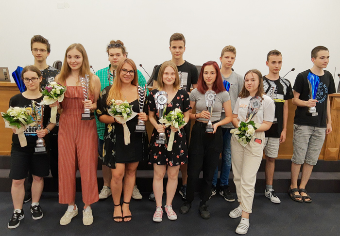

**  
  
O**d 27.7. do 3.8. održalo se Juniorsko prvenstvo Hrvatske u hotelu Slavonija u Vinkovcima. Lijepe uspomene nas vežu uz ovaj grad budući da su cure ovdje osvojile drugo mjesto na Završnici prvenstava OŠ. Od naših članova, na ovome natjecanju je nastupio samo Ivan M. u otvorenoj konkurenciji do 17 godina. Ivan V. i Božo nisu imali pretjeranu želju nastupiti iz različitih razloga (nedostatak mora, cure…:)). Tako da je Ivan bio u društvu dva člana ŠK Liburnija, Enricom Ghersinichem i Brunom Purinijem.

**I**vanova igra nije bila loša, ali ništa više od toga, nedostatak agresivnosti i odigranih partija je bio problem. Uza sve to, do pretposljednjeg kola je bio u igri za medalju, ali onda je poraz u pretposljednjem kolu značio da je borba za medalju završila. Na kraju se sa 5.5 bodova ugurao u prvih 10 i možemo se nadati da će iduće godine biti bolje, budući da je već 4 godine u nizu naizmjence 3. pa 10. :).

**E**nrico i Bruno također nisu odigrali na očekivanoj razini (obojica O19 konkurencija). Enrico, prvi nositelj je na kraju sa 5.5 bodova završio na 4. mjestu, a Bruno je sa 3.5 bio 11.

**Z**ahvaljujemo hotelu na gostoljubivosti, a Enricu na vožnji i brizi za našega člana.

**M**edalje po konkurencijama:

Ž17:

1.Dejanović Tereza, ŠK Polet, 7 iz 9

2.Bevanda Ema, ŠK Picok, 6.5

3.Randić Petra, HAŠK Mladost, 6.5

O17:

1.Levačić Matej, ŠK Casper, 7.5 iz 9

2.Trošelj Ivan, AŠK Junior, 7

3.Ljubičić Mario, ŠK Casper, 6.5

Ž19:

1.Smetiško Marija, ŠK Ericsson – Nikola Tesla, 4 iz 5

2.Muha Magdalena, ŠK Liburnija, 3.5

3.Golub Nikolina, ŠK Draga, 3.5

O19:

1.Čotić Borna, ŠK Mornar, 7 iz 9

2.Jakrlin Mihael, ŠŠK Konaki, 5.5

3.Morić Ivan, ŠK Sveta Nedelja, 5.5

**Z**a kraj jedna partija:

```pgn
[Event "Juniorsko prvenstvo Hrvatske"]
[Site "sahovski-klub.com"]
[Date "2020.08.01"]
[Round "7"]
[White "I Maravić, Ivan"]
[Black "MK Jurakić, Lukas"]
[Result "1/2 - 1/2"]
[ECO "D04"]
[WhiteElo "2009"]
[BlackElo "2023"]
[PlyCount "101"]

1. d4 d5 2. Nf3 Nf6 3. e3 c5 4. c3 Nc6 5. dxc5 a5 6. Bb5 g6 7. b4 Bg7 8. Bb2 O-O
9. a3 Ne4 10. Qb3 e5 11. O-O Be6 12. Qc2 Ng5 13. Nbd2 e4 14. Nd4 Ne5 15. f4 exf3
16. N2xf3 Ngxf3+ 17. Nxf3 Ng4 18. Rae1 Bd7 19. Bxd7 Qxd7 20. Bc1 Rfe8 21. Qd3
Nf6 22. Rd1 Qe7 23. Nd4 Ng4 24. Nb5 Qe5 25. g3 Qh5 26. Qe2 Bh6 27. Rd3 Re5 28.
Nd6 Re7 29. Rfd1 f5 30. Qa2 Nf6 31. Rf1 Bg5 32. Qg2 Qh6 33. Rf3 Ng4 34. Qe2 Ne5
35. Rxd5 Nxf3+ 36. Qxf3 axb4 37. Rd3 bxa3 38. Qd5+ Kf8 39. c6 bxc6 40. Qxc6 Rd8
41. Bxa3 Bxe3+ 42. Kg2 Qh5 43. Rxe3 Rxe3 44. Ne8+ {Propušta forsirani mat sa:}
(44. Ne4+ Kg8 45. Qe6+ Kg7 46. Qf6+ Kg8 47. Qxd8+ Kf7 48. Qf6+ Kg8 49. Qf8#)
Re7 45. Bxe7+ Kxe7 46. Qf6+ Kxe8 47. Qe6+ Kf8 48. Qf6+ Ke8 49. Qe6+ Kf8 50. Qf6+ Ke8 51. Qe6+ 1/2-1/2
```

*IvanM*
