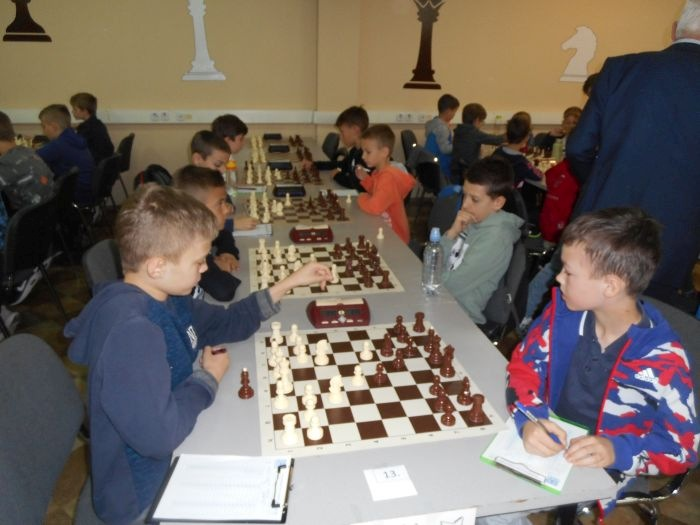
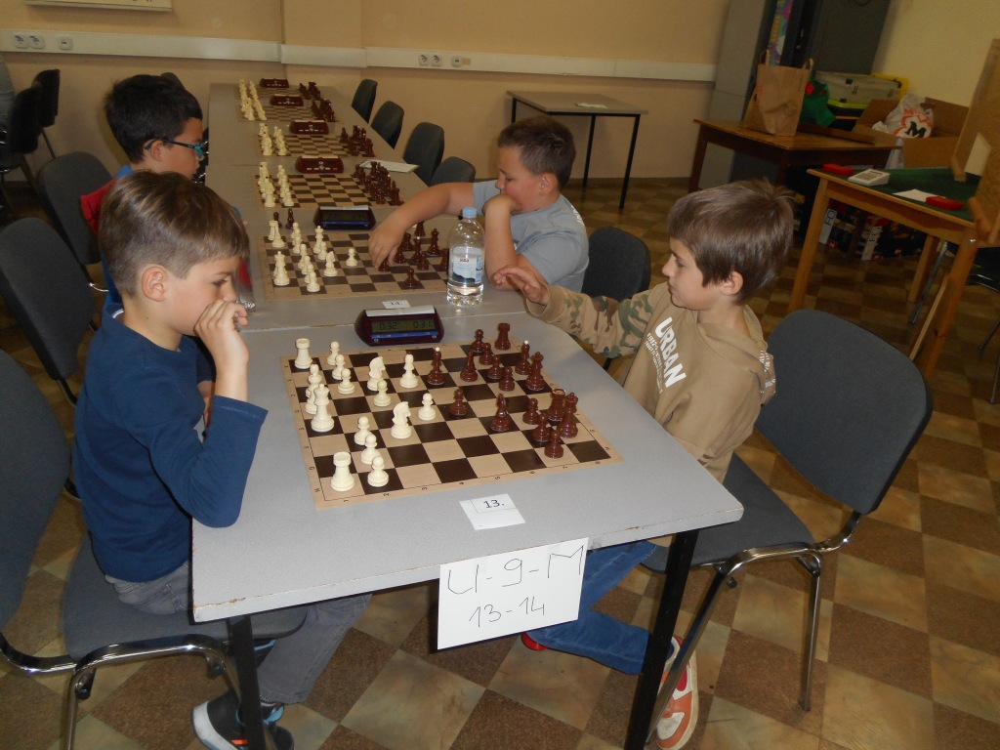
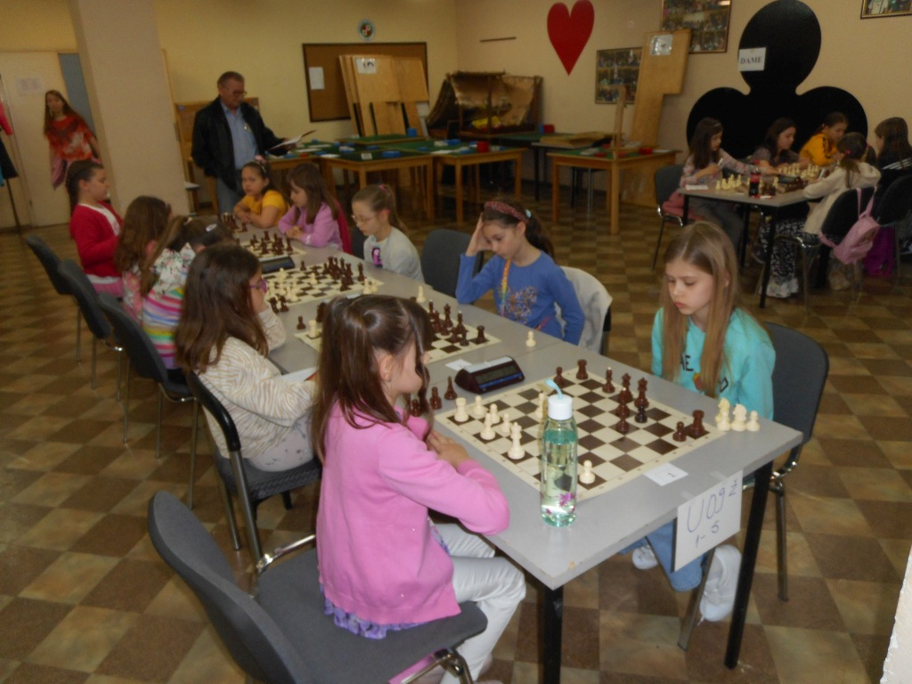
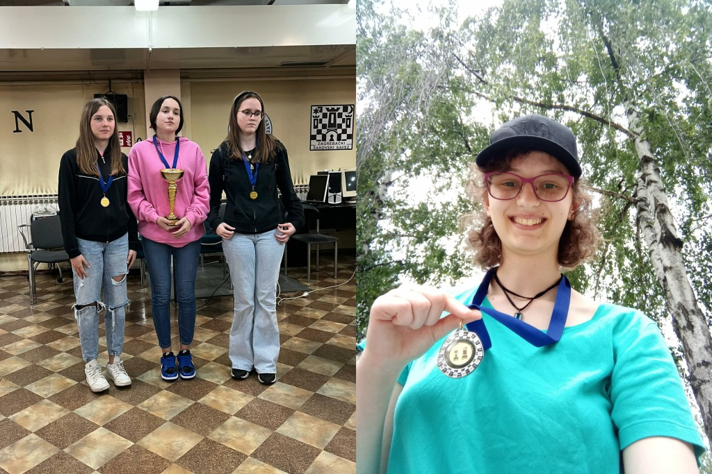
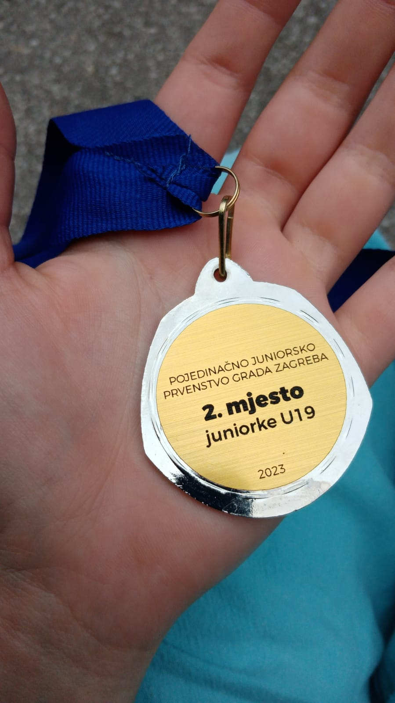

Tri vikenda zaredom, u travnju i svibnju, u organizaciji Zagrebačkog šahovskog saveza, igrana su [Pojedinačna kadetska prvenstva Grada Zagreba](https://chess-results.com/tnr754949.aspx?lan=13&art=4) te tri vikenda u svibnju i lipnju, [Pojedinačna juniorska prvenstva Grada Zagreba](https://chess-results.com/tnr768647.aspx?lan=13&art=4) u šahu 2023.  
Od naših članova nastupili su Martin Primorac u [konkurenciji do 7 godina](https://chess-results.com/tnr756132.aspx?lan=13&art=4&turdet=YES) , Ana Predović, Vili Sesar i Petar Primorac u konkurenciji do 9 godina, Petra Medoš, Bartol Glagolić i Domagoj Leko u konkurenciji do 11 godina, Ivana Fiolić, Vjeka Vidra, Lucija Fiolić i Lucija Medoš u konkurenciji do 15 godina, Slavko Biondić i Filip Matašić u konkurenciji do 17 godina te Lucija Komljenović Sović u konkurenciji do 19 godina.  
Medalje su osvojile **Ivana Fiolić, bronca** U15Z i **Lucija Komljenović Sović, srebro** U19Z. Čestitke Ivani i Luciji kao i svim učesnicima turnira.  
Termini kadetskih turnira su se pokazali prilično lošim jer su se preklapali sa prvomajskim praznicima kada su mnogi (roditelji) imali već druge planove pa je bilo puno izostanaka. Tako je Ana uspjela odigrati samo tri kola, Domagoj, Petra, Petar i Vili su odigrali po 6 kola…  Iskreno se nadam da će se dogodine vratiti na uobičajene termine u veljači/ožujku.  
Mnogim našim članovima u mlađim konkurencijama (U9, U11) ovo je bio prvi turnir, prvo zapisivanje partija, bilo je puno treme, igrali su ispod svojih realnih mogućnosti, ali je bitno da su to pregrmili i sljedeći put bit će lakše. Nekolicina se ozbiljno zaintersirala za šah, dolaze redovno petkom i dogodine bi se mogla složiti dobra kadetska ekipa. 🙂 Uskoro će i Prvenstvo Hrvatske, prijavljeno je zasad sedmoro klinaca, a još se nadam da će se taj broj možda i povećati pa da se priključe i Bartol, Vili i Domagoj. Njih trojica pokazuju veliku volju, a problem je samo  organizacijski.

               

darko
