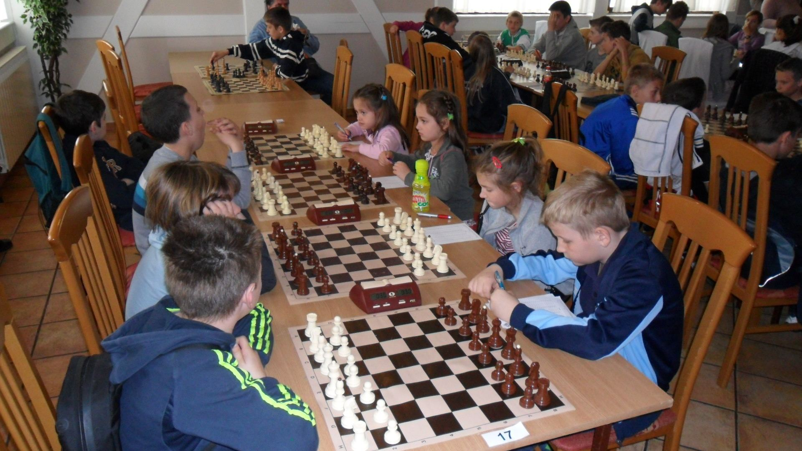
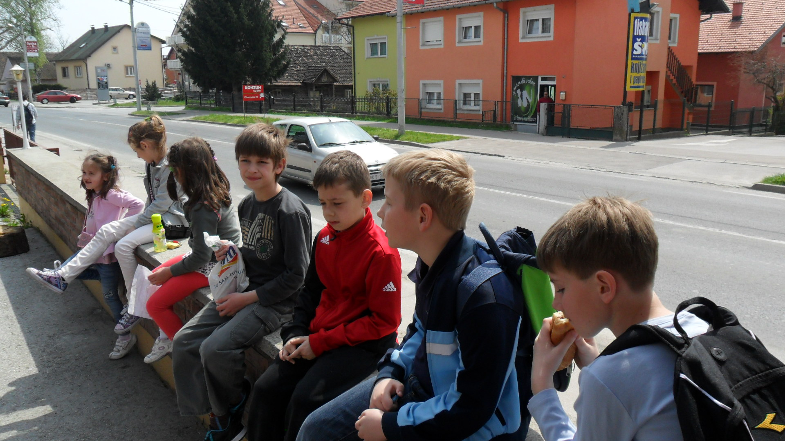

U subotu 20. travnja 2013. u **Dugom Selu** odigran je drugi krug kadetske lige. Zbog obveza igrača bilo je malo teže skupiti ekipu pa su djevojke uskočile u pomoć. Nadamo se da će sljedeće godine djevojke igrati svoju ligu, pa takva pomoć neće biti  moguća. U svakom slučaju i njima je dobro došlo da skupljaju  prva iskustva u ekipnim natjecanjima.

Od rezultata, **Lucija** je osvojila pola boda, a **Ivan** i **Vraneša** upisali su prve pobjede na ovom natjecanju!  
Ipak, svi su bili pomalo brzopleti i moramo još dosta raditi na tome.

Ekipa sada ima pet bodova iz šest kola i za prvi nastup to je pohvalan rezultat.

Od voditelja, Miroslav, Stipe, Darko i Darko odradili su organizacijski dio.

Što se tiče sljedećega kruga u Đurđevcu, zasad su aktivni kandidati Ana, Bruna, Vraneša, Božo…

Od voditelja tu su Miroslav i Vjekoslav, koji će voziti, a u petak ćemo dogovoriti detalje. Ako bude išlo više od četiri člana, neće biti problema jer je u Đurđevcu moguće i kupanje (samo za one koji ne zaborave kupaći i dobiju dopuštenje roditelja).
