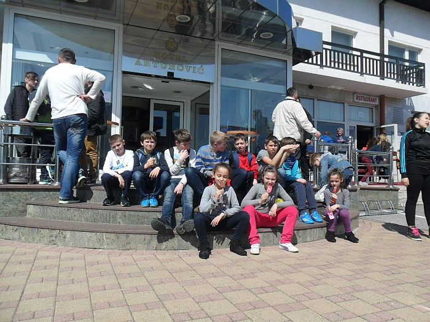

**Kadetska liga 2015.**

**J**učer je u Sesvetskom Kraljevcu, u hotelu Antunović odigran drugi krug kadetskih liga za 2015. ŠK Odra nastupa s tri ekipe.  
**U** prvoj ligi igraju kadetkinje, koje su i jučer bile u nepotpunom sastavu. Na Anu vjerojatno više ne možemo računati. S obzirom na to da je propustila posljednja tri susreta, teško je vjerovati da je riječ o slučajnosti. Djevojke od ove godine uredno zapisuju poteze i to je veliki iskorak u njihovoj igri jer ćemo sada moći lakše učiti i ispravljati pogreške u igri i otvaranjima. U šestom kolu imale su ravnopravne protivnice te umalo upisale i prve ekipne bodove. Franka je bila najbliža pobjedi, ali je to bila već treća partija i nije uspjela vidjeti dobitak pa su ona i Monika osvojile po pola boda.  
**P**rva ekipa kadeta, koja, kao i druga ekipa, igra u IV. ligi, jučer je ubilježila jednu pobjedu, jedan neriješen rezultat i jedan poraz. Da su bili malo hrabriji (Ivan je uzeo remi u boljoj poziciji) i/ili malo koncentriraniji (Vraneša nije uzeo besplatnog pješaka), i u drugom bi krugu imali dvije pobjede i bili mnogo više na tablici, s realnim izgledima za plasman u višu ligu. Božo je u ovom krugu pobijedio u sve tri partije!  
**D**ruga ekipa predvođena Brunom na prvoj ploči te Lukom, Jurjem i Stipom, koji je u ovom krugu zamijenio Petra, uz hrabru igru, ali i pomaženi žrijebom, upisali su dvije pobjede! Sada imaju šest meč-bodova, tj. samo jedan manje od prve ekipe. Tko zna, možda već u sljedećem krugu odmjere snage s prvom ekipom.  
**K**adeti i kadetkinje polako sazrijevaju, dobro se snalaze u svoj toj gunguli oko stolova, termina, početaka partija, formulara i svega o čemu moraju voditi brigu na turnirima. Postaju samostalniji. Čini se da prilično dobro podnose i poraze i samo im treba što više partija. Razmišljamo o kadetskom prvenstvu Varaždinske županije, iako je termin pomalo nezgodan jer se prva kola igraju petkom pa je teško organizirati prijevoz, dok za djevojke postoje izgledi da odigraju turnir juniorki koji se igra prvog svibnja u Buševcu. Više o tome u jednom od sljedećih postova…

**S**ljedeći, završni krug kadetskih liga igra se 25. travnja u Novom Zagrebu, Kombolova 2a, u Ugostiteljsko-turističkom učilištu.

U [galeriju slika](/galerija/) dodano je nekoliko novih fotografija s jučerašnjih nastupa.
