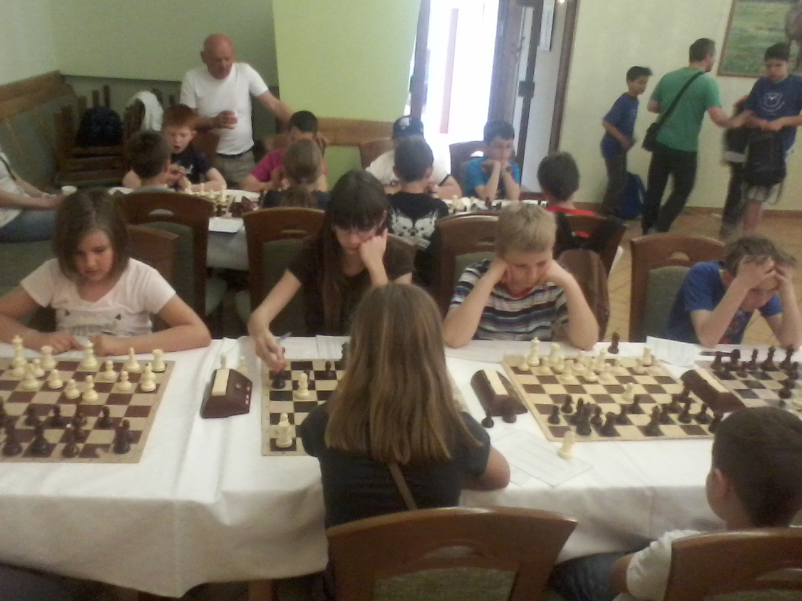
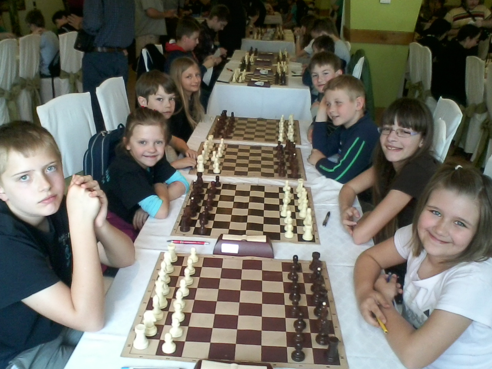
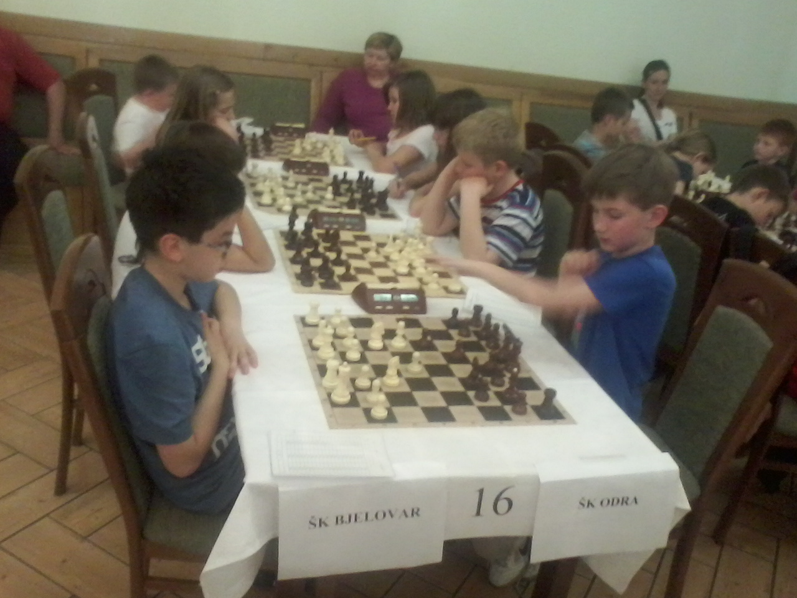

ĐURĐEVAC – KADETSKA LIGA

Prošle subote, 27. travnja, odigran je i treći, završni krug kadetske lige u Đurđevcu. Voditelj je bio prof. Vjekoslav Novak, a za ekipu su nastupili **Ivan, Vraneša, Emma i Bruna**. Partije su bile zanimljive, posebno prvo kolo, u kojem je Ivan igrao završnicu skakač i lovac protiv kralja i nije uspio matirati protivnicu. Zato smo jučer svi učili taj mat i mislim da je već pomalo “sjeo”! Jednostavan nije, s obzirom na to da ga ne znaju ni svi seniori.

**Vraneša** je ubilježio dvije nove pobjede, **Bruna** jednu, a **Emma Baljak** svoj je prvi klupski nastup obilježila sa 100% učinkom, tri pobjede iz tri partije!

Sve je prošlo bez problema, a voditelj je uspio organizirati i kupanje. “Kupali smo se sat i četrdeset minuta!” rekao mi je **Ivan**.

 

Kadetima je u ovoj fazi potrebno da što više igraju turnirske partije, a prilika nema baš mnogo. Može se zaključiti da je prvi nastup u ovoj ligi uspješno okončan, ekipa je uspjela biti kompletna na sva tri kruga, a bude li dovoljno ozbiljnosti u pristupu, sljedeće godine mogli bismo organizirati i žensku ekipu.

U svakom slučaju, o tome ćemo se s članovima kadetima i njihovim roditeljima još dogovarati.

Zahvaljujem svima koji su pomogli u organizaciji kvalitetno odigrane lige, a posebno mladim kadetima koji su nastupili, **Ivanu, Vraneši, Boži, Emmi, Bruni i Bruni, Ani, Moniki i Luciji!** Sljedeće godine, nadamo se, i **Franki**.

Darko
