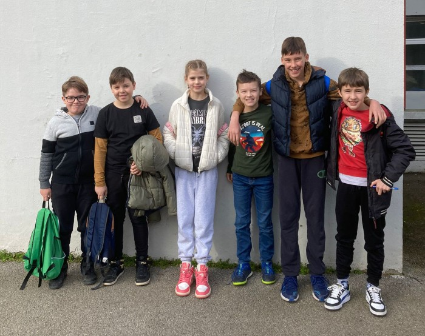
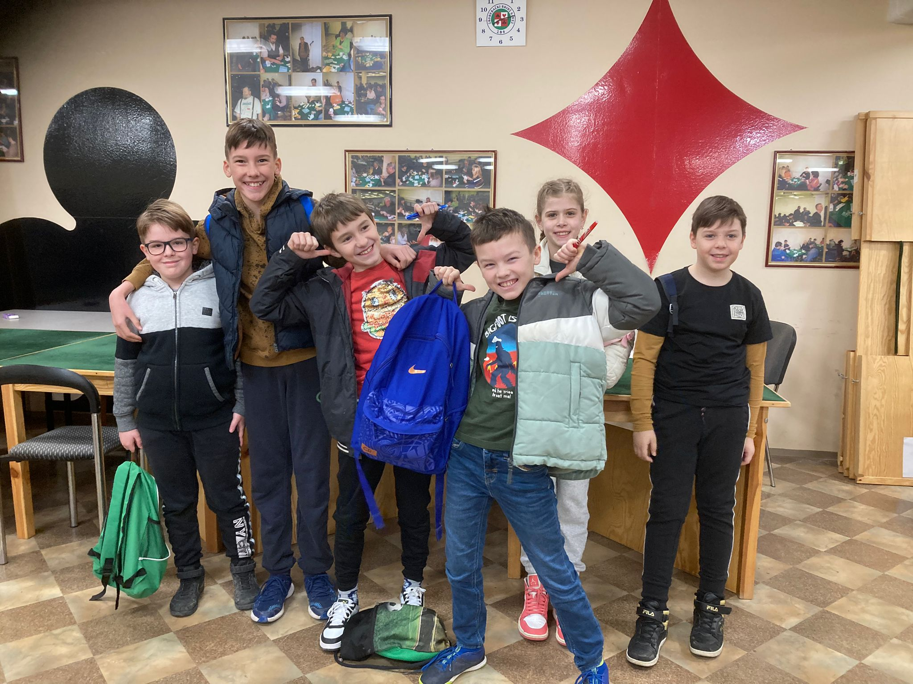
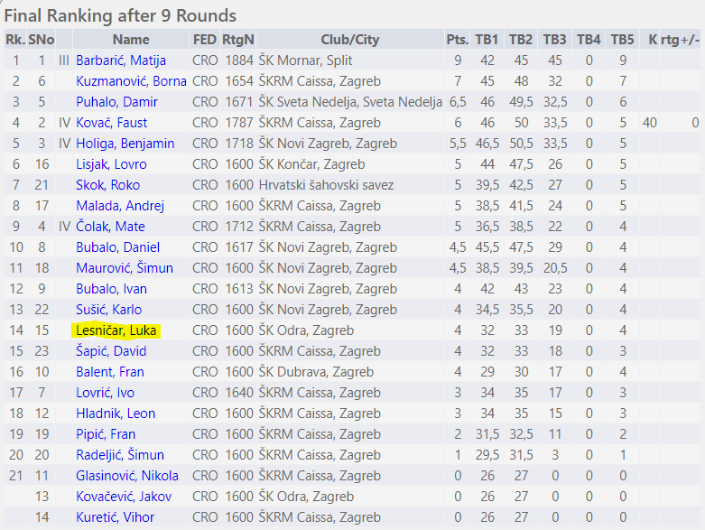
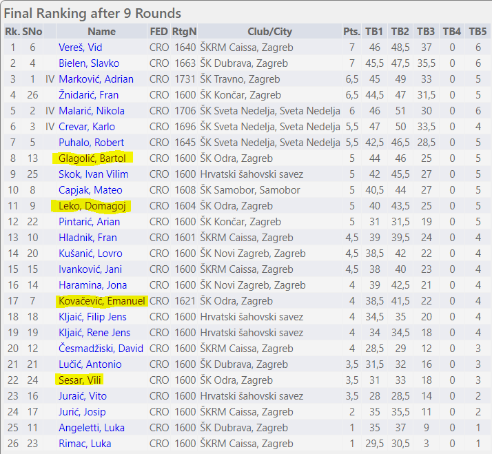
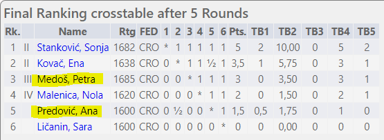
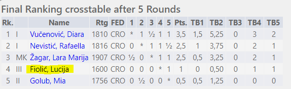
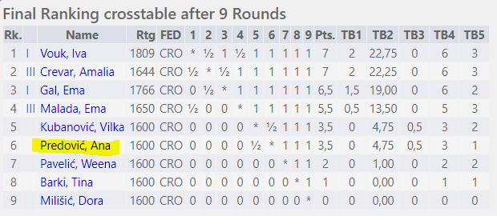
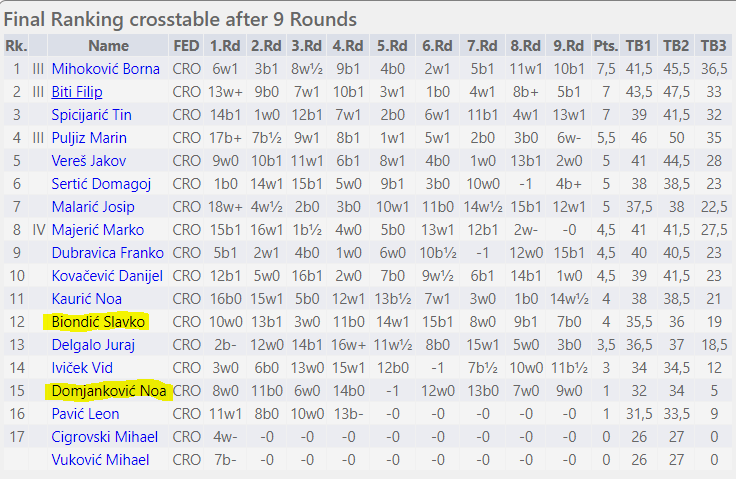

Luka, Emanuel, Domagoj, Bartol, Vili, Slavko, Noa, Petra, Ana i Lucija Fiolić nastupili su na prvenstvu Zagreba. Trebao je nastupiti i Jakov, no nažalost se razbolio prije početka turnira. Turnir se održavao od 20. 02. do 25. 2. 2024. u Domu sportova. Igralo se na najbržem tempu za sporopotezne partije, 30+30. Dečki i cure su zapisivali poteze te smo tako mogli napraviti analizu partija u klubu. Svatko je uspio ostvariti poneku pobjedu. **Petra Medoš** je osvojila i **3\. mjesto** u konkurenciji [kadetkinja do 13 godina](https://chess-results.com/tnr893111.aspx?lan=13&art=1). Bravo za Petru! 😃 **Ana** se natjecala u konkurenciji kadetkinja do 13 godina I kadetkinja do 11 godina, hrabro od nje, no rezultati su mogli biti i bolji. U konkurenciji [kadeta do 9 godina](https://chess-results.com/tnr893120.aspx?lan=13&art=4) nastupao je samo Luka koji je uspio skupiti 4 od 9 bodova. **Luka** je nedavno počeo igrati šah i polako napreduje. U konkurenciji [kadeta do 11 godina](https://chess-results.com/tnr893119.aspx?lan=13&art=4) nastupilo je najviše naših igrača. **Bartol** je pokazao da je i dalje najjači igrač, te je zauzeo 8. mjesto sa 5 sakupljenih bodova. **Domagoj** je također imao 5 bodova i zauzeo zlatnu sredinu tablice. **Emanuel i Vili** su pokazali da malo zaostaju. Dečki se trebaju uozbiljiti i početi redovitije vježbati. **Lucija Fiolić** je igrala u konkurenciji [kadetkinja do 15 godina](https://chess-results.com/tnr893109.aspx?lan=13&art=4), te je zauzela 4. mjesto. Konkurencija je bila jaka, ali rezultat je mogao biti i bolji uz malo redovitije vježbe i igre. **Slavko i Noa** igrali su u konkurenciji [kadeta do 15 godina](https://chess-results.com/tnr893108.aspx?lan=13&art=4). **Slavko** je pokazao da je malo zahrđao jer ne vježba i ne igra redovno. Završio je na 12. mjestu sa 4 osvojena boda. **Noa** je noviji igrač u klubu I treba mu još iskustva na turnirima.  Na kraju, treba reći da je nastupila većina naših kadeta te smo ponosni na njihove nastupe. Bitno je da nastave **trenirati, vježbati, truditi se** i bolji rezultati će doći!

  

