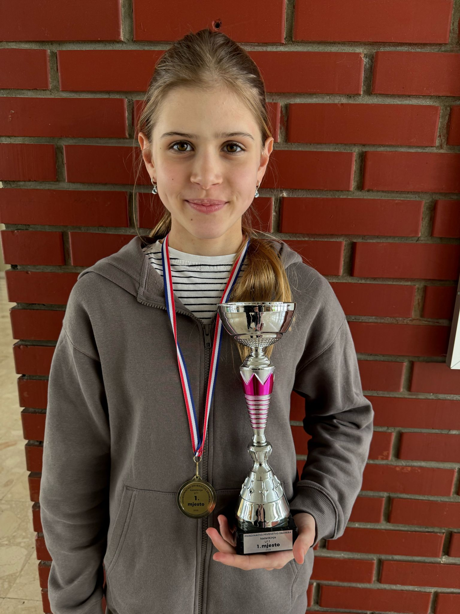
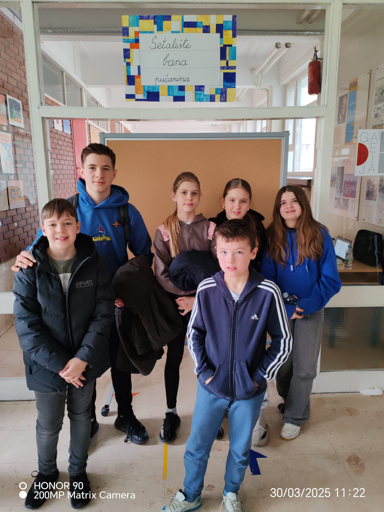
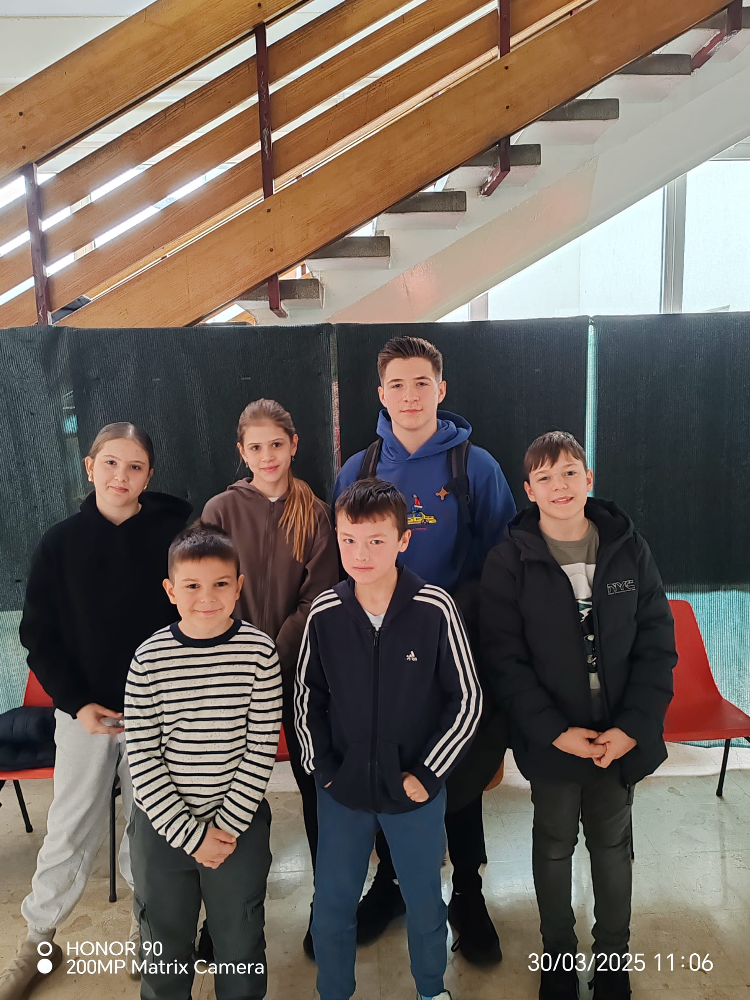
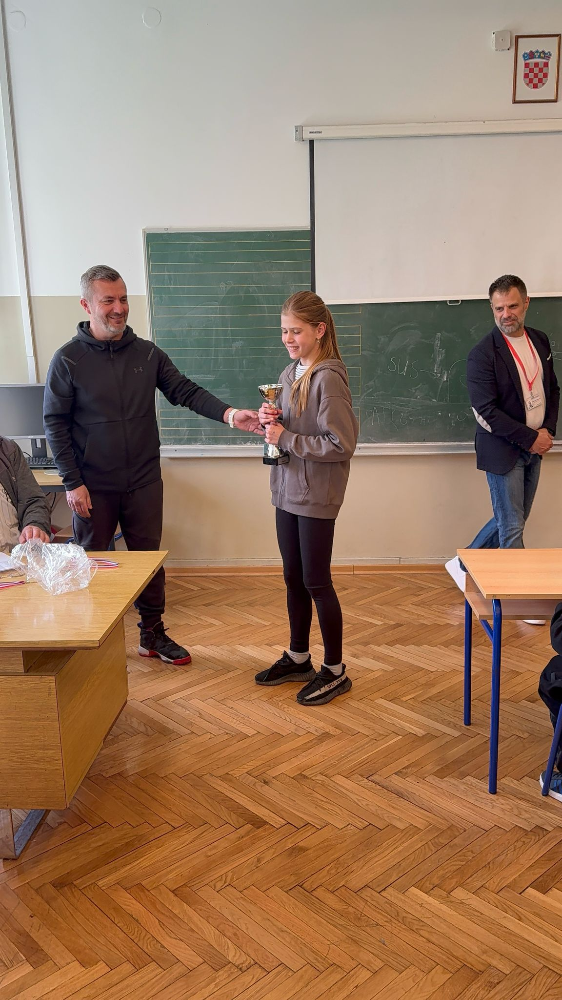
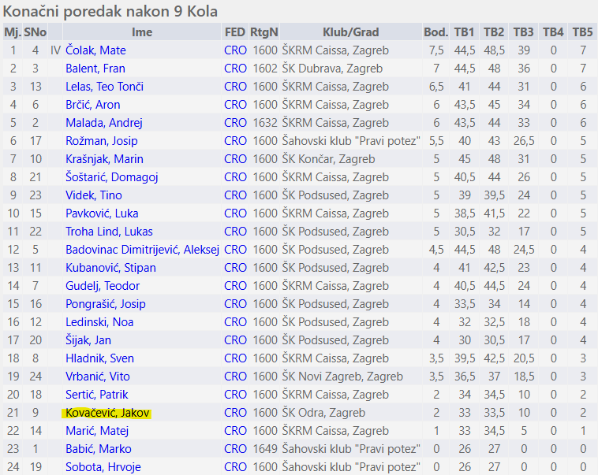
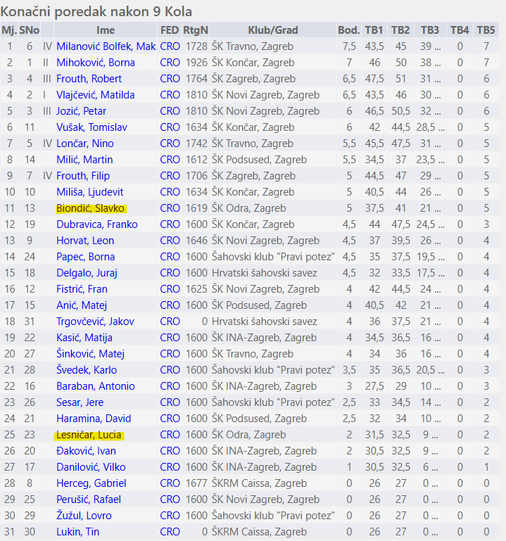
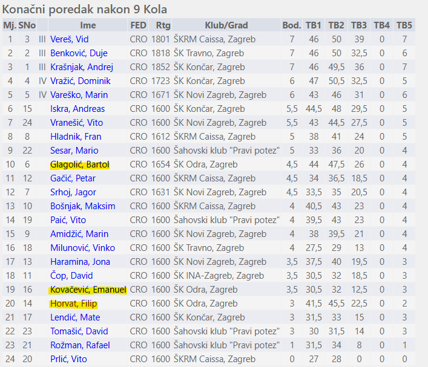
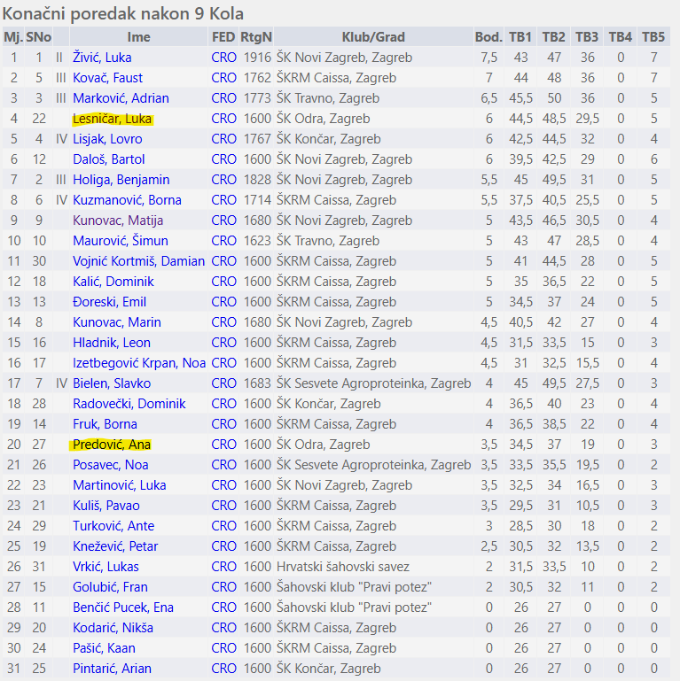
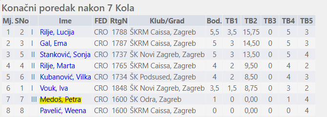

Petra, Jakov, Ana, Luka, Filip, Emanuel, Bartol, Lucia Lesničar i Slavko nastupili su na ovogodišnjem prvenstvu Zagreba. [Turnir](https://chess-results.com/tnr1139111.aspx?lan=13&art=1&fed=CRO) se održavao od **16\. 3. do 30. 3. 2025.** u **OŠ Ivana Mažuranića**. Igralo se tempom **30+30**, a kako su se zapisivali potezi, omogućena je i kvalitetna analiza partija nakon mečeva.

**Ana Predović** osvojila je **1\. mjesto** u kategoriji **kadetkinja do 11 godina**! Bravo za Anu! 👏 Nadamo se da će ju ovaj rezultat potaknuti na još više vježbe, te da ćemo se još puno puta veseliti njenim uspjesima.

**Luka** je također pokazao kako se trud isplati – zauzeo je odlično **4\. mjesto** u kategoriji **do 11 godina**.

**Slavko** je u samo **šest odigranih kola** skupio **5 bodova** i završio na **11\. mjestu** u kategoriji **kadeta do 15 godina**. Šteta što nije odigrao cijeli turnir.

**Filip Horvat**, **Emanuel** i **Bartol** natjecali su se u kategoriji **kadeta do 13 godina**. **Bartol** je zauzeo **10\. mjesto** sa **4,5 boda**. Dečki trebaju „zagrijati stolicu“ i redovnije vježbati kako bi postigli još bolje rezultate.

**Jakov** se natjecao u kategoriji **kadeta do 9 godina**, dok je **Petra** nastupila među **kadetkinjama do 13 godina**.

**Lucia Lesničar** je predstavljala naš klub u kategoriji **kadetkinja do 15 godina**.

Na kraju, možemo reći da je **nastupila većina naših kadeta**, što nas veseli i čini ponosnima. Bitno je da nastave trenirati, vježbati, truditi se – i **bolji rezultati sigurno će doći!** ♟️💪

  

IvanV
