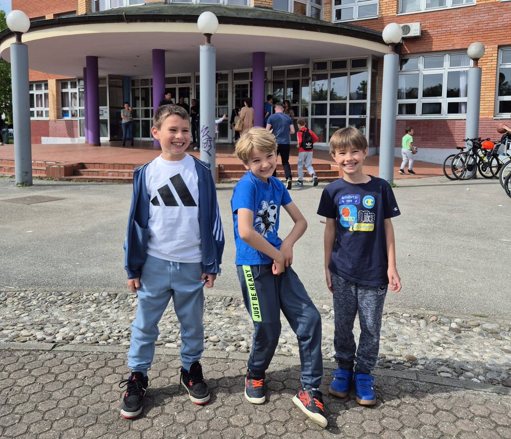
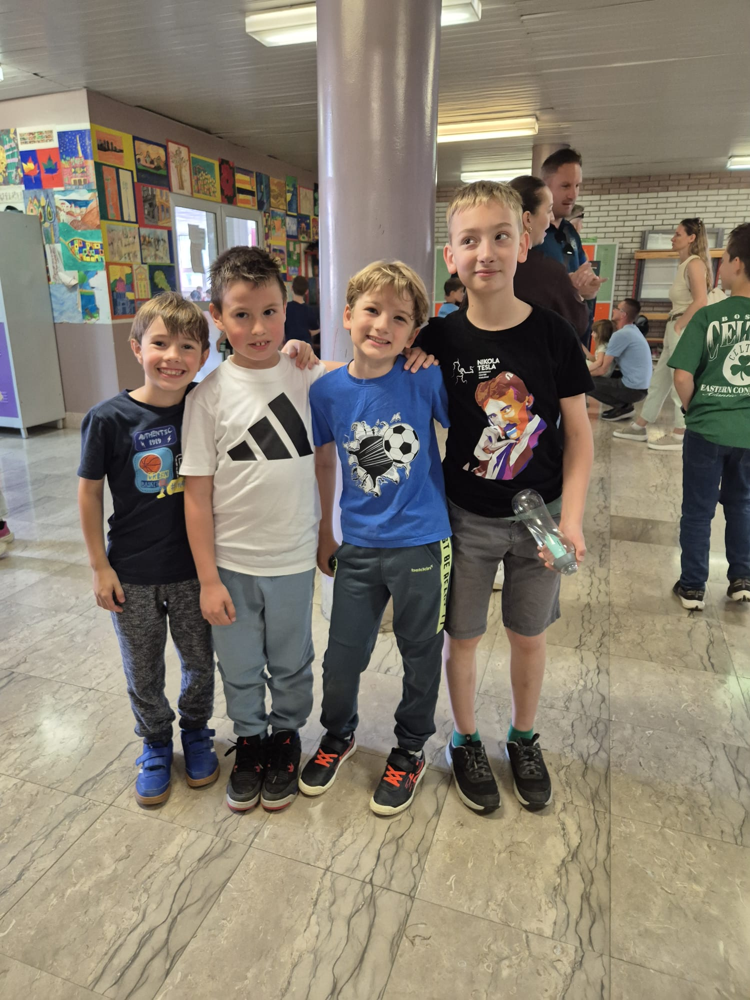

Ovogodišnja [pojedinačna kadetska prvenstva Grada Zagreba](https://s2.chess-results.com/tnr1401357.aspx?lan=15&art=0&turdet=YES&SNode=S0) održala su se 9. i 10. svibnja u OŠ Vrbani. Prvenstvo se igralo kroz 7 kola, tempom 20+5, odnosno 20 minuta po igraču uz dodatak od 5 sekundi za svaki odigrani potez.

Tempo od 20+5 nešto je brži nego prošle godine, što po našem mišljenju nije najbolja odluka organizatora. Djeci bi više odgovarao sporiji tempo igre koji im omogućuje dovoljno vremena za razmišljanje i zapisivanje poteza, a samim time i kvalitetniju analizu odigranih partija nakon meča. Upravo kroz analizu vlastitih partija mladi igrači mogu najbolje uočiti pogreške i napredovati.

Na ovogodišnjem prvenstvu naš Šahovski klub Odra predstavljali su Lucia Lesničar u konkurenciji kadetkinja do 15 godina, Luka Lesničar i Tomas Milovanović u konkurenciji kadeta do 11 godina te Lukas Carek, Milan Verić i Alan Vitaljić u konkurenciji kadeta do 9 godina.

**Lucia** nastupila je u konkurenciji kadetkinja do 15 godina i osvojila odlično 2. mjesto, čime je osvojila srebrnu medalju! Čestitamo Luciji na sjajnom rezultatu! 👏🥈

**Luka** je završio na vrlo visokom 4. mjestu i bio nadomak medalje. Za samo jedno mjesto izmaklo mu je postolje, ali rezultat je svakako vrijedan pohvale. Čestitamo Luki na odličnom nastupu! 👏

Posebno nas veseli što se ove godine nekolicina naših najmlađih članova ozbiljno zainteresirala za šah. Redovito dolaze na treninge utorkom i petkom, igraju i sve više pokazuju želju za napretkom.

Ako nastave ovako redovito trenirati i sudjelovati na turnirima, vjerujemo da bi se već dogodine mogla složiti dobra i perspektivna kadetska ekipa.

Čestitamo svim našim kadetima na nastupu! Najvažnije je nastaviti trenirati, igrati, učiti iz vlastitih partija i uživati u šahu. Bolji rezultati sigurno će doći! ♟️ 
