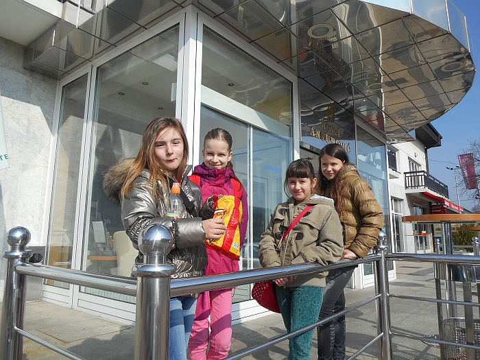
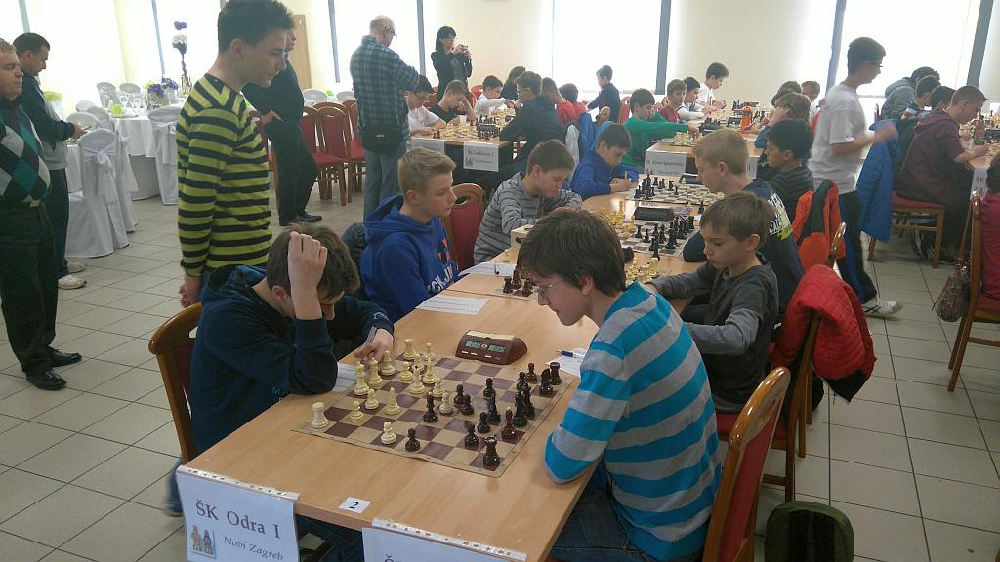
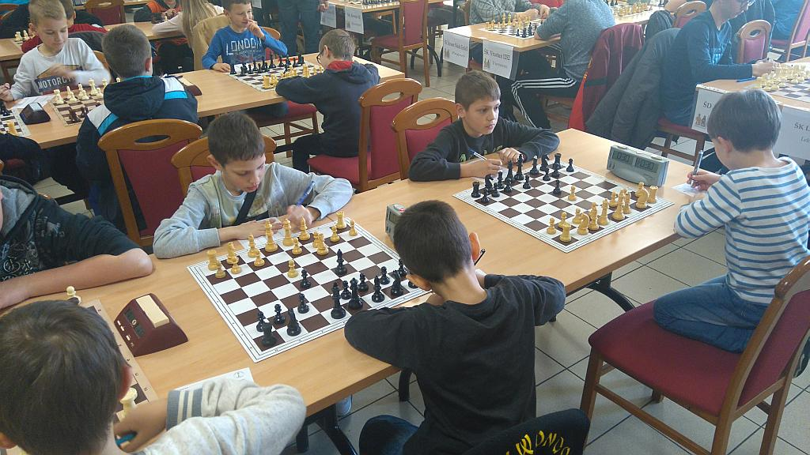
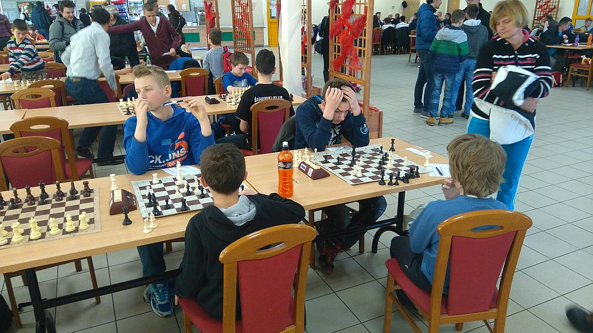
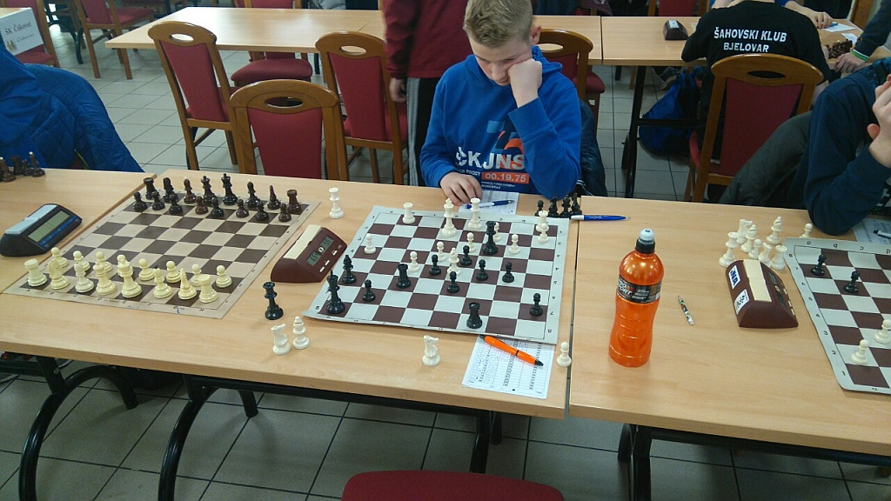
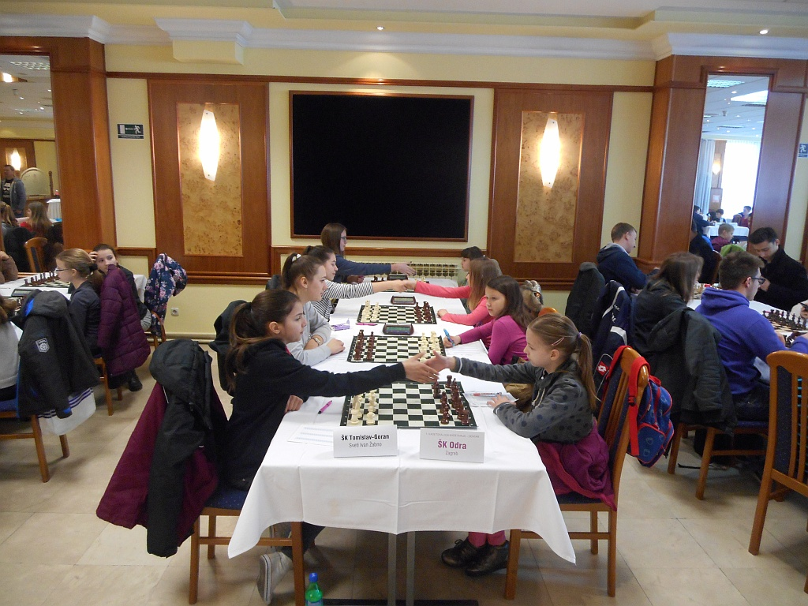
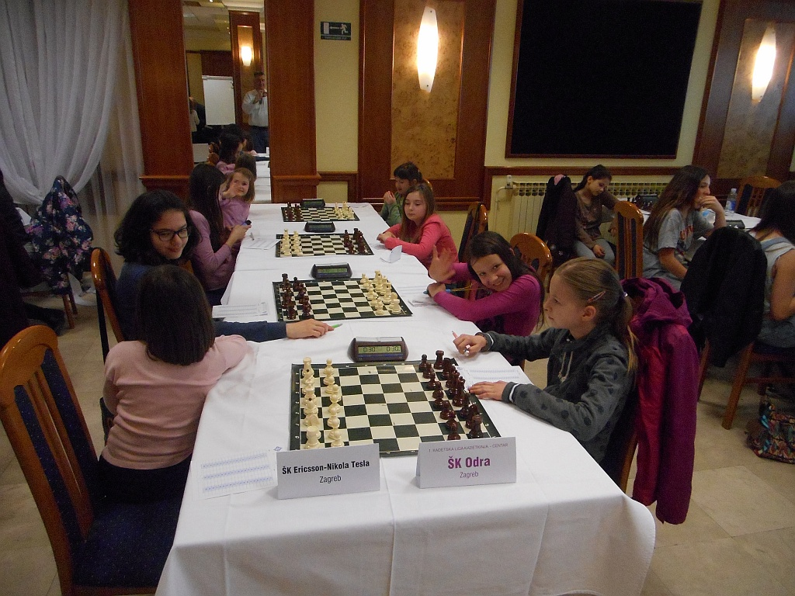
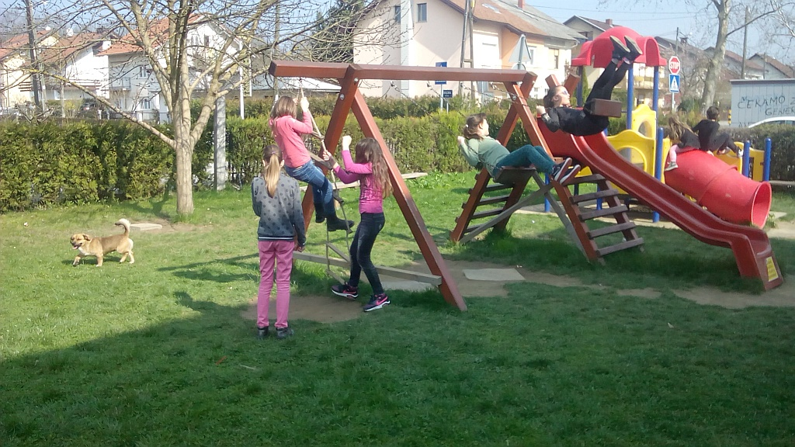
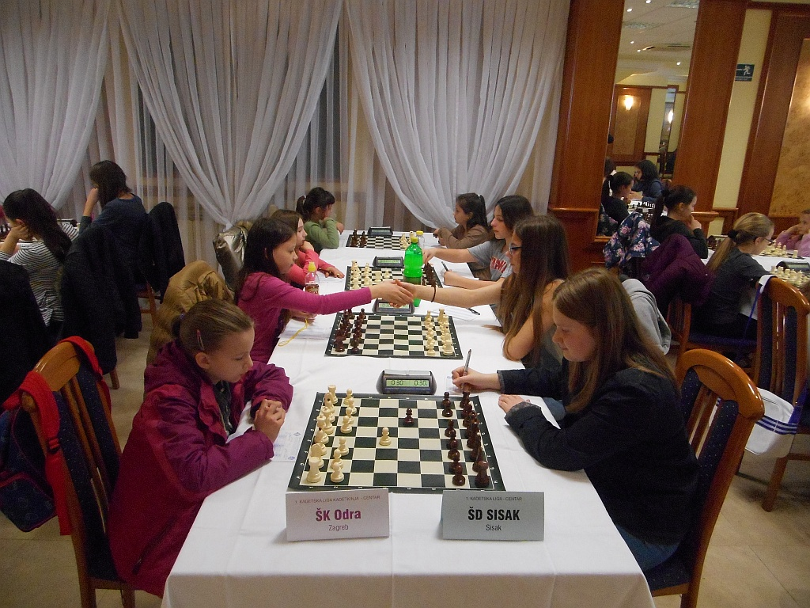

  
U subotu su nastavljene kadetske lige 2016. Dečki su igrali u Krapini, a djevojke u Sesvetskom Kraljevcu. Bilo je problema u sastavljanju druge kadetske ekipe jer se Josip nažalost razbolio, a ima vrlo malo prilika igrati. Razbolio se i Antonio, koji se još pomalo plaši nastupa. Nasreću, uskočila su braća Pisačići, Juraj i Petar. Juraj je u ovom krugu zabilježio dvije pobjede, a i Petar je na trećoj ploči uspio iščupati pola boda, tako da se može reći da su njih dvojica i prebacila normu! Druga ekipa u ovom je krugu igrala samo dva kola jer su jedno bili slobodni, ali su ubilježili i prvu pobjedu, a u šestom kolu umalo i drugu! Ekipa je igrala u sljedećem sastavu: Luka, Filip, Petar i Juraj.

Kao što se veselimo ekipnoj pobjedi druge ekipe, tako smo žalosni zbog ekipne pobjede prve ekipe. U subotu je, naime, ostvarena samo jedna pobjeda! Dečki su u četvrtom kolu pobijedili drugu ekipu Siska, zatim opravdano izgubili od ŠK Gardinovec, koji je vjerojatno i glavni favorit za osvajanje lige, ali su onda izgubili meč koji nisu smjeli izgubiti, protiv ŠK Caissa I. Tako su Gardinovec i Caissa zasjeli na prva dva mjesta na tablici, a naši dečki pali na peto mjesto i prije posljednjega kruga više ne ovise samo o sebi. Prva ekipa nastupila je u standardnom sastavu, Ivan, Vraneša, Kljujev, Bruno i Božo.

Djevojke, u sastavu: Anđela, Samanta, Katarina i Dora, također su odigrale drugi krug I. lige kadetkinja. Izgubile su sva tri meča, ali one, kao i druga ekipa kadeta, još uče o nastupima. Doru smo, kao i Hanu prošle subote, vodili prvi put i njezin prvi ekipni nastup dosta je dobro prošao. U prvoj partiji uspjela je pravilno razviti sve figure, bolje nego neke njezine starije kolegice. Šteta je samo što još ne zapisuje poteze. Između kola analizirale su se partije i vjerujem da su naučile još ponešto. Anđela igra dosta dobro i već u svakoj partiji ima izglede. Nadam se da će pružene prilike uskoro početi i prihvaćati. Samanta i Katarina još pomalo brkaju varijante, ali radit ćemo na tome da se to ispravi.

Sljedeći krug kadetskih liga igra se 9. travnja. Dečki igraju u Gornjemu Mihaljevcu, a djevojke u Varaždinskim Toplicama.

     
   

darko
