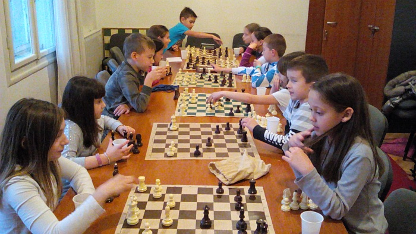
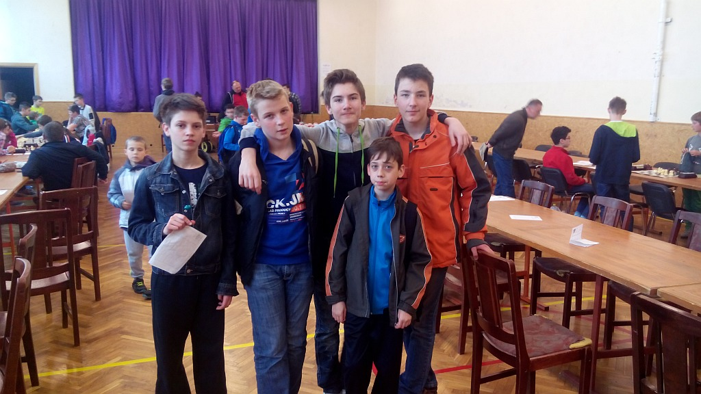
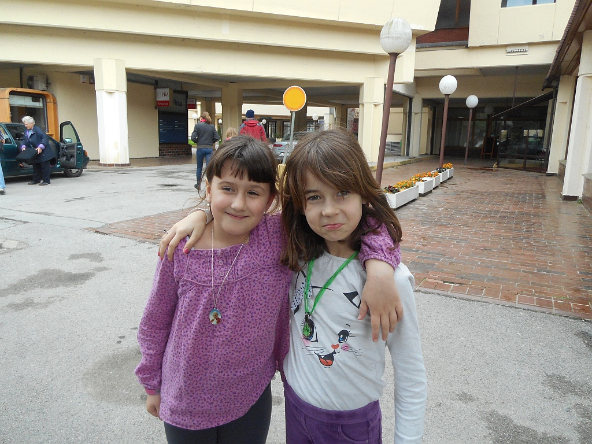
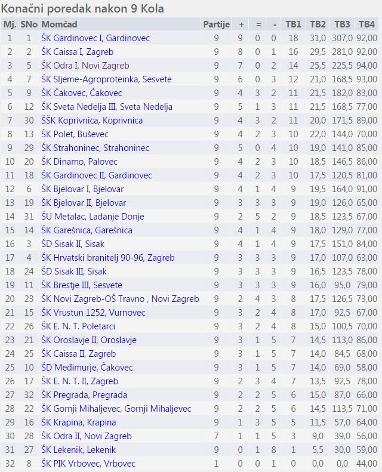
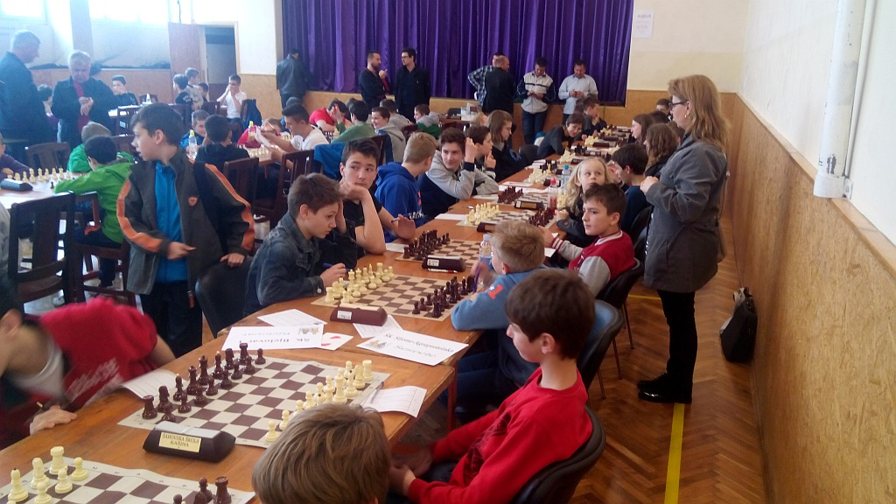
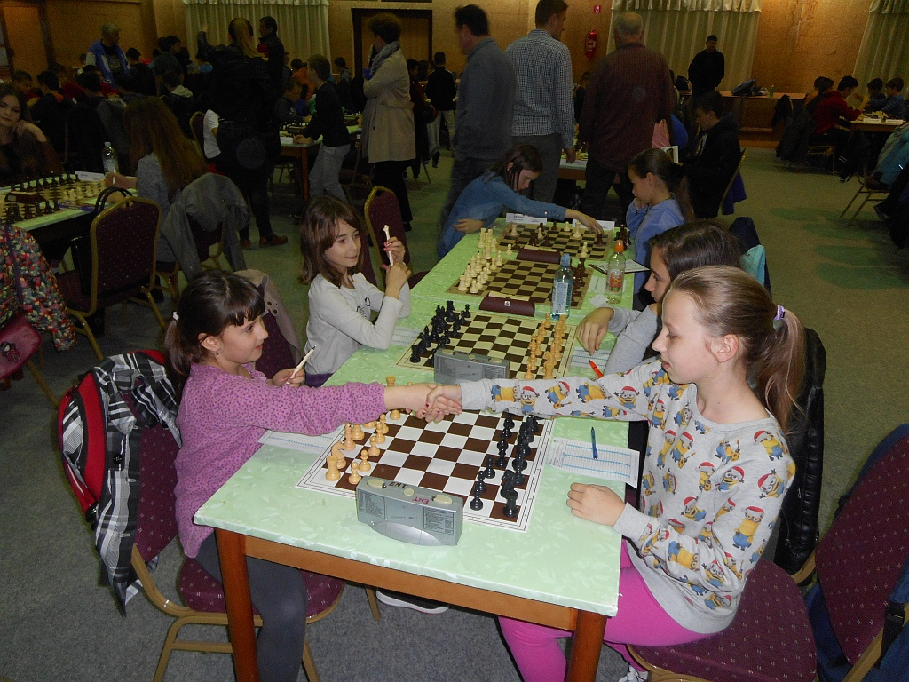
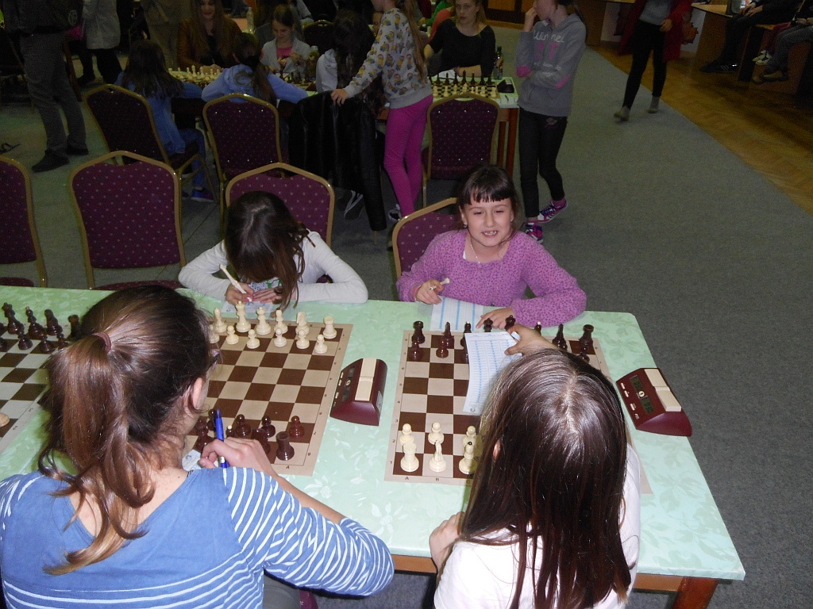

  
U subotu su završene kadetske lige. Dečki su igrali u Gornjemu Mihaljevcu, a cure u Varaždinskim Toplicama. Prvo o lijepim stvarima. **Dečki su osvojili treće mjesto**, a liga nije nimalo bezazlena. U toj njihovoj, četvrtoj ligi, ima mnogo jačih ekipa nego u drugoj ligi, ali to je stvar sustava natjecanja, za koji sam načuo da će se uskoro mijenjati. U subotu su pomeli protivnike u sva tri kola. Svi, osim Vraneše, imali su stopostotan učinak. Važno je zapisati da je Vraneša od prvog travnja ove godine i službeno naš treći kadet s osvojenom kategorijom! Ekipu djevojaka u ovom krugu predstavljale su Dora i Hana, kojima je to ujedno bio test iz pisanja. Naime, odnedavno je i najmlađa generacija djevojaka svladala zapisivanje partija. Od šest partija, pet je bilo čitljivo, što je postotak koje ni naše starije kadetkinje koje idu u četvrti razred ne uspijevaju postići. 🙂 Za nagradu su djevojčice dobile olovke u obliku kosti. Nadam se da će ih i ubuduće s uspjehom upotrebljavati .  
Lijepo je vidjeti da imamo kadetsku ekipu na koju se može računati. Članovi prve ekipe shvatili su ozbiljnost natjecanja i, ako je još prošle godine bilo malo nedoumica kod pojedinaca, više ih nema. Dečki su pouzdani i ne može im se dogoditi da preskoče neko od obvezatnih natjecanja. Dosta toga svjesno žrtvuju pa svaku drugu zabavu, kao rođendan ili gledanje utakmice, podređuju nastupu za Klub. Iako ih u ekipi igraju četvorica, svaki su put došla sva petorica i uredno se izmjenjivali po kolima, Ivan i Vraneša kao stalna postava, dok su se Božo, Kljujev i Bruno kao igrači podjednake snage izmjenjivali iz kola u kolo. Ove godine još ih očekuje nastup na Pojedinačnom prvenstvu Hrvatske, koje se u lipnju igra u Trogiru, a pridružit će im se i Luka, koji je igrao prvu ploču za drugu ekipu i koji također, bez obzira na godine (drugi razred!), pokazuje zrelost u pristupu natjecateljskom šahu.  
Spomenut ću i njihove roditelje, koji su ih vozikali, hranili, pazili i dali im svu potrebnu materijalnu i moralnu potporu u nastupima. A napredak kadeta itekako je vidljiv.  
Sad malo i o lošim stvarima. Bolestan je bio samo Luka, ali za treći krug nismo uspjeli sastaviti drugu ekipu, dok su nastup djevojaka u posljednjem krugu izvukle najmlađe. Neki imaju opravdanje, kao obveze vjeronauka, ali mnogi nemaju. Još doživljavam da mi roditelji kažu: “Sutra idemo u goste, ali ići će on sljedeći vikend.” Neće. Sljedeći se vikend ne igra. Neki se ne žele ni javiti i reći u čemu je problem, a neki svojoj djeci jednostavno ne dopuste odlazak na natjecanje bez opravdanog razloga. Drugi problem koji se pojavljuje, jest kada djeca odluče da im je neka druga obveza prioritet, poput rođendana. To je opet zapravo prvi problem jer je roditeljska dužnost da djeci objasne i što znače obveze. Mnogi prevaljuju i više od sto kilometara da bi odigrali ligu, koja se igra samo tri subote, a onda im se protivnička ekipa ne pojavi. Nije korektno.  
Vjerujem da ne moram objašnjavati kako djecu katkad treba malo i “pogurati”. Šah je u pravom smislu riječi plemenita vještina, koju nije lako svladati. Nekad se malci i uplaše. Nekad im je teško igrati protiv jačih i starijih, nekad misle da neće dostići starije klupske kolege. A potrebno je više godina da im se počne slagati slika te da počnu i pobjeđivati. Tada je mrvicu lakše.  
Opet ću ponoviti, Pojedinačno prvenstvo Zagreba, Kadetska liga i Prvenstvo osnovnih škola: to su turniri koji se ne smiju propustiti. Od ove godine pod obvezne turnire ide i klupsko prvenstvo jer ono određuje ekipe, i školske i klupske. Svima je dobar primjer ove godine dala Ana, koja zbog bolesti nije mogla nastupiti na Pojedinačnom prvenstvu Zagreba, ali je naknadno odigrala pojedinačno u starijoj skupini kada je mogla. Svi drugi nastupi i više su nego dobrodošli jer se isključivo igrom na turnirima može napredovati i utvrditi ono što vježbamo u klubu. Prihvatljivih turnira nema previše, a često su i skupi. Ove godine dobili smo i poziv za “malu ligu”, ligu školskih ekipa osnovnih škola Novog Zagreba. Nažalost, iako je to savršen izbor za igranje, ne košta, a i odgovara po snazi, teško se odlučiti na prihvaćanje takve obveze kad se uzmu u obzir teškoće u sastavljanju ekipa, tj. odnos prema tim obvezama. Možda jednog dana…  
Svim kadetima i kadetkinjama koji su nastupili na ovogodišnjoj kadetskoj ligi, čestitke, a posebno dečkima iz prve ekipe čestitke na osvojenomu trećem mjestu!

darko

 

   
