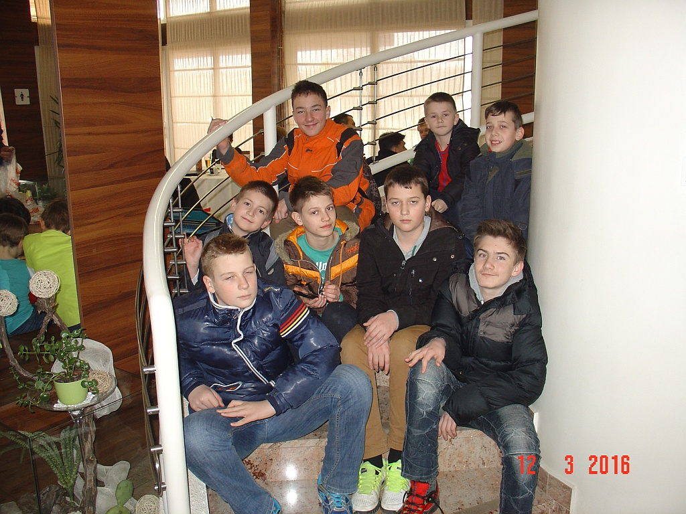
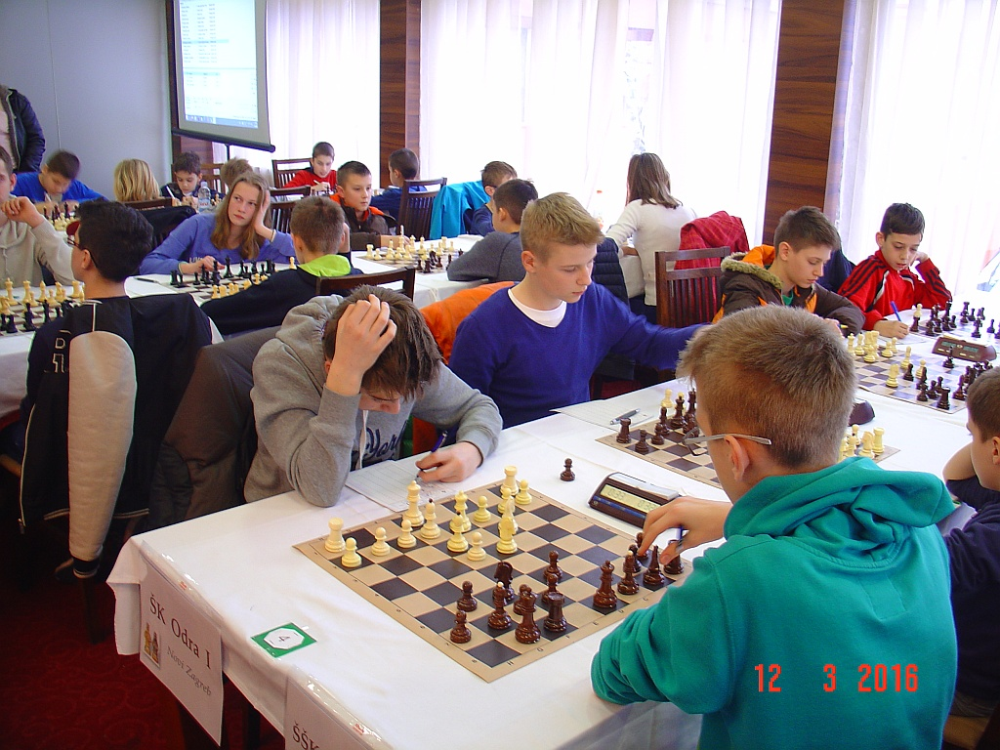
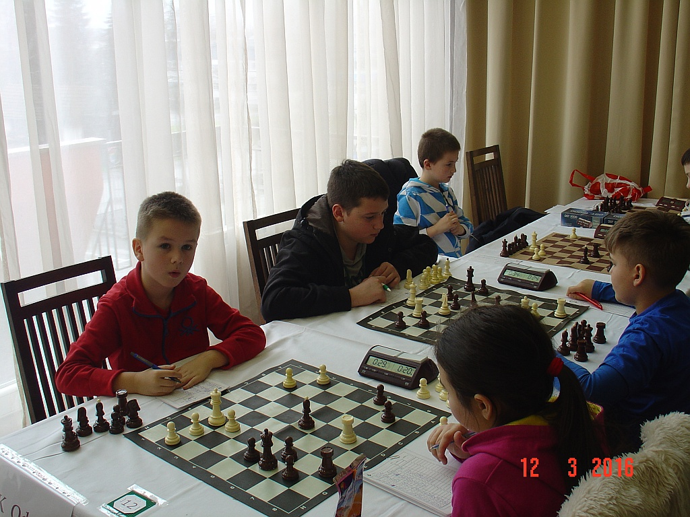
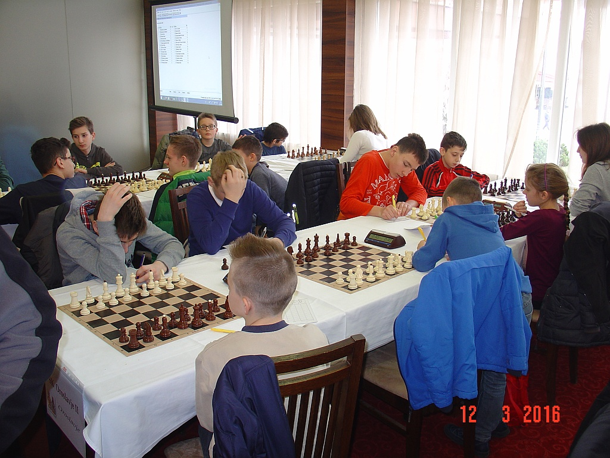
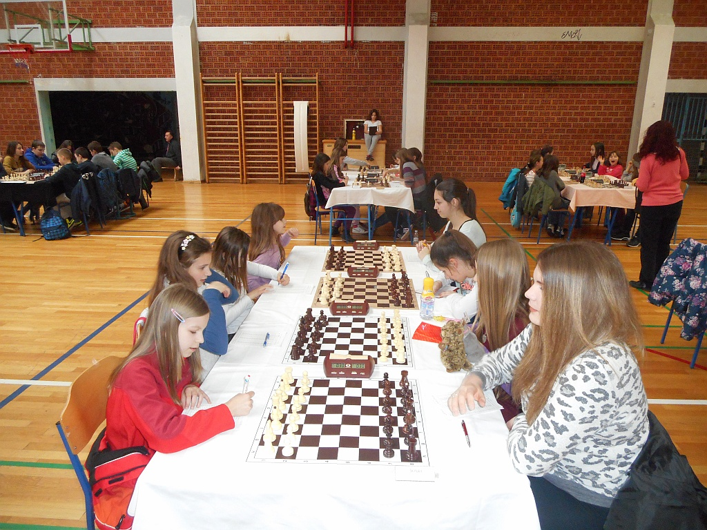
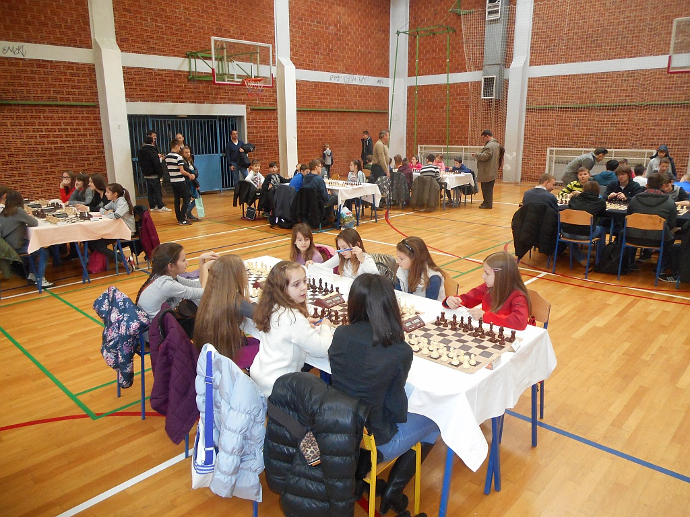
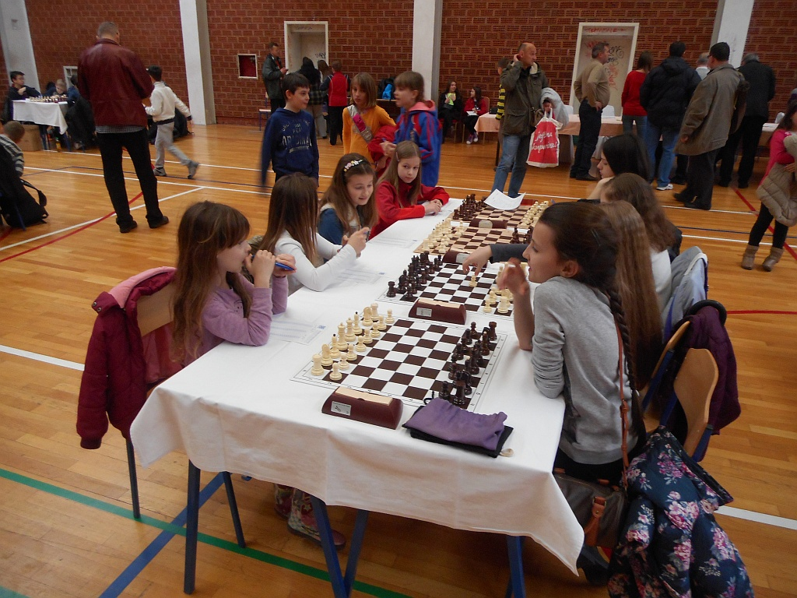
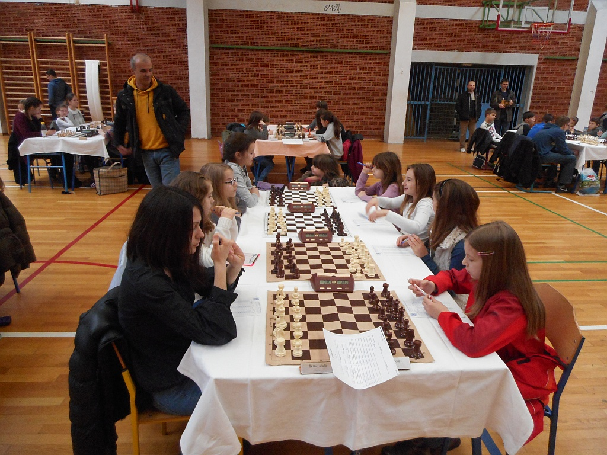

U subotu su počela ligaška natjecanja za kadete i kadetkinje. Kadetkinje nastupaju u I. kadetskoj ligi centar, dok su dečki (dvije ekipe) u IV. kadetskoj ligi centar. Od prve ekipe kadeta očekuje se da ove godine, u konkurenciji 32 ekipe, izbore jedno od prva dva mjesta koja vode u viši rang natjecanja sljedeće godine. Cure su još mlade i njihov je cilj u ovoj ligi (zasad) stjecanje iskustva, a za dvije-tri godine očekujemo i poneku pobjedu.  
Kadeti su prvi krug od tri kola igrali u Garešnici, prva ekipa u sastavu **Ivan, Vraneša, Kljujev, Bruno i Božo** (jedan je uvijek pričuva jer se igra na četiri ploče) ostvarila je tri uvjerljive pobjede, ali se još nisu susreli s pravom konkurencijom. Druga ekipa u sastavu **Luka, Filip i Josip** (jedan im je član nedostajao) izgubila je sva tri kola, ali su i Luka i Filip uspjeli uzeti po pola boda, dok su treće kolo bili u ozbiljnoj prilici i za meč-pobjedu. Njih su dvojica  inače i potencijalni kandidati za prvu ekipu koja je određena na pojedinačnom prvenstvu Kluba potkraj prošle godine. Josip nije uspio uloviti poneki bod, ali mu čestitamo na hrabrosti i na tome što je iskoristio priliku za prvi ekipni nastup (ove subote nije bilo vjeronauka). Kako su se Antonio, Juraj i Marko uplašili nastupa u posljednji trenutak, druga ekipa u ovom je krugu igrala s igračem manje. Trebali bi se ugledati na Petra, koji je bez straha nastupio i na Pojedinačnom prvenstvu Hrvatske u Sisku, ili na Hanu, koja je ove subote prvi put nastupila za ekipu Kluba iako je tek u drugom razredu.  
Djevojke su igrale dva kola, a prvi krug lige kadetkinja igrao se u Novom Zagrebu. Nastupile su **Anđela, Ana, Katarina i Hana.** Katarina je jedina uspjela osvojiti bod, dok je Hana bila blizu remiju u prvom kolu protiv protivnice iz sedmog razreda. Ana i Anđela su, iako su već prilično dobre, ipak imale prejake protivnice, ali su pružile dostojan otpor.  
Sljedeće subote dečki igraju u Krapini, a djevojke u Sesvetskom Kraljevcu. Početak je u 10 sati.  
[Rezultati, liga kadeta.](http://chess-results.com/tnr202662.aspx?lan=1&art=63&wi=821)  
[Rezultati, liga kadetkinja.](http://chess-results.com/tnr202663.aspx?lan=1&art=0&wi=821) 

     
     
darko
