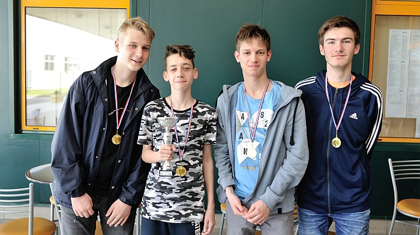
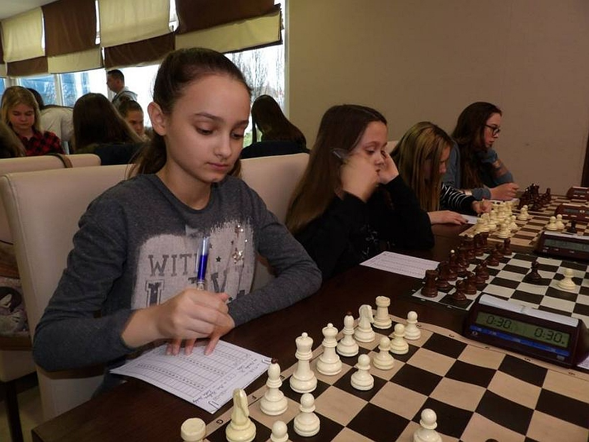
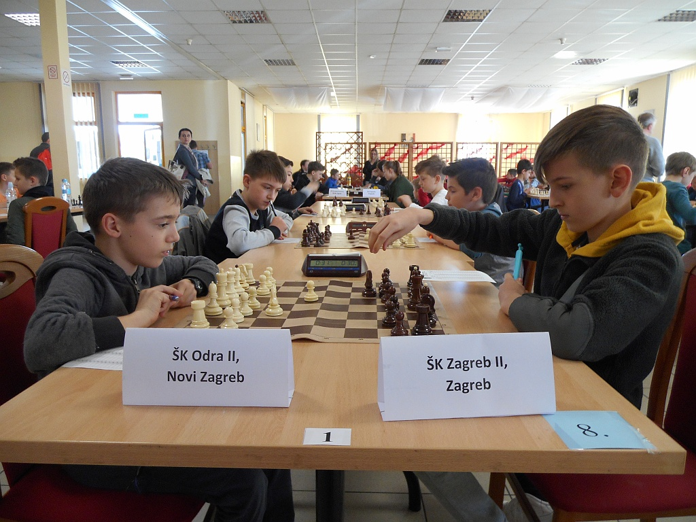
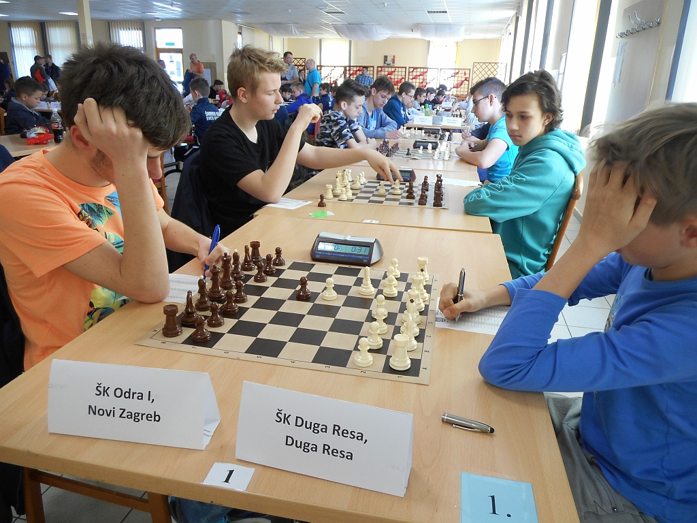
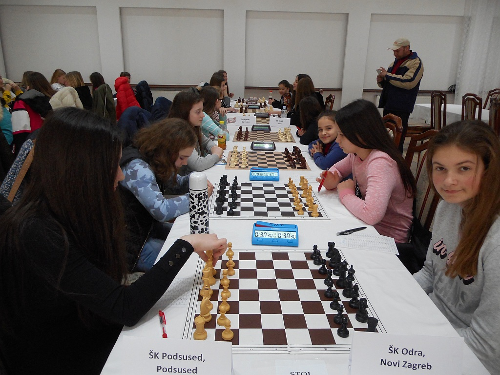
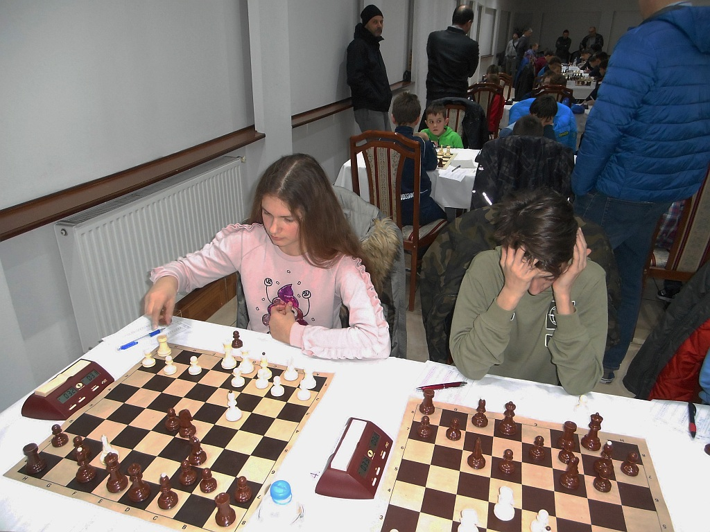
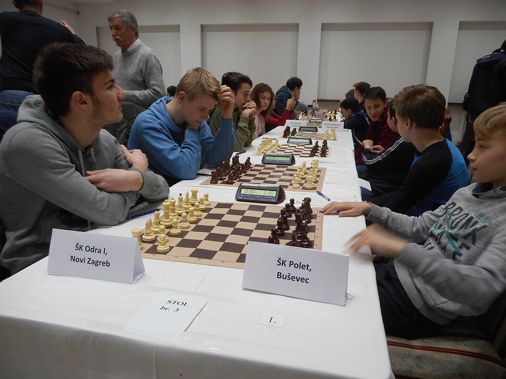
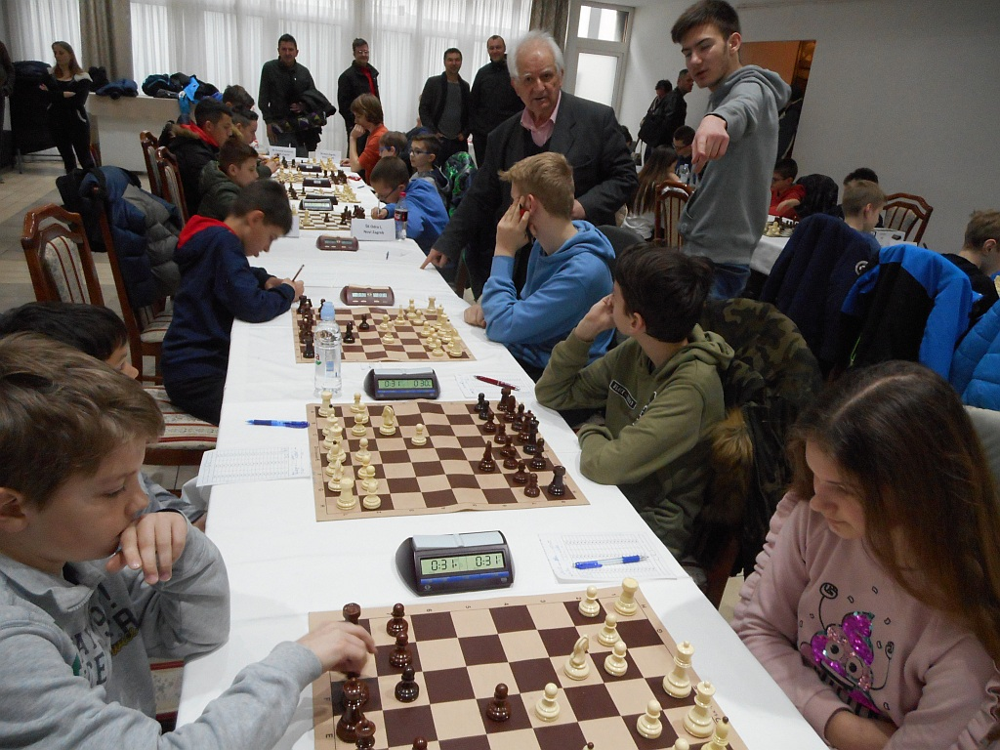
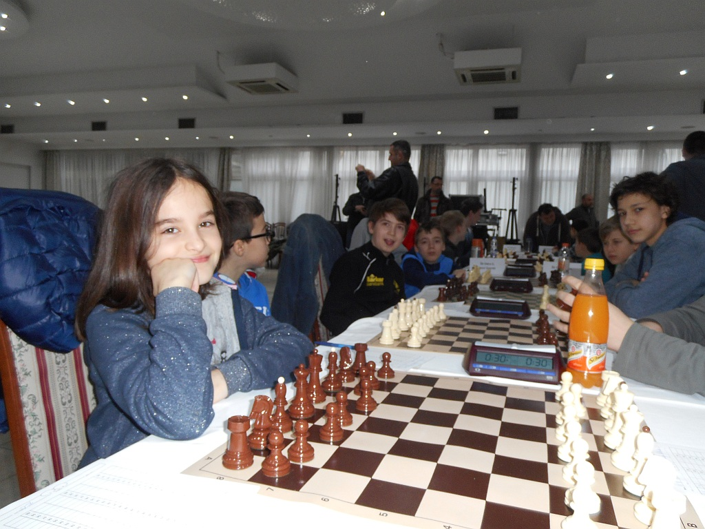

Kadetska ekipa ŠK Odra osvojila je prvo mjesto u [II kadetskoj ligi centar](http://chess-results.com/tnr334268.aspx?lan=13&art=0) ! Za ŠK Odra igrali su  **Ivan Maravić, Ivan Vraneša, Božo Cvetković, Bruno Kolovrat, Ivan Kljujev i Ana Kolovrat.**  Devet pobjeda u devet mečeva! Posebno impresivan rezultat su ostvarili Božo (8,5/9) i Ana (3/3). Liga je igrana u ožujku i travnju u Zagrebu (17.3. i 24.3.) i Krapini (14.4.). Bilo je i nekoliko teških mečeva, posebno protiv ŠK Podsused i ŠK Novi Zagreb. Nasreću, i u tim mečevima su ubilježili pobjede i na kraju turnira bezbrižno odigrali posljednje kolo jer su već osigurali prvo mjesto i plasman u I kadetsku ligu.  
I ove godine nastupili smo sa tri ekipe u kadetskim ligama. Dvije ekipe igrale su II kadetsku ligu, a djevojke su igrale [I ligu kadetkinja](http://chess-results.com/tnr334269.aspx?lan=13&art=0&turdet=YES). Djevojke su završile na sedmom mjestu, a slijedeće godine ćemo pokušati izboriti plasman među prve četiri ekipe. Ove godine nam to nije bio cilj. Velik napredak pokazale su Ana i Samanta. A Franka je ostvarila najbolji rezultat, 2,5/3. Druga kadetska ekipa je završila natjecanje na 17. mjestu, kako su bili rejtingirani i prije početka natjecanja. Druga ekipa služi da bi se mlađi članovi pripremali za buduće uspjehe. To su dobro iskoristili Luka Matašić, Filip, Josip, Amar i Botica. A Josip je ostvario i dobar rezultat. Filip i Botica igraju sve bolje, ali im (zasad) nedostaje rezultat. Oni će, uz Luciju, morati vježbati kombinatoriku. Na ovom natjecanju profilirale su se i buduće školske ekipe, obzirom da čak četvorica igrača od slijedeće godine nisu više osnovnoškolci, u ekipu ulaze novi članovi. Također, vrlo vjerojatno će osim Ane još jedna djevojka upasti i u prvu ekipu kadeta. Vidjet ćemo, ovisi koliko će raditi na šahu. Ove godine, zakazao je jedino Luka Fiolić. U ključnim trenucima dao je prednost nogometu te tako ispao iz ekipe. Još jednom, čestitke svima, a posebno članovima prve kadetske ekipe na ovom impresivnom rezultatu.

II kadetska liga centar – Konačni poredak nakon 9 kola

<table><tbody><tr><td>Mj.</td><td>SNo</td><td>Momčad</td><td>Partije</td><td>&nbsp; +</td><td>&nbsp; =</td><td>&nbsp; –</td><td>&nbsp;TB1</td><td>&nbsp;TB2</td></tr><tr><td><strong>1.</strong></td><td>4</td><td><strong><a style="color: #ff0000;" href="http://chess-results.com/tnr334268.aspx?lan=13&amp;art=20&amp;snr=4" target="_blank" rel="noopener">ŠK Odra I, Novi Zagreb</a></strong></td><td>9</td><td><strong>9</strong></td><td><strong>0</strong></td><td><strong>0</strong></td><td>18</td><td>29,0</td></tr><tr><td>2.</td><td>3</td><td><a href="http://chess-results.com/tnr334268.aspx?lan=13&amp;art=20&amp;snr=3" target="_blank" rel="noopener">ŠK Novi Zagreb, Novi Zagreb</a></td><td>9</td><td>7</td><td>1</td><td>1</td><td>15</td><td>28,5</td></tr><tr><td>3.</td><td>1</td><td><a href="http://chess-results.com/tnr334268.aspx?lan=13&amp;art=20&amp;snr=1" target="_blank" rel="noopener">ŠK E.N.T. I, Zagreb</a></td><td>9</td><td>5</td><td>2</td><td>2</td><td>12</td><td>22,0</td></tr><tr><td>4.</td><td>5</td><td><a href="http://chess-results.com/tnr334268.aspx?lan=13&amp;art=20&amp;snr=5" target="_blank" rel="noopener">ŠK Podsused, Podsused</a></td><td>9</td><td>4</td><td>3</td><td>2</td><td>11</td><td>22,5</td></tr><tr><td>5.</td><td>12</td><td><a href="http://chess-results.com/tnr334268.aspx?lan=13&amp;art=20&amp;snr=12" target="_blank" rel="noopener">ŠK Donja Stubica</a></td><td>9</td><td>3</td><td>5</td><td>1</td><td>11</td><td>22,0</td></tr><tr><td>6.</td><td>6</td><td><a href="http://chess-results.com/tnr334268.aspx?lan=13&amp;art=20&amp;snr=6" target="_blank" rel="noopener">ŠK Duga Resa, Duga Resa</a></td><td>9</td><td>4</td><td>2</td><td>3</td><td>10</td><td>20,5</td></tr><tr><td>7.</td><td>11</td><td><a href="http://chess-results.com/tnr334268.aspx?lan=13&amp;art=20&amp;snr=11" target="_blank" rel="noopener">ŠK Polet, Buševec</a></td><td>9</td><td>5</td><td>0</td><td>4</td><td>10</td><td>20,0</td></tr><tr><td>8.</td><td>2</td><td><a href="http://chess-results.com/tnr334268.aspx?lan=13&amp;art=20&amp;snr=2" target="_blank" rel="noopener">ŠK Ban Jelačić, Zaprešić</a></td><td>9</td><td>4</td><td>2</td><td>3</td><td>10</td><td>18,0</td></tr><tr><td>9.</td><td>10</td><td><a href="http://chess-results.com/tnr334268.aspx?lan=13&amp;art=20&amp;snr=10" target="_blank" rel="noopener">ŠK Sveta Nedelja II, Sveta Nedelja</a></td><td>9</td><td>3</td><td>3</td><td>3</td><td>9</td><td>18,0</td></tr><tr><td>10.</td><td>18</td><td><a href="http://chess-results.com/tnr334268.aspx?lan=13&amp;art=20&amp;snr=18" target="_blank" rel="noopener">ŠK Sveta Nedelja III, Sveta Nedelja</a></td><td>9</td><td>4</td><td>1</td><td>4</td><td>9</td><td>18,0</td></tr><tr><td>11.</td><td>9</td><td><a href="http://chess-results.com/tnr334268.aspx?lan=13&amp;art=20&amp;snr=9" target="_blank" rel="noopener">ŠK Zagreb I, Zagreb</a></td><td>9</td><td>4</td><td>1</td><td>4</td><td>9</td><td>18,0</td></tr><tr><td>12.</td><td>15</td><td><a href="http://chess-results.com/tnr334268.aspx?lan=13&amp;art=20&amp;snr=15" target="_blank" rel="noopener">ŠK Caissa II, Zagreb</a></td><td>9</td><td>4</td><td>1</td><td>4</td><td>9</td><td>17,5</td></tr><tr><td>13.</td><td>7</td><td><a href="http://chess-results.com/tnr334268.aspx?lan=13&amp;art=20&amp;snr=7" target="_blank" rel="noopener">ŠK Travno, Zagreb</a></td><td>9</td><td>4</td><td>1</td><td>4</td><td>9</td><td>15,0</td></tr><tr><td>14.</td><td>19</td><td><a href="http://chess-results.com/tnr334268.aspx?lan=13&amp;art=20&amp;snr=19" target="_blank" rel="noopener">ŠK Pregrada, Pregrada</a></td><td>9</td><td>4</td><td>0</td><td>5</td><td>8</td><td>17,0</td></tr><tr><td>15.</td><td>22</td><td><a href="http://chess-results.com/tnr334268.aspx?lan=13&amp;art=20&amp;snr=22" target="_blank" rel="noopener">ŠK Samobor II, Samobor</a></td><td>9</td><td>3</td><td>1</td><td>5</td><td>7</td><td>16,0</td></tr><tr><td>16.</td><td>23</td><td><a href="http://chess-results.com/tnr334268.aspx?lan=13&amp;art=20&amp;snr=23" target="_blank" rel="noopener">ŠK Zagreb II, Zagreb</a></td><td>9</td><td>2</td><td>3</td><td>4</td><td>7</td><td>15,5</td></tr><tr><td>17.</td><td>17</td><td><a style="color: #ff0000;" href="http://chess-results.com/tnr334268.aspx?lan=13&amp;art=20&amp;snr=17" target="_blank" rel="noopener">ŠK Odra II, Novi Zagreb</a></td><td>9</td><td>2</td><td>3</td><td>4</td><td>7</td><td>15,0</td></tr><tr><td>18.</td><td>16</td><td><a href="http://chess-results.com/tnr334268.aspx?lan=13&amp;art=20&amp;snr=16" target="_blank" rel="noopener">ŠK Krapina, Krapina</a></td><td>9</td><td>2</td><td>3</td><td>4</td><td>7</td><td>14,0</td></tr><tr><td>19.</td><td>14</td><td><a href="http://chess-results.com/tnr334268.aspx?lan=13&amp;art=20&amp;snr=14" target="_blank" rel="noopener">ŠK Hrvatski branitelj 90-96, Zagreb</a></td><td>9</td><td>2</td><td>2</td><td>5</td><td>6</td><td>14,0</td></tr><tr><td>20.</td><td>13</td><td><a href="http://chess-results.com/tnr334268.aspx?lan=13&amp;art=20&amp;snr=13" target="_blank" rel="noopener">ŠK Končar, Zagreb</a></td><td>9</td><td>1</td><td>4</td><td>4</td><td>6</td><td>13,0</td></tr><tr><td>21.</td><td>8</td><td><a href="http://chess-results.com/tnr334268.aspx?lan=13&amp;art=20&amp;snr=8" target="_blank" rel="noopener">ŠK Zaprešić, Zaprešić</a></td><td>9</td><td>2</td><td>2</td><td>5</td><td>6</td><td>13,0</td></tr><tr><td>22.</td><td>21</td><td><a href="http://chess-results.com/tnr334268.aspx?lan=13&amp;art=20&amp;snr=21" target="_blank" rel="noopener">ŠK Laufer, Sv. Križ Začretje</a></td><td>9</td><td>1</td><td>4</td><td>4</td><td>6</td><td>12,0</td></tr><tr><td>23.</td><td>20</td><td><a href="http://chess-results.com/tnr334268.aspx?lan=13&amp;art=20&amp;snr=20" target="_blank" rel="noopener">ŠK E.N.T. II, Zagreb</a></td><td>9</td><td>1</td><td>3</td><td>5</td><td>5</td><td>10,5</td></tr></tbody></table>

       

darko
