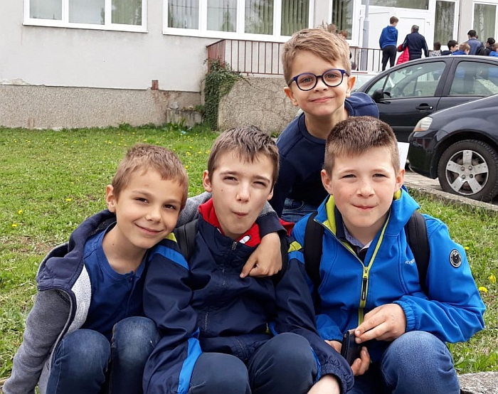
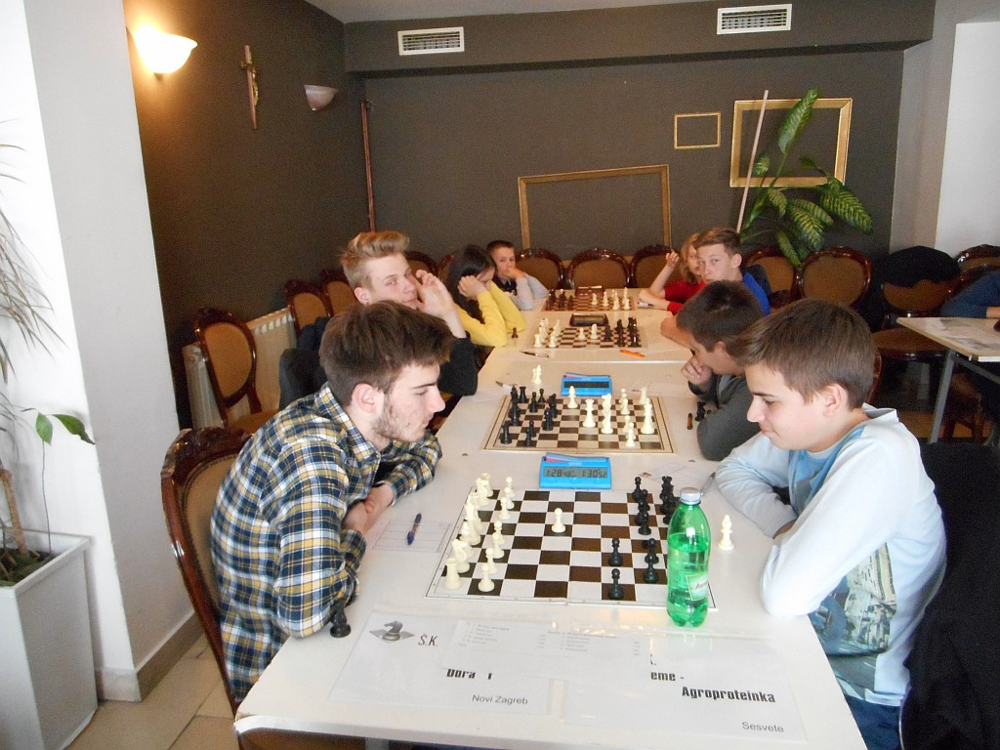
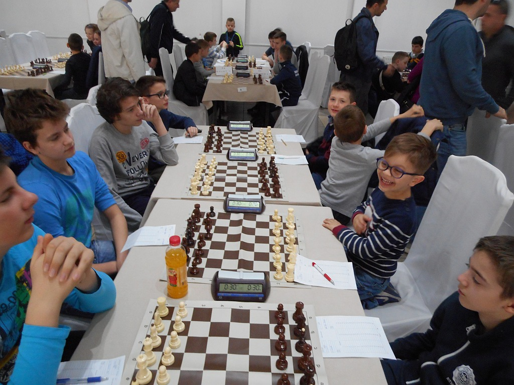
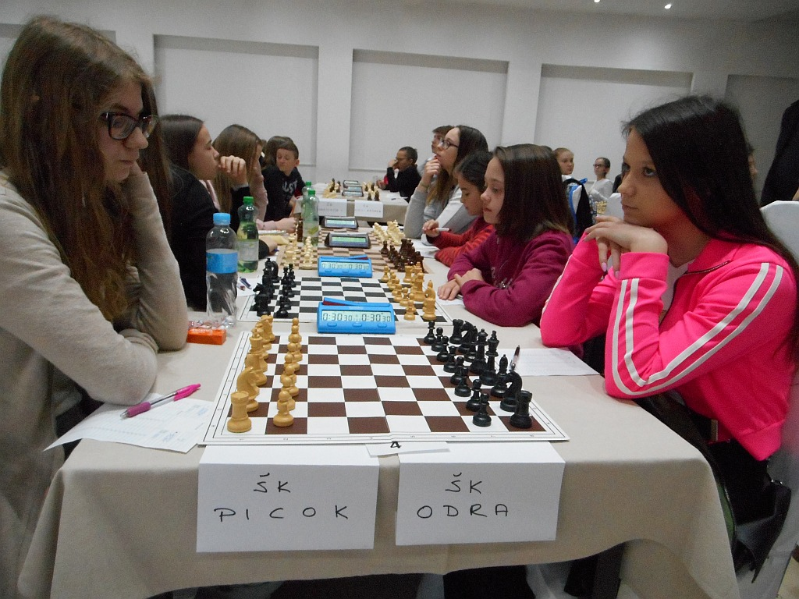
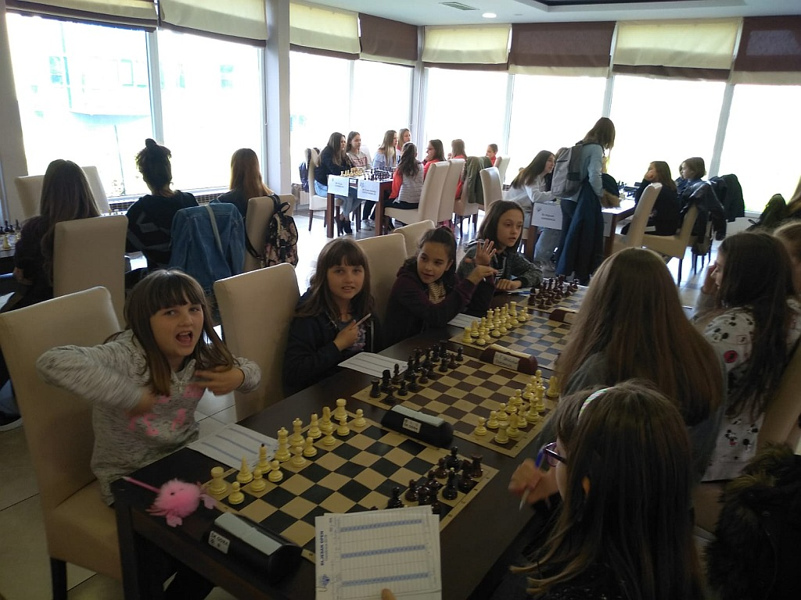
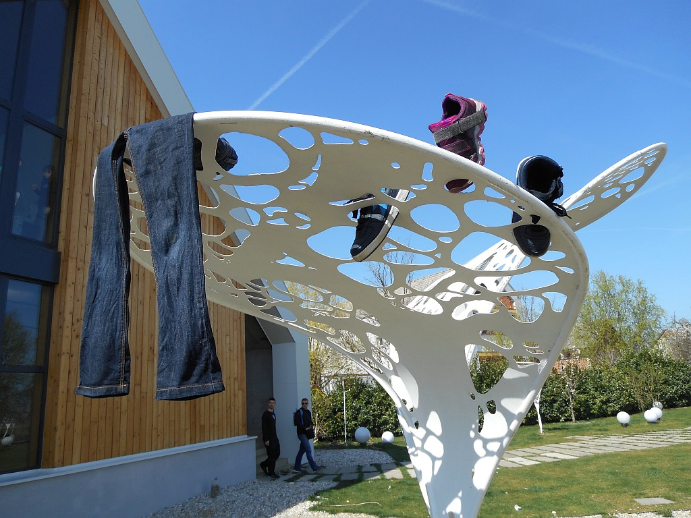
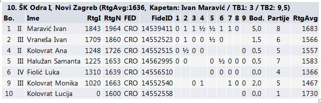
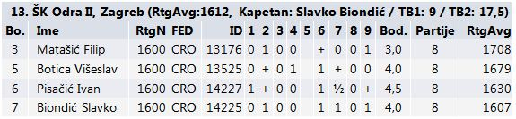
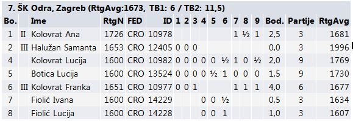

Završile su kadetske lige 2019. Igralo se subotama, a lige su se igrale u Sesvetama, Zagrebu, Čakovcu, Rakovom potoku, Donjoj Stubici, Vurnovcu i Kutini. Nastupili smo s tri ekipe. U [prvoj ligi](http://chess-results.com/tnr418471.aspx?lan=13&art=0), u [drugoj ligi](http://chess-results.com/tnr418473.aspx?lan=13&art=0) i [ligi kadetkinja](http://chess-results.com/tnr418475.aspx?lan=13&art=0). Pomalo zbunjujuće, ali najbolji rezultat napravila je ekipa u drugoj ligi sa dva šestogodišnjaka u ekipi. Dečki su usput naučili i zapisivati poteze, a pravo pisanje naučit će za godinu dvije, kada počnu pohađati osnovnu školu. 🙂 Dečki igraju već vrlo dobar šah, a nastave li trenirati, za koju godinu bit će respektabilna ekipa. Ivanda je zasad najbolji u pristupu, a od Filipa očekujemo da počne malo više vježbati. Višeslav je već savladao neke velike prepreke, ne predaje više partije kada previdi materijal, a i bolje podnosi poraze. Slavko je napravio najbolji rezultat, kapetan je ekipe, ali još vodi borbu sa nekim svojim strahovima te zbog toga ne vježba na ispravan način. Djevojke nisu ostvarile neki veći pomak, barem što se tiče ligaškog nastupa, ali razlog leži u tome što su prednost dale igranju u prvoj ligi za dečke, tako da npr. Monika nije odigrala niti jednu partiju za žensku ekipu. Nažalost, iz prve lige smo ispali. Malo su rezultatski podbacili Vraneša i Samanta, dok od Luke nismo puno ni očekivali obzirom da ne vježba dovoljno. Ipak, pokazao je volju i nije mu kasno da se prihvati ozbiljnijeg rada. Talent ima. Priliku su dobile i Flucija i Fivana i dobro je iskoristile. Djevojke su nove u šahu, ali dosta vježbaju i vjerujem da će i one već za godinu dana dostići jednu višu razinu. Botica je ostvarila prilično nevjerojatan napredak, a sada joj slijedi period kada će morati naučiti igrati sporije. Franka je napravila jako dobra rezultat, ali nedovoljno radi. Lucija je ugodno iznenadila pokazavši da se može nositi i sa znatno više rangiranim protivnicama, ali ni ona ne radi dovoljno. Monika je sve bolja, radi na šahu i ostale su još samo neke finese koje mora savladati. Ana je pokazala svoju snagu u zadnjem krugu lige kadetkinja kada je napravila 2,5/3! Radi samostalno, a pomaže i mlađima. Ivan je bio standardno dobar, kako u igri, tako i u organizaciji. Roditelji su isto zaslužili sve pohvale i prijevoz su odradili bez greške. Sve u svemu, možemo biti zadovoljni ovogodišnjom ligom, posebno zbog novih igrača i igračica, Flucije, Fivane, Viska, Ivande, Slavka…  
     
   
