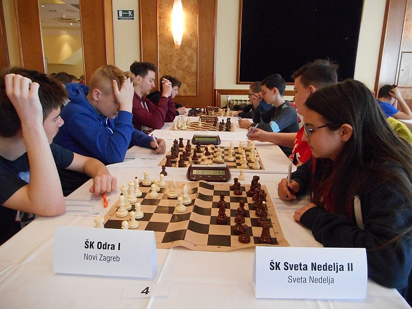
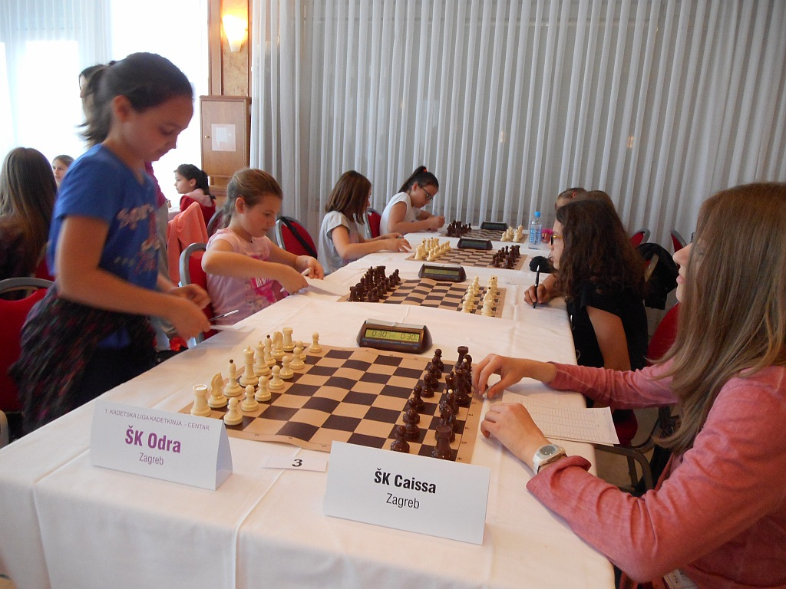
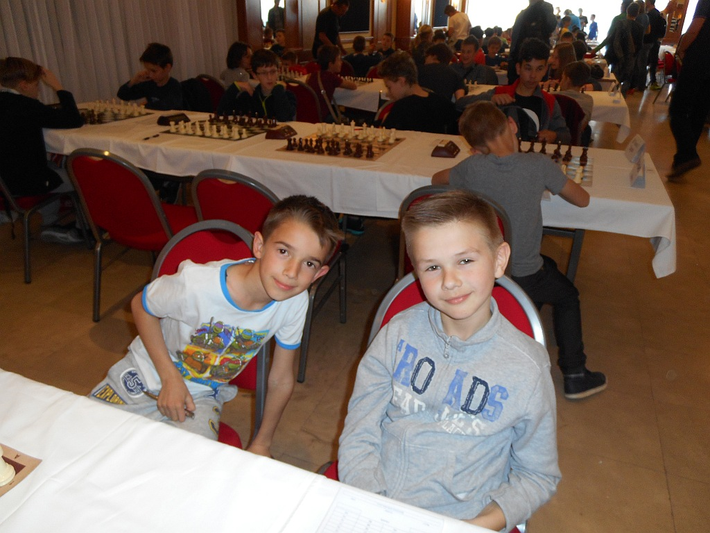
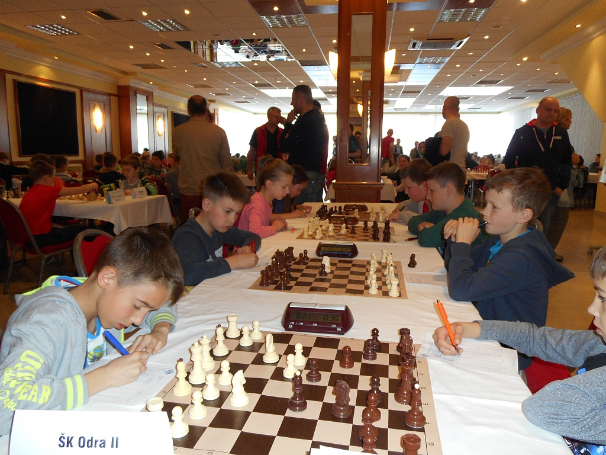
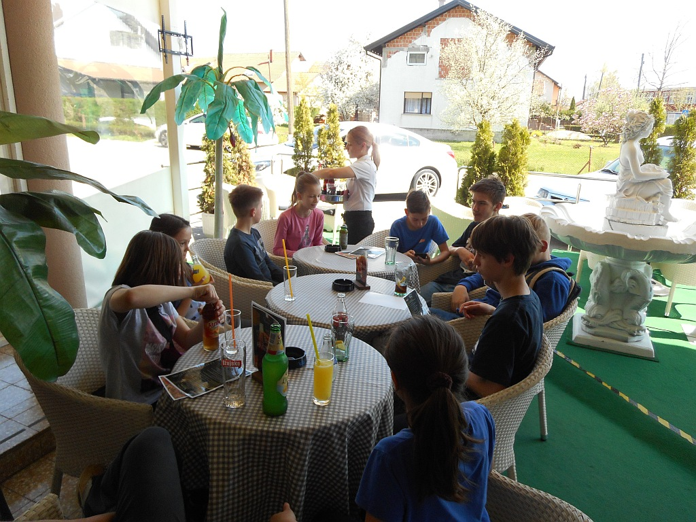

  
Jučer je u [Hotelu Antunović](http://www.hotelantunovicsesvete.com/) u Sesvetskom Kraljevcu odigran drugi krug kadetskih liga. Prva ekipa nastavila je s klimavim rezultatima, koji su ipak zamjetno bolji nego rezultati djevojaka ili druge ekipe, ali s obzirom na to da od njih najviše očekujemo, treba priznati da su malo podbacili. Nakon šest odigranih kola nalaze se na osmome mjestu. Zato su ostale ekipe pokazale i više nego što smo od njih očekivali. Druga ekipa uspjela je u petom kolu ubilježiti i ekipnu pobjedu, a djevojke su na ovom turniru ubilježile već drugu. Pojedinačno, lijep napredak pokazuju Luka Matašić, Samanta Halužan i Lucija Kolovrat. Od njih, posebno treba pohvaliti Luku, koji je u šestom kolu igrao partiju gotovo dva sata i uspio zadržati potrebnu koncentraciju te jedini ubilježio pobjedu. Monika i Katarina, koje trenutačno igraju bolje od ostatka ekipe, iz nekog razloga teško prihvaćaju savjete. Prva ekipa igrala je u standardnoj postavi, dok su djevojke uskakale u drugu ekipu kadeta jer Filip i Luka F. imaju druge obveze subotom prijepodne. Cijelo natjecanje prošlo je bez problema, a istomu se nadamo i sljedeće subote, kada dečki (druga ekipa napokon u prvoj postavi!) igraju u Krapini, a djevojke u Đurđevcu. Sponzor ovoga kruga natjecanja bio je tata Davor Kolovrat, koji je podmirio materijalne troškove i nahranio klince u popodnevnoj pauzi.  
[Rezultati kadeti](http://chess-results.com/tnr263254.aspx?lan=13)  
[Rezultati kadetkinje](http://chess-results.com/tnr263259.aspx?lan=13&art=0&wi=821)

   
