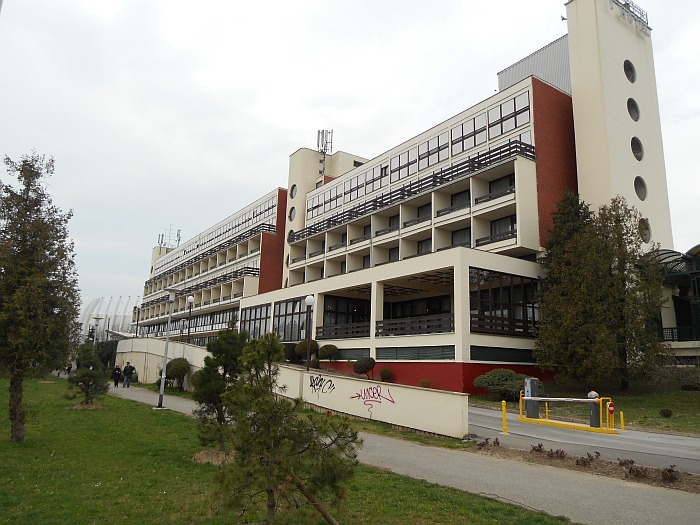
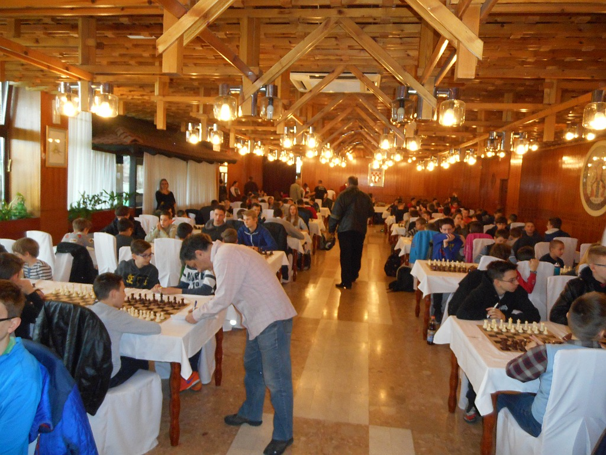
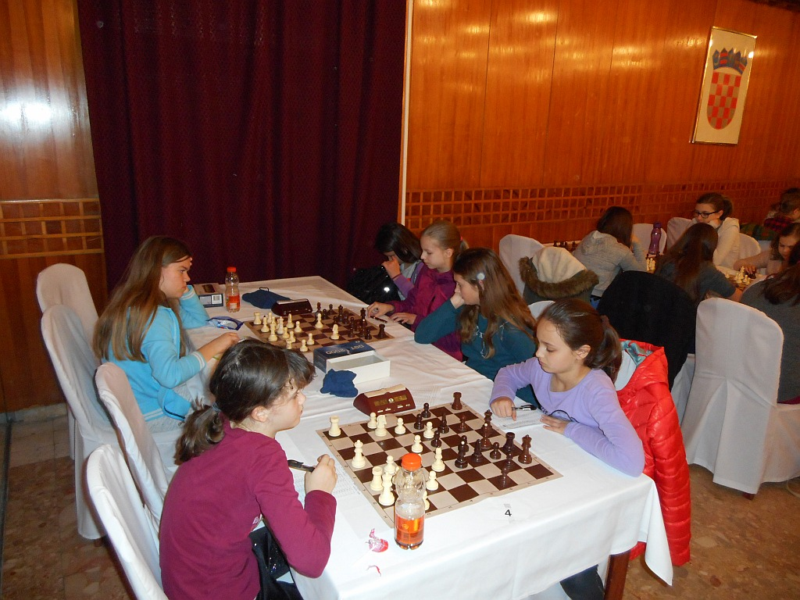
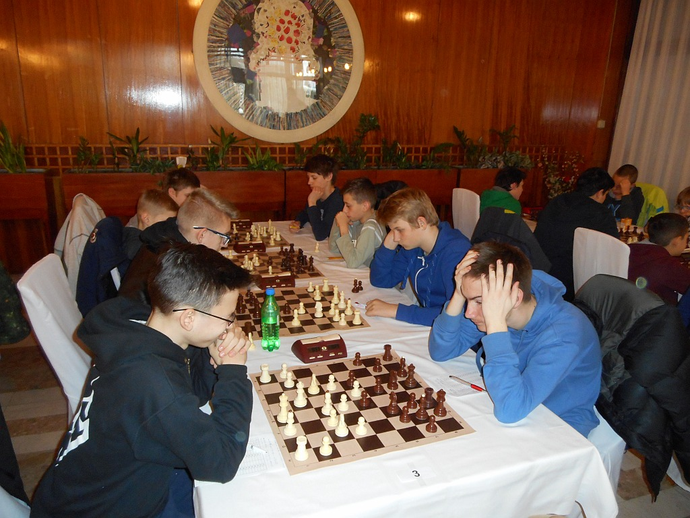
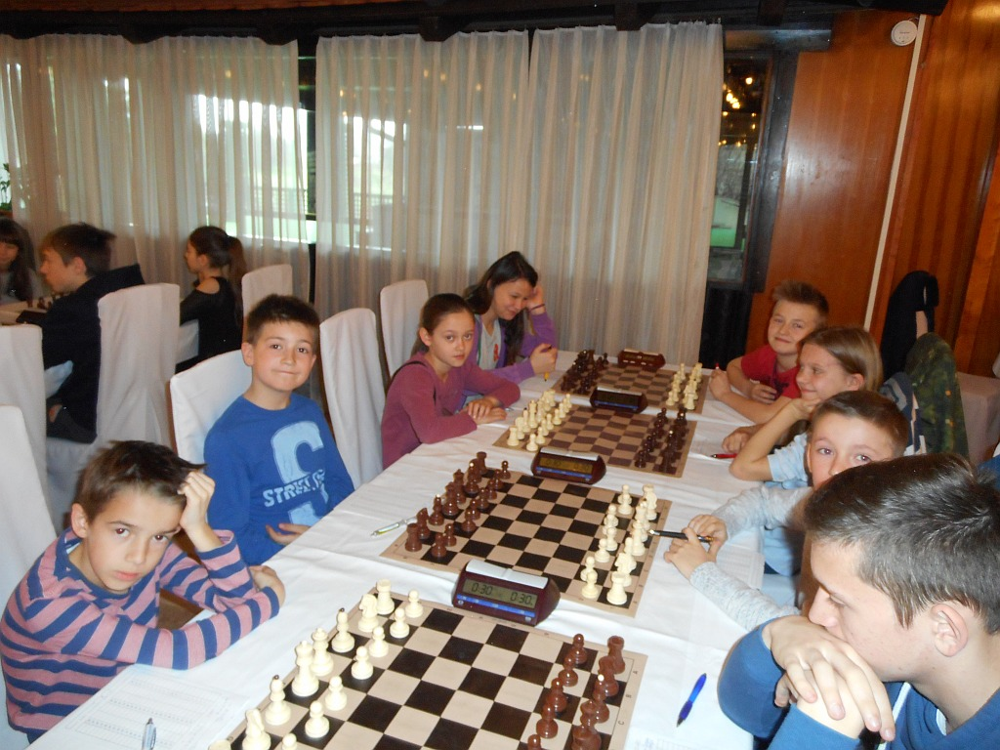
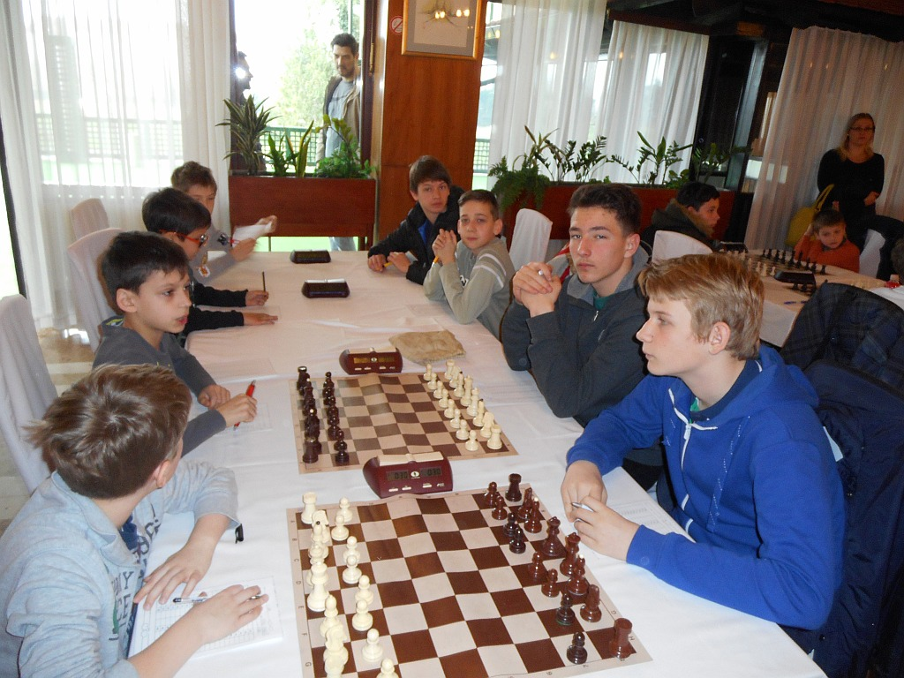

  
Jučer su se u [Hotelu I](http://www.hotel-i.hr/) u Zagrebu igrala prva tri kola kadetskih liga za 2017. ŠK Odra nastupa u II. A kadetskoj ligi i I. ligi kadetkinja.  U drugoj ligi nastupamo s dvije ekipe, prvom standardnom, u kojoj igraju Ivan, Vraneša, Kljujev, Božo i Bruno, te drugom ekipom, u kojoj bi prvu postavu trebali činiti Luka Fiolić, Luka i Filip Matašić te Josip Mahin. Kako dvojica od njih subotom imaju vjeronauk, ekipu su popunjavale djevojke, koje se koriste tom prilikom da odigraju što više partija koje su im nužne za napredak.  
**Prva ekipa** ostvarila je dvije pobjede protiv slabijih protivnika, ali su izgubili treće kolo čim su naišli na ravnopravne protivnike. Još pokazuju neke “dječje bolesti”. Vraneša je bio brzoplet, Božo nije iskoristio priliku za jednostavnu taktiku kojom je mogao osigurati barem pola boda (i time cijeli meč-bod), a i Ivan je na prvoj ploči odigrao treće kolo prilično nezainteresiran. Bruno i Kljujev nisu pak imali ravnopravne protivnike te su završili prvi krug sa 100% učinkom.  
**Druga ekipa** zasad pokazuje disciplinu na kojoj im se može pozavidjeti. Zapisivali su poteze, a to je jedan od prvih preduvjeta da bi počeli napredovati. Igrali su u dva kola, a u trećemu su bili slobodni. U drugoj ekipi samo je Lucija omastila brk i osvojila pola boda. Inače, u Klub su počeli dolaziti “neki novi klinci” pa vjerujem da će za godinu dana biti dovoljno dobri i da ćemo s lakoćom popunjavati drugu ekipu na ekipnim natjecanjima.  
**Djevojke** su, prvi put otkako igraju ovo klupsko natjecanje, ostvarile ekipnu pobjedu! Prošle godine u cijelom natjecanju imale su samo jedan pojedinačni bod, a sada, nakon tri kola, imaju tri meč-boda. Nažalost, kod njih se dogodio incident i Katarina je u drugom kolu bila nepravedno kontumacirana u dobivenoj poziciji. Sudac se zbog svoje pogreške naknadno ispričao. I u šahu se katkad događaju sportske nepravde, ali i dalje mnogo manje nego u drugim sportovima.  
**Liga** se nastavlja za dva tjedna, kada se igra u Sesvetskom Kraljevcu.  
   

[Rezultati kadeti](http://chess-results.com/tnr263254.aspx?lan=13&art=0&wi=821)  
[Rezultati kadetkinje](http://chess-results.com/tnr263259.aspx?lan=13&art=0&wi=821)

darko
