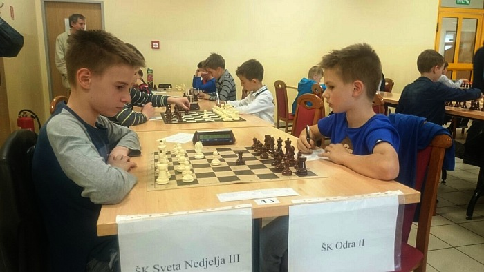
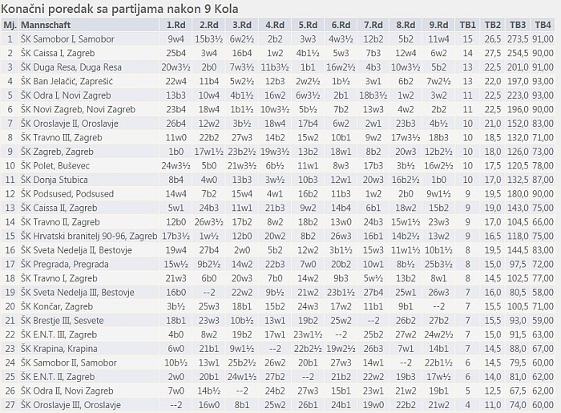
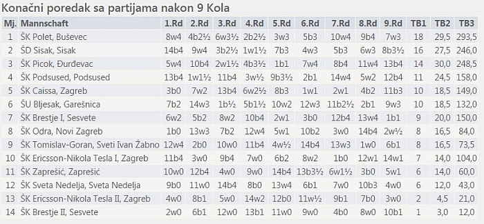
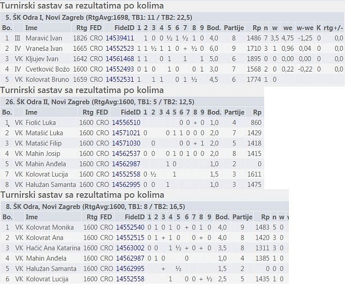

  
U subotu 8. travnja završene su kadetske lige za ovu godinu. Dečki su igrali u Krapini, a djevojke u Đurđevcu. Dečki još nisu sazreli za prvu ligu, prva ekipa osvojila je peto mjesto s 11 meč-bodova, a imala je malu šansu i za treće. U svakom slučaju, položaj na tablici realan je. Mlađa ekipa ovaj je krug odigrala u prvoj postavi i njima sam zadovoljan. Uredno zapisuju poteze i napreduju, što je ipak najvažnije. Osvojili su pet meč-bodova i to je dobar rezultat. Nadam se da će za koju godinu dostići razinu sadašnje prve ekipe.  
Djevojke su ove godine pokazale zamjetan napredak, napokon su se malo uozbiljile u pristupu, a počele su i pobjeđivati. Prvi put. Do ove godine nisu znale za ekipnu pobjedu, a sada su ih upisale čak tri, uz dva neodlučena susreta, i tako osvojile osam meč-bodova.

Drugu A kadetsku ligu zasluženo je osvojila ekipa **ŠK Samobor I** i tako se plasirala u prvu ligu.  
Prvu ligu kadetkinja osvojila je ekipa **ŠK Polet iz Buševca**, a prve četiri ekipe stekle su pravo igranja u završnici kadetskih liga.

U nastavku je poredak II. kadetske lige, I. lige kadetkinja i pojedinačni rezultati.

  
  
  
Više slika sa ovogodišnjih kadetskih liga može se naći u [galeriji](/galerija/).  
[KADETSKE LIGE 2017 bilten br.3](/files/wp/2017/04/KADETSKE-LIGE-2017-bilten-br.3.pdf)
