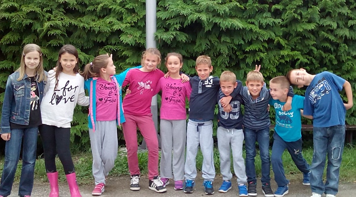

Kadetski turnir ŠK Odra, “MLAĐI KADETI ŠK ODRA 2015.” odigrat će se 26. i 27. rujna 2015.  

Turnir počinje u subotu u 14 sati u prostorijama Kluba. Turnir je za mlađe kadete, tj. za učenike nižih razreda. Očekujemo nastup 12 kadeta.

Tempo igre je 15 minuta po igraču, a nadamo se završiti turnir u nedjelju ujutro, kada se turnir nastavlja u 9.  
Termin je u dogovoru s roditeljima i kadetima izabran tako da se ne poklapa s nogometom, rođendanima, vjeronaukom i nedjeljnom misom.

Molimo sve da ne izostaju sa vjeronauka jer će vjerojatno trebati izostati jednu ili više subota, kada će igrati za ekipu osnovne škole.  
Dosad nikad nije bio problem izostati radi nastupa za školu pa vjerujemo da neće biti ni ove školske godine.

Također, molim roditelje da s najmlađima još jedanput ponove osnovne matove jer ne stignemo sve u terminima šahovske škole.
