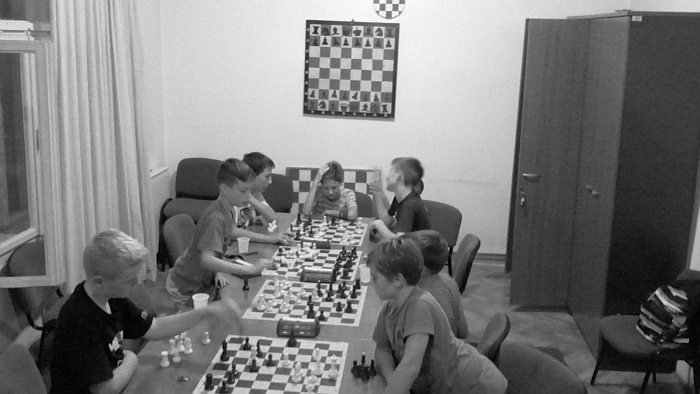

Kadetski turnir ŠK Odra, STARIJI KADETI ŠK ODRA 2015., odigrat će se 17. i 24. listopada.

Turnir počinje u subotu u 14 sati u prostorijama Kluba. Turnir je ponajprije namijenjen starijim kadetima ŠK Odra, tj. za učenike viših razreda. Očekujemo nastup 12 kadeta. Tempo igre je 20+3 (20 minuta plus tri sekunde po potezu). Obvezatno je zapisivanje poteza.  
Ovo je ujedno prvenstvo Kluba za starije kadete i kvalifikacije za nastup u prvoj ekipi 2016. godine, i u školskoj i u klupskoj.  
Kako imamo osam kandidata za ovo prvenstvo (Ivan, Božo, Vraneša, Bruno, Kljujev, Luka Fran, Filip i Stipe), a mjesta ima za nastup 12 igrača, ovo je idealna prilika i za četiri mlađa kadeta da se pridruže starijima, neopterećeni rezultatom, iskoriste izvrsnu priliku da zaigraju s jačim protivnicima, malo uvježbaju pisanje i nadasve za dobar trening. Iskreno se nadam da će tu priliku iskoristiti pobjednici turnira ŠK ODRA MK2015, Luka i Monika, te da će im se pridružiti još netko od mlađih kadeta, Josip, Anđela, Ana, Lucija… ili netko treći, tko god želi napredovati. (Prednost pri prijavi bit će prema rezultatima odigranog turnira za mlađe kadete.)  
Molim sve koji će nastupiti ili to žele da se prijave do srijede.

Šahovska škola u petak se nastavlja prema uobičajenom rasporedu, mlađi u pola sedam, stariji u pola osam. Svi kadeti trebaju donijeti olovku sa sobom. Oni koji imaju potvrde za školske iskaznice koje su im potpisali roditelji, neka ih ne zaborave donijeti.  Molim Katarinine roditelje da mi dostave podatke za kontakt.
