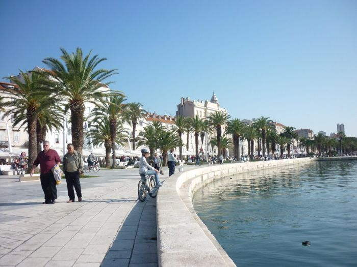

  
Ove će se godine Kadetsko prvenstvo Hrvatske igrati u Splitu od 20. do 26. lipnja u hotelu “Zagreb”, Put Duilova 23, u organizaciji HŠS-a i Šahovskog saveza Splitsko-dalmatinske županije. Raspis turnira je u  
[prilogu.](/files/wp/2015/05/IZMJENA-Kadet-prv-Hrv-2015.-raspis-sa-rasporedom.pdf "(IZMJENA! 17. lipnja 2015.) kadetsko, 2015., Split")  
Prošle godine na turnir su išla četiri kadeta, a ove godine ima i više kadeta koji su zalaganjem i radom zaslužili da se okušaju na završnom turniru. To se posebno odnosi na kadetkinje, koje su ove godine svladale i pisanje. Malo s učenjem otvaranja zapinju Vraneša i Luka, ali još ima vremena da sve stignu.  
Što se tiče smještaja, još smo u planovima. Najvjerojatnije ćemo moći smjestiti nekoliko kadeta kod Stipeta, još čekamo potvrdu, a računamo i na neke ujake i slično. 🙂  
Naravno, sve ovisi i o financijskim mogućnostima roditelja, a članovi Kluba pomoći će koliko mogu. Od voditelja, tu su Cvetko i Stipe, koji su i ove godine spremni ići i paziti na podmladak, a vjerojatno i Goran. Bilo bi dobro da i roditelji do petka 22. svibnja razmotre situaciju, želje i mogućnosti te da se taj petak u Klubu počnemo ozbiljnije dogovarati.

Kako je prvenstvo Hrvatske praktički posljednji turnir ove godine, bilo bi poželjno da zainteresirani kadeti odigraju [Kadetsko prvenstvo Varaždinske županije,](/files/wp/2015/05/RASPIS-OPEN-Varazdin-2015.pdf "Varaždin, raspis") koje se igra u petak, subotu i nedjelju. Još je važnije kada bi taj B-turnir odigrali kadeti koji su još u počecima šahovskog razvoja i nemaju iskustva na turnirima, kao Kljujev i Noa. Taj je turnir baš po mjeri za kadete, ali je malo nezgodan jer se prva kola igraju petkom pa nije lako organizirati prijevoz. Zasad znam da je iz Kluba u petak za prijevoz voljan uskočiti Cvetko, a nadam se i netko od roditelja pa neka odmah javi da znamo kakvi su nam kapaciteti.
