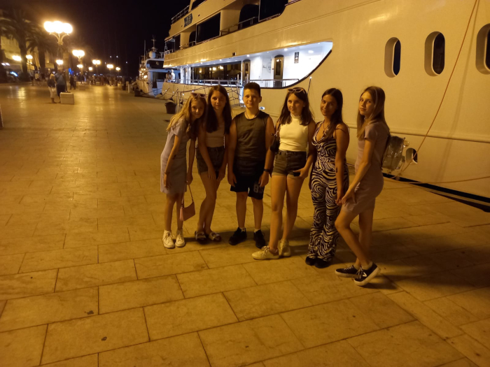

Pojedinačna kadetska prvenstva u šahu igrana su u Hotelu Medena u Segetu Donjem od 21. do 27. lipnja. Tempo igre bio je 90+30, a učesnici su morali osigurati ispravan šahovski sat, dok je organizator osigurao figure. Igralo se po skupinama, do 7, do 9, do 11, do 13 i do 15 godina starosti u kunkurenciji za djevojčice i otvorenoj konkurenciji. Nastupilo je šest članova ŠK Odra, Lucija Fiolić (17.), Ivana Fiolić (9.), Vjeka Vidra (20.), Iva Periša (24.) i Lucija Medoš (23.) u [konkurenciji djevojčica do 13 godina](http://chess-results.com/tnr644182.aspx?lan=13&art=1&rd=9&turdet=YES). Slavko Biondić (26.) je nastupio u [otvorenoj konkurenciji do 13 godina](http://chess-results.com/tnr644181.aspx?lan=13&art=1&rd=9&turdet=YES). Treba napomenuti da je do zadnjeg kola Ivana bila u borbi za medalju. Ekipa se zabavljala, i prema rječima višestrukih svjedoka “bila glasnija nego ikada :)”. Jedino što je nedostajalo je bilo šahovske ozbiljnosti jer je većina svoje partije završavala u sat vremena iako su na raspolaganju imali sat i pol! Ipak, i ove godine smatram da je prvenstvo uspješno odrađeno, nitko nije bio zadnji, Iva i Lucija Medoš su upisale svoj prvi nastup te čak i pobijedile koju partiju! Posao “stručnog stožera” su ove godine odradili Goran Fiolić i Ivan Cvetković. Nadamo se da će ovo ekipi biti poticaj za više rada na šahu i ozbiljniji pristup, svi imaju dovoljno vremena i interneta da odigraju jednu partiju dnevno, što bi već bilo dovoljno da se značajno podignu u igri do iduće godine.

Za kraj donosimo listu najbolje plasiranih po skupinama:

Ž7

1\. Nora Ljaljić ŠK Križevci 6,0  
2\. Karla Maračić ŠK Polet 5,5  
3\. Elena Poljak ŠK Petar Žaja 4,5

Ž9

1\. Natalie Osmanagić ŠK Novi Zagreb 7,5  
2\. Marta Rilje ŠKRM Caissa 7,0  
3\. Ema Gal ŠKRM Caissa 6,0

Ž11

1\. Agata Kokša ŠŠK Konaki 7,5  
2\. Renata Hranilović ŠK Garešnica 7,0  
3\. Lucija Rilje ŠKRM Caissa 6,0

Ž13

1\. Ema Hajdinić ŠK Kraljevica 8,0  
2\. Lara Zagorac ŠK Rječina 7,0  
3\. Diara Vučenović ŠK Sesvete Agroproteinka 6,5

Ž15

1\. Klara Begić ŠK Petar Sedlar – Pepe 8,0  
2\. Petra Karij ŠŠK Konaki 7,0  
3\. Josipa Zovko ŠK Slavonac 6,5

M7

1\. Faust Kovač ŠKRM Caissa 7,0  
2\. Josip Prgomet ŠK Mornar 7,0  
3\. Adrian Petani ŠK Zadar 7,0

M9

1\. Mihael Katić ŠK Sesvete Agroproteinka 8,0  
2\. Vedran Kaloci ŠK Đuro Đaković 7,5  
3\. Jakov Friščić ŠK Ivanec 7,0

M11

1\. Ivano Močić ŠK Šibenik 8,0  
2\. Erik Golubović ŠK Rijeka 8,0  
3\. Josip Mesić ŠK Samobor 6,0

M13

1\. Borna Pehar ŠK Mornar 7,5  
2\. Max Poljan ŠK Stridon 7,0  
3\. Bartol Šimunković ŠK Sveta Nedelja 7,0

M15

1\. Ivor Colev ŠK Stridon 7,0  
2\. Ivano Sundać ŠK Crikvenica 7,0  
3\. Marin Grgantov ŠK Petar Sedlar – Pepe 7,0

*IvanM*
