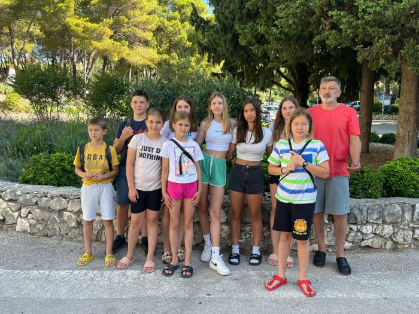
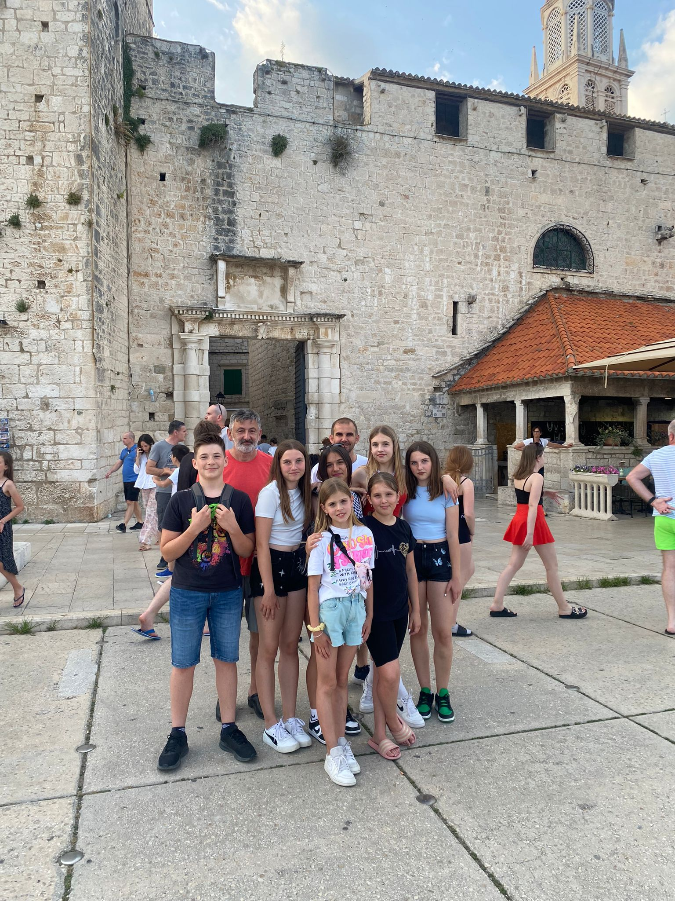

*[Pojedinačna kadetska prvenstva Hrvatske](https://chess-results.com/tnr773828.aspx?lan=13&art=4&turdet=YES) u šahu igrana su u Hotelu Medena u Segetu Donjem od 21. do 27. lipnja. Tempo igre bio je 90+30, a sudionici su morali osigurati ispravan šahovski sat, dok je organizator osigurao figuru. Igralo se po skupinama, do 7, do 9, do 11, do 13 i do 15 godina starosti u kunkurenciji za djevojčice i otvorenoj konkurenciji. Nastupilo je devet članova ŠK Odra, Lucija Fiolić , Ivana Fiolić , Vjeka Vidra , i Lucija Medoš igrale su u konkurenciji do 13 godina, Petra Medoš je igrala u konkurenciji do 11 godina, a Ana Predović u konkurenciji do 9 godina. Slavko Biondić nastupio je u  konkurenciji do 13 godina, Sesar Tvrtko igrao je u konkurenciji do 11 godina, a Sesar Vili je igrao u konkurenciji do 9 godina. Treba napomenuti da je do zadnjeg kola Petra bila u borbi za medalju. Ekipa se zabavljala, i prema riječima višestrukih svjedoka “bila glasnija nego ikada :)”. Jedino što je nedostajalo bila je šahovska ozbiljnost jer je većina svojih partija završila u sat vremena iako su na raspolaganju imali sat i pol! Ipak, i ove godine smatram da je prvenstvo uspješno odrađeno, nitko nije bio zadnji, Petra Medoš, Ana Predović, Vili Sesar i Tvrtko Sesar upisali su svoj prvi nastup te čak i pobijedile koju partiju! Posao “stručnog stožera” ove su godine odradili Goran Fiolić i Ivan Cvetković. Nadamo se da će ova ekipa biti poticaj za više rada na šahu i ozbiljniji pristup, svi imaju dovoljno vremena i interneta da odigraju jednu partiju dnevno, što bi već bilo dovoljno da se značajno podigne u igri do iduće godine.*

*Ivana Fiolić*

---

```pgn
[Event "Pojedinacno kadetsko prvenstvo Hrvatske - Z11"]
[Date "2023.06.26"]
[Round "9"]
[White "Medoš, Petra (1600)"]
[Black "Hranilović, Renata (1815)"]
[Result "1-0"]
[Variant "Standard"]
[Termination "Normal"]

1.e4 c5 2.Nf3 d6 3.Nc3 Nf6 4.Bc4 e6 5.d4 cxd4 6.Nxd4 a6 7.a4 b6 8.O-O Bb7 9.Re1 Be7 10.Bg5 O-O 11.Qd3 d5 12.Qg3 Nh5 13.Bxe7 Qxe7 14.Qf3 Nf6 15.exd5 Rd8 16.Rad1 Qc7 17.Bb3 Nxd5 18.h3 Nf4 19.Qg3 Bxg2 20.Nxe6! Rxd1?? {trebalo je igrati fxe6. } (20... fxe6 21. Bxe6+ Nxe6 22. Qxc7 Rxd1 23. Qc8+ Nf8 24. Rxd1 Nd7 25. Qc4+ Kh8 26. Kxg2 Nf6 27. Rd6)21.Qxg7# 1-0
```

---

Pobjednici:

**Kadetkinje U7:**

1.  Teodora Vukajlović– ŠK Trpinja, Trpinja
2.  Marita Piteša – ŠK Slavonac, Gradište
3.  Miriam Bučan – ŠK Brda, Split

**Kadeti U7:**

1.  Marul Juzbašić – ŠK Šahovski centar, Županja
2.  Lukas Stanišić – ŠK Novi Zagreb, Zagreb
3.  Mate Čolak – ŠKRM Caissa, Zagreb

**Kadetkinje U9:**

1.  Iva Vouk – ŠK Novi Zagreb, Novi Zagreb
2.  Marta Rilje – ŠKRM Caissa, Zagreb
3.  Nora Ljaljić – Šk Križevci

**Kadeti U9:**

1.  Luka Karlović – ŠK Veli Vrh, Pula
2.  Jakov Friščić – ŠK Ivanec, Ivanec
3.  Viktor Gašparec – ŠK Picok, Đurđevac

**Kadetkinje U11:**

1.  Renata Hranilović – ŠK Garešnica, Garešnica
2.  Lucija Rilje – ŠKRM Caissa, Zagreb
3.  Ema Gal – ŠKRM Caissa, Zagreb

**Kadeti U11:**

1.  Ivančić Ivan – ŠK Crikvenica, Crikvenica
2.  Erik Golubović – ŠK Rijeka, Rijeka
3.  Andrej Stojković – ŠK Pula, Pula

**Kadetkinje U13:**

1.  Lara Zagorac – ŠK Rječina, Dražice
2.  Iva Crvelin – GŠK Solin-Cemex, Solin
3.  Paula, Jurić – ŠK Radnik, Velimirovac

**Kadeti U13:**

1.  Zvan Sošić – ŠK Batana, Rovinj
2.  Jure Tadić – ŠK Zadar, Zadar
3.  Matija Mimica – ŠK Brda, Split

**Kadetkinje U15:**

1.  Ema Hajdinić – ŠK Kraljevica, Kraljevica
2.  Lara Marija Žagar – ŠK Sveta Nedelja, Sveta Nedelja
3.  Mia Dundović – ŠK Radnik, Velimirovac

**Kadeti U15:**

1.  Ivano Tomljanović – ŠK Crikvenica, Crikvenica
2.  Ivor Colev – ŠK Stridon, Štrigova
3.  Ivano Sundać – ŠK Crikvenica, Crikvenica
