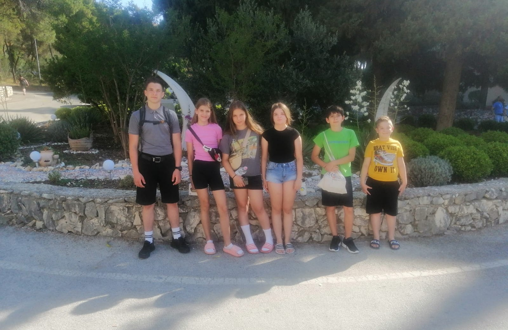
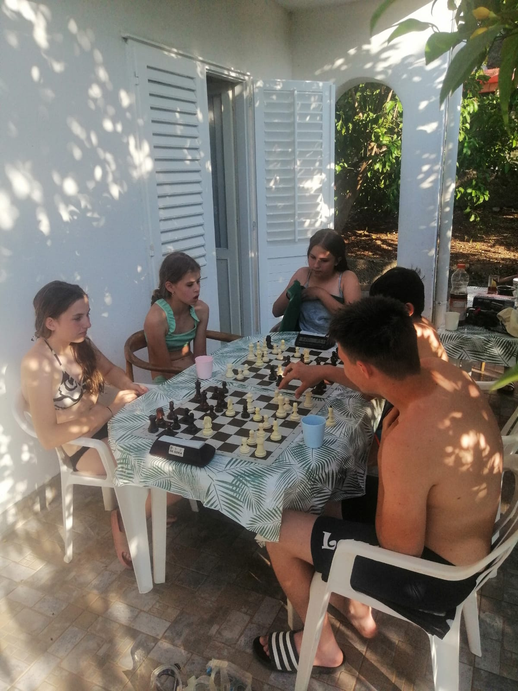
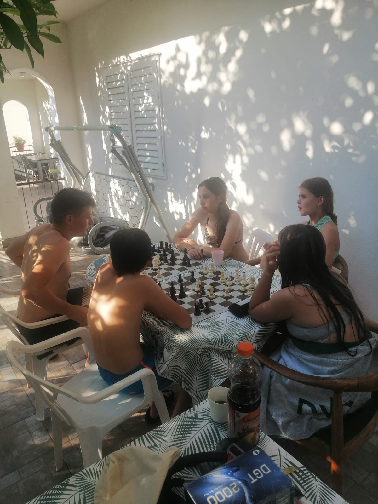
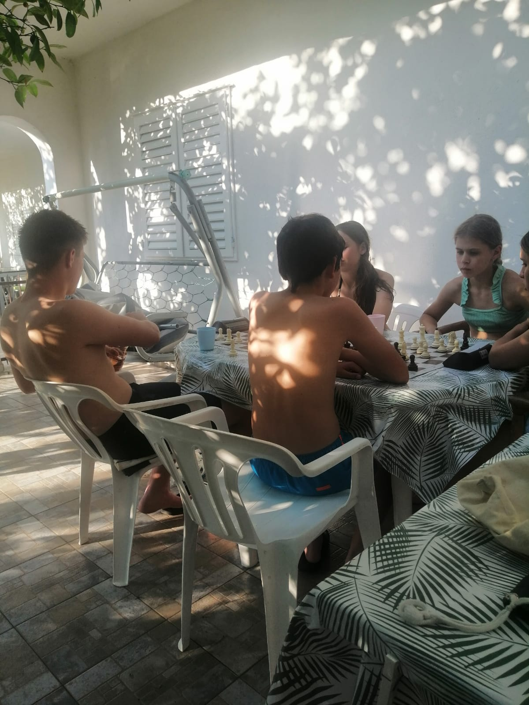
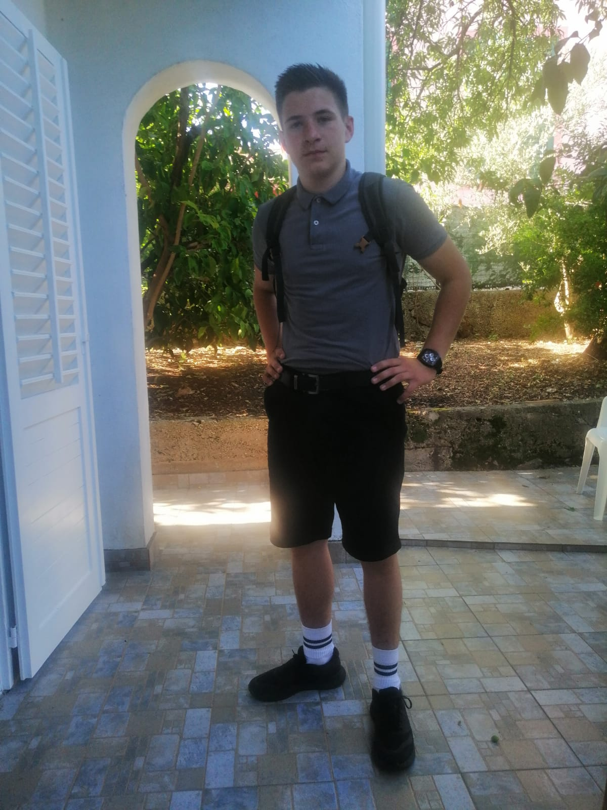
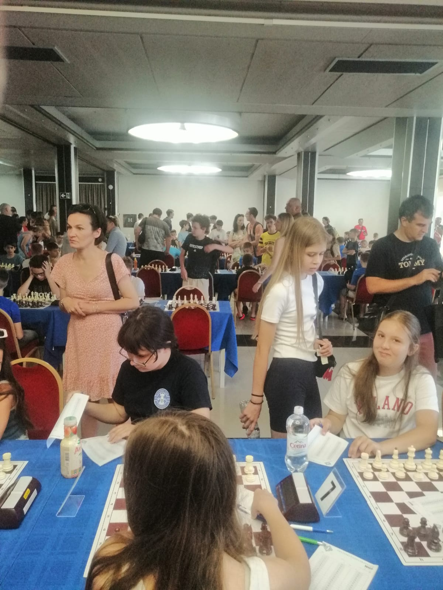
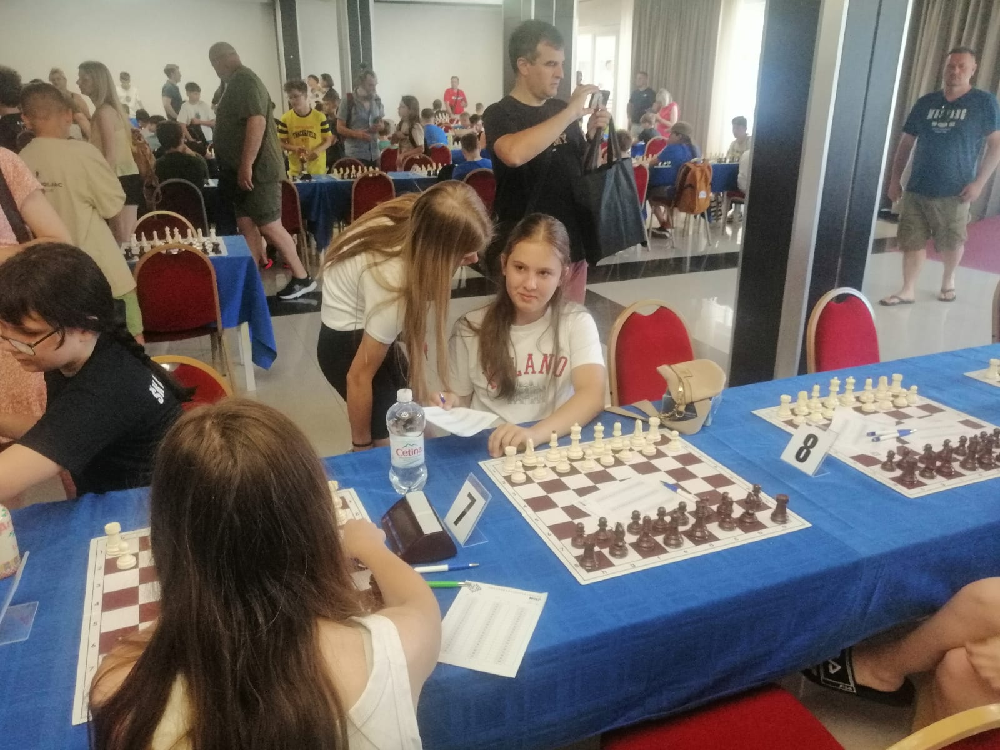
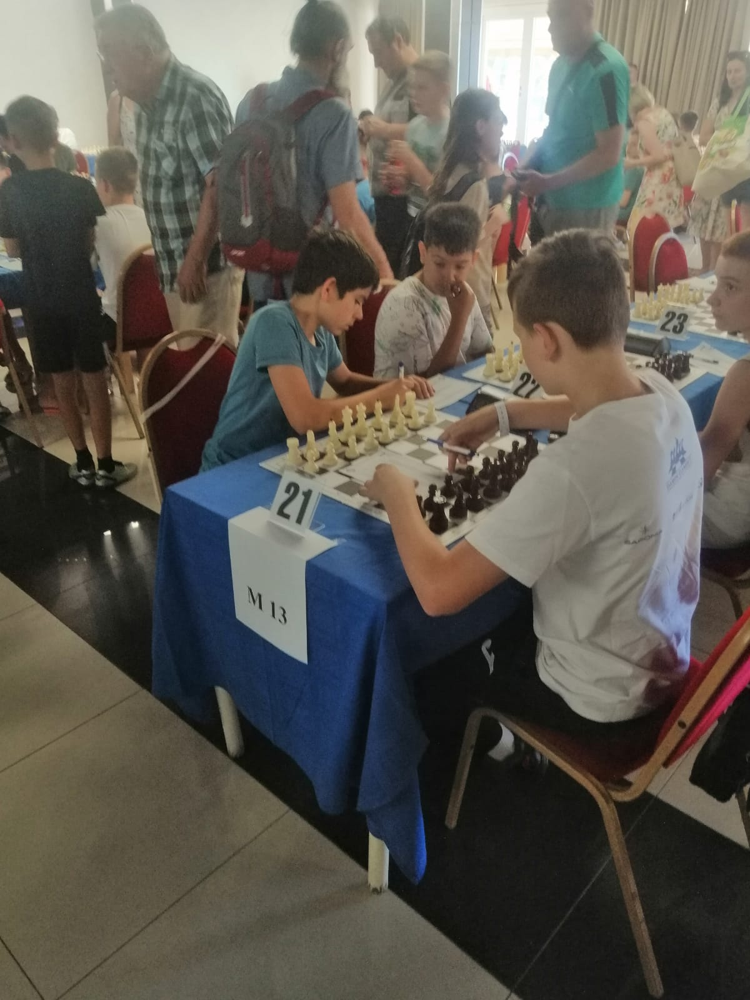
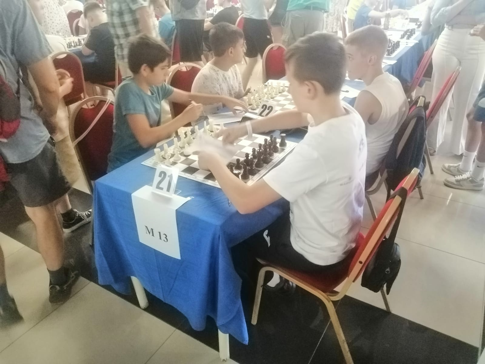
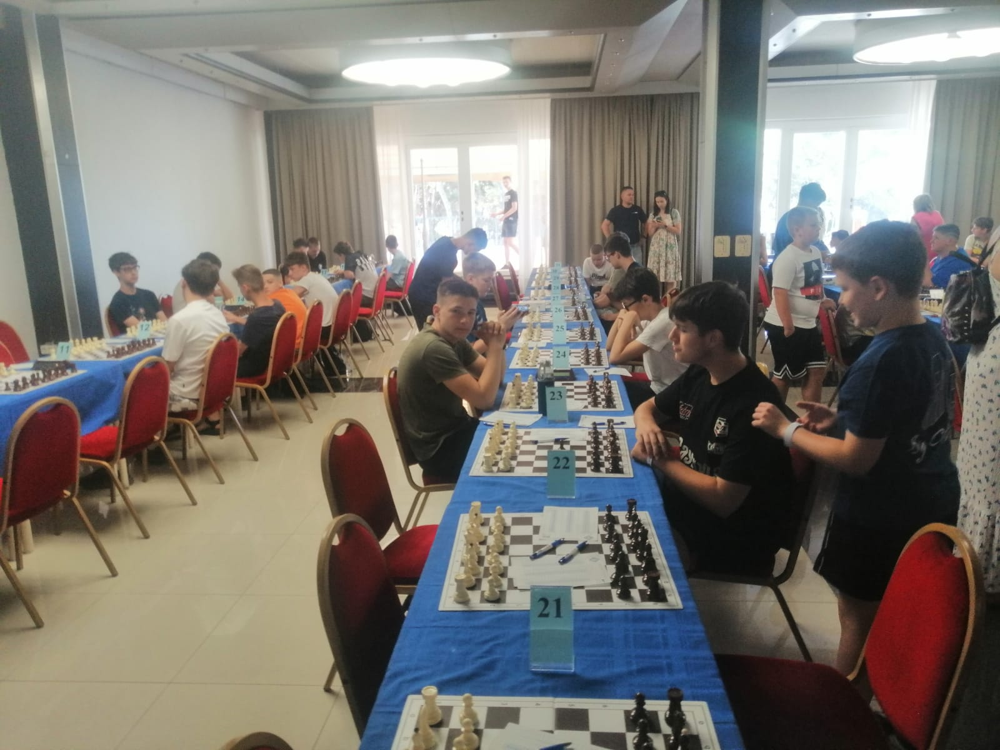

Od 15. do 20. lipnja 2025. godine u hotelu **Medena** u Segetu Donjem, pokraj Trogira, održano je **Pojedinačno kadetsko prvenstvo Hrvatske u šahu**. Turnir je i ove godine privukao stotine mladih šahistkinja i šahista iz cijele Hrvatske, a igralo se standardnim tempom: **90 minuta po igraču + 30 sekundi dodatka za svaki potez**, uz obavezno zapisivanje partija.

Naši su članovi ponovno pokazali volju, trud i šahovsku borbenost. Nastupili su:

-   **Luka Lesničar ([U11](https://s3.chess-results.com/tnrWZ.aspx?lan=1&art=0&SNode=S0&tno=1176209))** – 5 bodova, 19. mjesto od 55 igrača
-   **Ana Predović ([Ž11](https://s3.chess-results.com/tnrWZ.aspx?lan=1&art=0&SNode=S0&tno=1198427))** – 4,5 boda, 15. mjesto od 21 igračice
-   **Petra Medoš ([Ž13](https://s3.chess-results.com/tnrWZ.aspx?lan=1&art=0&SNode=S0&tno=1188276))** – 3,5 boda, 22. mjesto od 26 igračica
-   **Filip Horvat ([U13](https://s2.chess-results.com/tnrWZ.aspx?lan=1&art=0&SNode=S0&tno=1188273))** – 4 boda, 47. mjesto od 71 igrača
-   **Lucia Lesničar ([Ž15](https://s2.chess-results.com/tnrWZ.aspx?lan=1&art=0&SNode=S0&tno=1188270))** – 2 boda, 22. mjesto od 24 igračice
-   **Slavko Biondić ([U15](https://s2.chess-results.com/tnrWZ.aspx?lan=1&art=4&SNode=S0&tno=1206105)) –** 4 boda, 46. mjesto od 61 igrača

Iako broj bodova uvijek privlači pažnju, ovaj turnir donosi mnogo više – priliku da djeca osjete kako izgleda igrati pravim, sporopoteznim tempom, razmišljaju dublje, uče se strpljenju i usput grade nova prijateljstva. Ove godine, nažalost, nismo imali veći broj sudionika, ali se nadamo da će nam se sljedeće godine pridružiti Emanuel, Domagoj i Bartol.

Slavko je pokazao šahovski napredak – njegove su partije konačno bile zaokružene i zrele. Filip je ostavio dobar dojam, igrao stabilno i pokazao želju za učenjem. Luka je napredovao u odnosu na prošlu godinu, vidi se da redovito vježba. Lucija je još na početku, ali pokazuje volju i motivaciju. Ana i Petra dale su sve od sebe, a uz malo dodatne vježbe, sigurno će i rezultati već iduće godine biti bolji.

Najvažnije od svega – svi su se lijepo zabavili, družili, naučili ponešto novo i pokazali lijepo ponašanje, često čak i zrelije nego što su igrali. A to je, dugoročno gledano, najveća pobjeda.

~****~   
     
  
