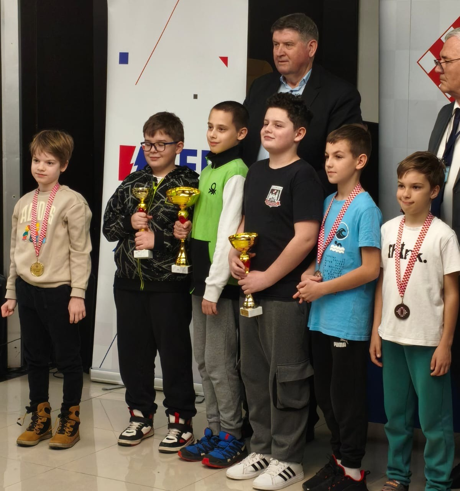

[  
](./kad-prv-hrv-2026.jpg)

U Hotelu Medena u Trogiru, od **28\. ožujka do 2. travnja**, naši najmlađi članovi nastupili su na Pojedinačnom kadetskom prvenstvu Hrvatske u šahu za 2026. godinu.

[Natjecanje](https://s1.chess-results.com/tnr1370611.aspx?lan=13&art=1&rd=9&flag=30&SNode=S0) se igralo u muškim i ženskim kategorijama do 9, 11, 13 i 15 godina, kroz devet kola po švicarskom sustavu, uz tempo igre od 90 minuta po igraču s dodatkom od 30 sekundi po potezu (90’ + 30’’). Zanimljivo je napomenuti kako se prvenstvo ove godine po prvi put održalo u zimskom terminu, umjesto uobičajenog ljetnog, iako sustav natjecanja (parne i neparne godine) pritom nije mijenjan.

Riječ je o najvažnijem državnom natjecanju za mlađe uzraste, koje svake godine okuplja najbolje mlade šahiste iz cijele Hrvatske. Naši su članovi ponovno pokazali volju, trud i šahovsku borbenost, a tijekom cijelog natjecanja imali su i veliku podršku roditelja koji su ih pratili i bodrili.

Nastupili su:

-   **Luka Lesničar ([U11](https://s2.chess-results.com/tnr1370611.aspx?lan=13&art=1&rd=9&turdet=YES&flag=30&SNode=S0))** – 6.5 bodova, 3. mjesto od 46 igrača
-   **Filip Horvat ([U15](https://s2.chess-results.com/tnr1370388.aspx?lan=13&art=1&rd=9&turdet=YES&flag=30&SNode=S0))** – 2.5 boda, 55. mjesto od 58 igrača
-   **Lucia Lesničar ([U15](https://s1.chess-results.com/tnr1370391.aspx?lan=13&art=1&rd=9&turdet=YES&flag=30&SNode=S0))** – 4.5 boda, 14. mjesto od 21 igračice

Prije svega, moramo čestitati Luki na osvojenom trećem mjestu! Luka je tijekom cijelog turnira pokazao borbenost, kvalitetnu igru i vidljiv napredak. Bravo Luka!

Iako broj osvojenih bodova često najviše privlači pažnju, ovakvi turniri donose puno više od samog rezultata – priliku da djeca osjete kako izgleda igrati pravim, sporopoteznim tempom, da razmišljaju dublje, uče se strpljenju te usput stvaraju nova prijateljstva. Ove godine, nažalost, nismo imali veći broj sudionika, no vjerujemo da će se to u budućnosti promijeniti.

Najvažnije od svega – svi su se lijepo zabavili, družili, naučili nešto novo i pokazali uzorno ponašanje, često i zrelije nego što su igrali na ploči. A to je, dugoročno gledano, najveća pobjeda.

U prilogu donosimo tri zanimljive partije, odnosno tri pobjede naših predstavnika.

```pgn
[Event "Kadetsko prvenstvo Hrvatske 2026 U11"]
[Site "Hotel Medena"]
[Date "2026.04.01"]
[Round "8"]
[White "Žitnik, Ivano"]
[Black "Lesničar, Luka"]
[Result "0-1"]
[WhiteElo "0"]
[BlackElo "1652"]

1. e4 e5 2. Nf3 Nc6 3. Nc3 Nf6 4. Bc4 Nxe4 5. Nxe4 d5 6. Bxd5 Qxd5 7. Nc3 Qd6 8. h3 Qg6 9. g3 Bd6 10. Nb5 O-O 11. d3 Re8 12. Be3 e4 13. Nxd6 cxd6 14. Nh4 Qf6 15. c3 exd3 16. Qxd3 g5 17. Ng2 Ne5 18. Qc2 Qf3 19. Rh2 Bf5 20. Qe2 g4 21. hxg4 Bxg4 22. Qc2 Bf5 23. Qd2 Qc6 24. Nh4 Ng4 25. Nxf5 Nxh2 26. Nh6+ Kf8 27. O-O-O Nf3 28. Qxd6+ Qxd6 29. Rxd6 Rad8 30. Rf6 Ne5 31. f4 Nd3+ 32. Kc2 Rxe3 33. Rxf7+ Ke8 0-1
```

```pgn
[Event "Kadetsko prvenstvo Hrvatske 2026 U15"]
[Site "Hotel Medena"]
[Date "2026.03.30"]
[White "Petar Jurić Bošković"]
[Black "Filip Horvat"]
[Result "0-1"]

[Round "4"]
[WhiteTeam "ŠK Sveta Nedelja"]
[BlackTeam "ŠK Odra"]
[Board "19"]

[WhiteElo "0"]
[BlackElo "1557"]

1. e4 e5 2. Nf3 Nc6 3. Bb5 f5 4. d3 fxe4 5. dxe4 d6 6. h3 Nf6 7. Nc3 a6 8. Bd3 b5 9. a3 Be6 10. O-O Be7 11. Bg5 h6 12. Bxf6 gxf6 13. Re1 Qd7 14. Nh2 O-O-O 15. Qf3 Nd4 16. Qe3 f5 17. exf5 Bxf5 18. Bxf5 Qxf5 19. Nd5 Bg5 20. Qc3 Qxc2 21. Rad1 c6 22. Nb4 Qxd1 23. Rxd1 Ne2+ 24. Kf1 Nxc3 25. Nxc6 0-1
```

```pgn
[Event "Kadetsko prvenstvo Hrvatske 2026 U15"]
[Site "Hotel Medena"]
[Date "2026.03.29"]
[White "Cale, Kaja"]
[Black "Lesničar, Lucia"]
[Result "0-1"]

[Round "3"]
[Board "6"]

[WhiteElo "1427"]
[BlackElo "1487"]

1.e4 e5 2.Nf3 Nc6 3.Bc4 Nf6 4.Ng5 d5 5.exd5 Na5 6.Qe2 Nxc4 7.Qxc4 Nxd5 8.Nc3 c6 9.Nxd5 cxd5 10.Qb5+ Qd7 11.Qe2 f6 12.Nf3 Be7 13.d3 Qc6 14.a3 Bg4 15.h3 Bh5 16.g4 Bg6 17.Nh4 O-O-O 18.Nxg6 hxg6 19.c3 d4 20.Rg1 dxc3 21.Qc2 Rxh3 22.bxc3 Rdxd3 23.g5 Rxc3 24.Qd2 Qe4+ 25.Qe2 Qxe2+ 26.Kxe2 f5 27.Bb2 Rc2+ 28.Kd1 Rxb2 29.Rc1+ Kb8 30.Re1 e4 31.Re2 Rxe2 32.Kxe2 Bxg5 33.Rg1 Bf6 34.Rxg6 Rxa3 0-1
```

IvanV
