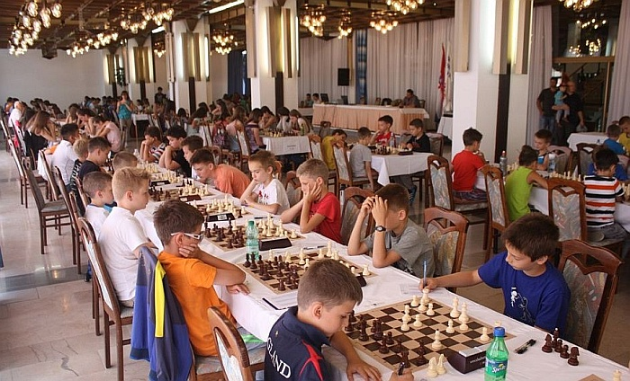
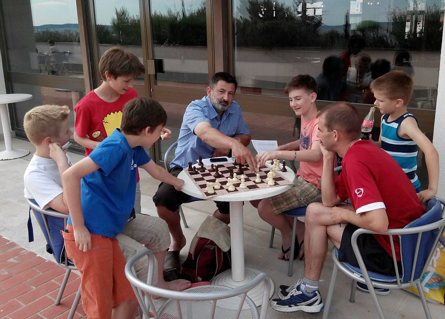
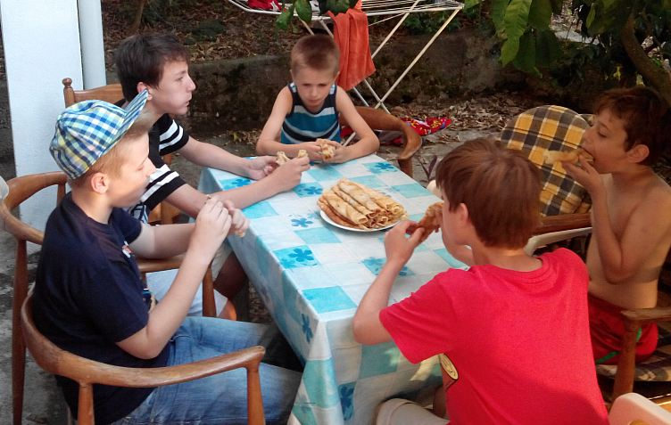
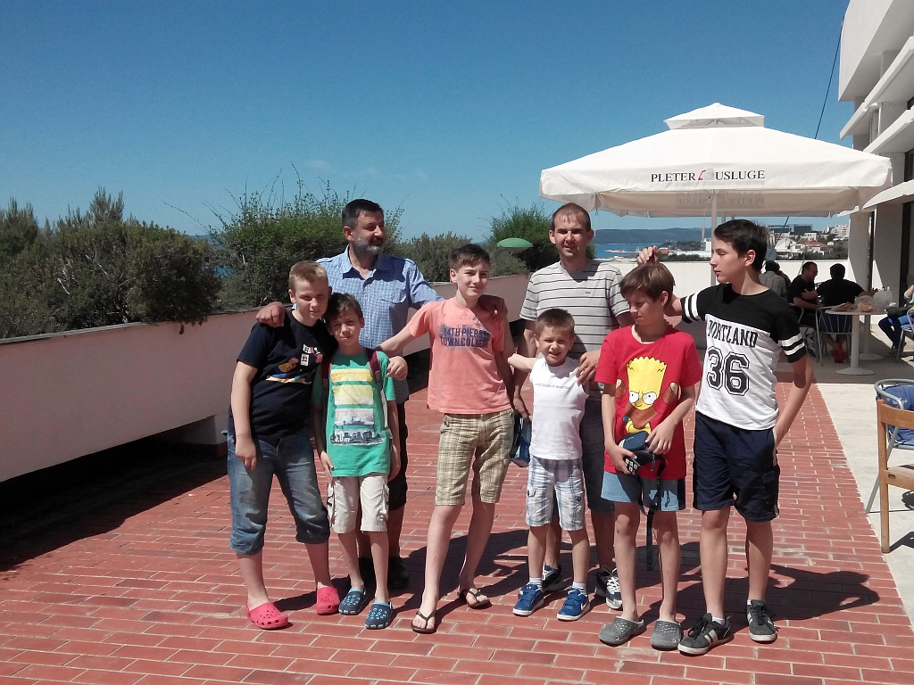
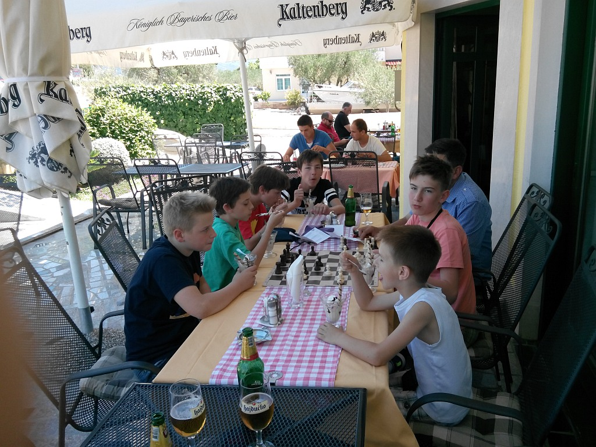

U tijeku je Kadetsko prvenstvo Hrvatske za kadete i kadetkinje do 15 godina. Prvenstvo se održava  
od 20. do 26. lipnja u Splitu, u hotelu “Zagreb”, a od naših članova nastupaju **Ivan Kljujev**, **Bruno Kolovrat** i **Božo Cvetković**  u skupini do 13  
[rezultati do 13](/files/wp/2015/06/kad.prv_.hrv_.do13._Split_2015.pdf "rezultati do 13")  
te **Ivan Maravić** i **Ivan Vraneša** u skupini do 11.  
[rezultati do 11](/files/wp/2015/06/kad.prv_.hrv_.do11._Split_2015.pdf "rezultati do 11")  
U skupini do 9 prvi nastup bilježi **Luka Fiolić**.  
[rezultati do 9](/files/wp/2015/06/kad.prv_.hrv_.do9_._Split_2015.pdf "rezultati do 9")  
Kljujevu, Luki, pa i Bruni, ovo je prvi nastup na takvom turniru i prema izvještaju voditelja dr. Cvetkovića, zasad im skupljanje iskustva ide vrlo dobro. Trenutačno su najuspješniji Ivan Maravić, Vraneša i Luka te se vidi koliku ulogu igra i iskustvo igranja na ovakvim turnirima.  
Želimo im lijepo vrijeme i još mnogo bodova do kraja prvenstva.  
   

  

darko
