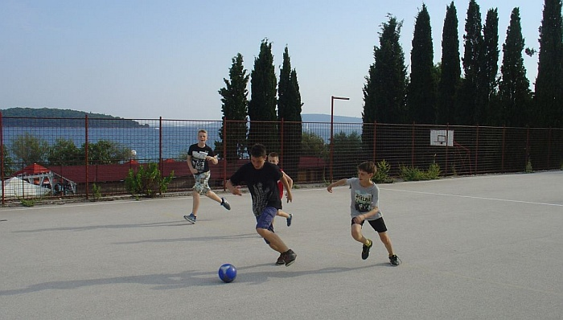  
Ove godine pojedinačno kadetsko prvenstvo Hrvatske u šahu igralo se od 20. do 26. lipnja u Trogiru, u hotelu Medena. Turnir je podijeljen u skupine do 9, 11, 13 i 15 godina, posebno za dječake, a posebno za djevojčice. Prvoplasirani i drugoplasirani igrači iz svake skupine stekli su pravo nastupa na svjetskome odnosno europskom prvenstvu. Natjecanje je bilo tehnički unaprijeđeno pa su se partije u skupinama do 11 i 13 godina (prvih 10 stolova) mogle pratiti i uživo, tako da se roditelji i treneri mogu živcirati i od kuće. 🙂  
Pobjednici po skupinama  
Turniri do 9 godina  
1. III **Franc, Borna**  0 1875 ŠK Samobor, Samobor 7,5  
2. III Vasilijević, Vili  1232 1832 ŠK Novi Zagreb, Zagreb 7,0  
3. IV Marković, Patrik  0 1683 ŠK Brestje, Sesvete 6,5  
1. I **Putar, Lara**  1409 1759 ŠK Brestje, Sesvete 7,0  
2.III Gretić, Tina  0 1711 ŠK Radnik, Velimirovac 5,0  
3. I Smetiško, Renata  1138 1809 ŠK Ericsson-Nikola Tesla, Zagreb 5,0  
Turniri do 11 godina  
1. III **Vučenović, Damian** 1562 1865 ŠK Casper, Zadar 8,0  
2. IV Cajner, Lukas 1271 1754 ŠK Brestje, Sesvete 7,0  
3. III Solina, Marin 0 1818 GŠK Požega, Požega 6,0  
1. I **Bevanda, Ema** 1371 1869 ŠK Picok Đurđevac, Đurđevac 8,0  
2. II Trgovac, Marta 1206 1695 ŠK Polet, Buševec 7,5  
3. II Aščić, Mihaela 0 1639 ŠK Đakovo, Đakovo 6,0  
Turniri do 13 godina  
1\. I **Dabić, Stjepan** CRO 1665 2000 ŠK Sladorana, Županja 8,5  
2\. IV Tomljanović, Marin CRO 1447 1748 ŠK Velebit, Senj 7,0  
3\. II Mažuran, Gabrijel CRO 1656 1915 ŠK Liburnija, Rijeka 7,0  
1. MK **Radiković, Anamarija** CRO 1836 1973 ŠK Rijeka, Rijeka 7,5  
2. I Randić, Petra CRO 1390 1872 ŠD Sisak, Sisak 7,5  
3. MK Dejanović, Tereza CRO 1673 1917 ŠD Sisak, Sisak 7,0  
Turniri do 15 godina  
1. II **Kukas, Oliver** 1847 1983 ŠK Oroslavje, Oroslavje 7,0  
2. II Duda, Daniel 1765 1957 ŠK Liburnija, Rijeka 7,0  
3. I Čotić, Borna 1918 2022 ŠK Mornar, Split 6,5  
1. NM **Cvitan, Ena** 2037 2109 ŠK Liburnija, Rijeka 7,5  
2. MK Bogdanić, Katarina 1847 1920 ŠK Krk, Krk 7,0  
3. MK Golub, Nikolina 1871 1990 ŠK Sveta Nedelja, Sveta Nedelja 6,5

Čestitke pobjednicima!

Naši dečki nastupili su u jednakom sastavu kao i prošle godine, s tim da su sada petorica nastupila na turniru do 13 godina (Ivan Maravić, Ivan Kljujev, Bruno Kolovrat, Ivan Vraneša i Božo Cvetković), a jedan u konkurenciji do 9 godina (Luka Fiolić). Počeli su turnir katastrofalno (0/6), a slično i završili (posljednje kolo osvojili su 1/6). Za početni kiks ne znam uzrok, a na posljednje kolo ipak je imao utjecaj poraz naše nogometne reprezentacije na Europskome nogometnom prvenstvu. 🙂  
Ivan se do nekoliko kola prije kraja borio i za vrh tablice, ali je tada izgubio dobivenu partiju i izostao je očekivani rezultat. Božo se malo popravio i ove godine nije strahovao od posljednje pozicije, Kljujev je napredovao, kad bi još i radio na šahu… Vraneša opet igra toplo – hladno i kod njega se nikad ne zna kakav će rezultat postići na nekom turniru, Bruno i dalje izbjegava rizik, a ima dovoljno talenta za mnogo bolji rezultat. Luka ima opravdanje za prva četiri kola jer je bio bolestan, ali ni poslije toga nije pokazao svoju pravu snagu. Bez obzira na godine, morat će se malo uozbiljiti u pristupu partijama.  
Prema kratkom izvještaju koji sam dobio, atmosfera je bila vrhunska; ako je izostao rezultat, zabave nije nedostajalo. Zahvaljujemo voditeljima Goranu Fioliću i dr. Ivanu Cvetkoviću na dobro odrađenu poslu, zahvaljujemo potpredsjedniku Kluba, prof. Stjepanu Maraviću na i ove godine besplatnom smještaju te Darku Vraneši na fotografijama s turnira. Iskreno se nadam da će se dogodine pojaviti još poneki talent koji zaslužuje nastup na ovom turniru te da će se djevojke organizirati i napokon pridružiti nastupima na državnom prvenstvu jer neke od njih igrom to već zaslužuju.  
U nastavku su neke partije s turnira, u pgn formatu, te rezultati za skupine do 9 i 13, koje su nam najzanimljivije zbog nastupa naših članova. Njihove partije još ćemo jedanput analizirati u petak na redovitom druženju u Klubu.  
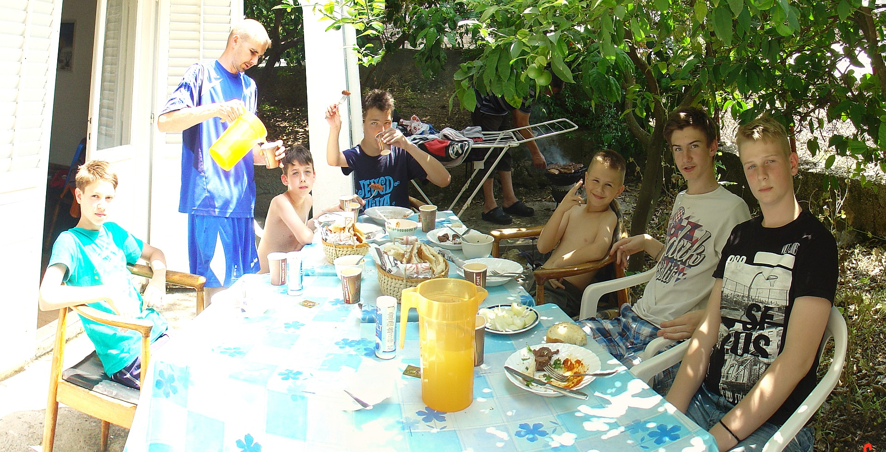 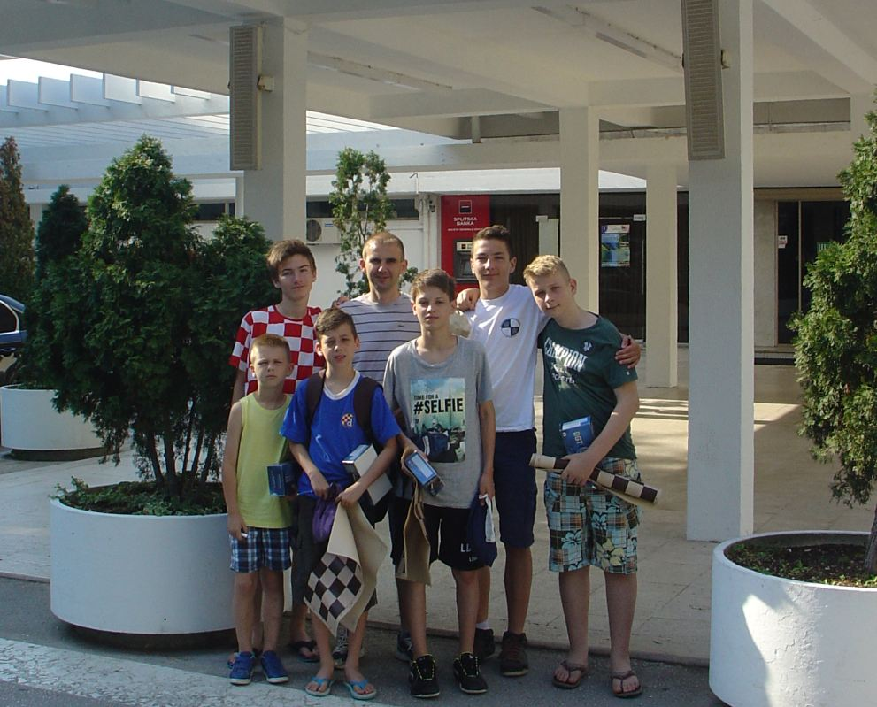 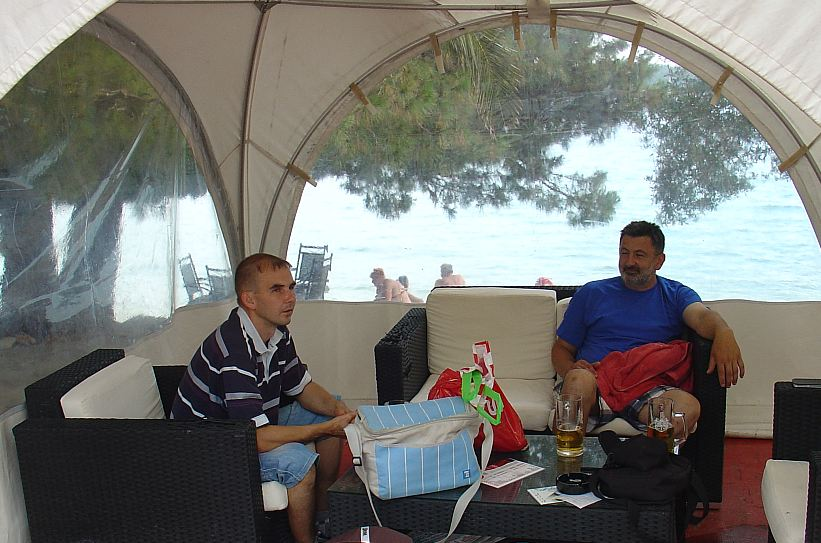 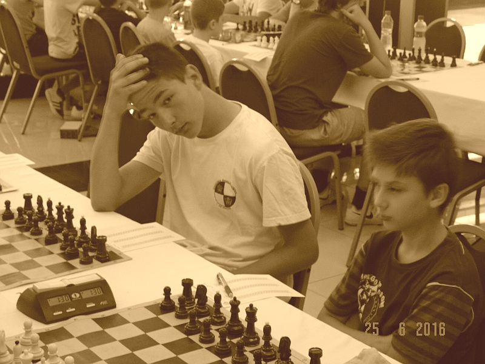  
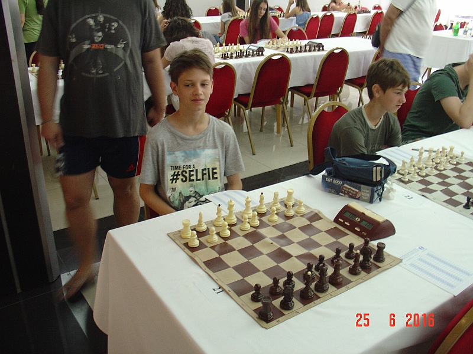 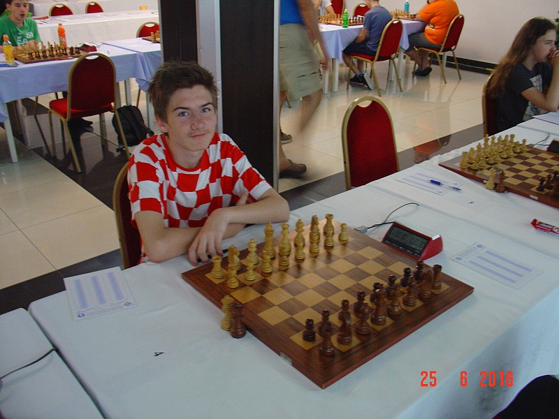 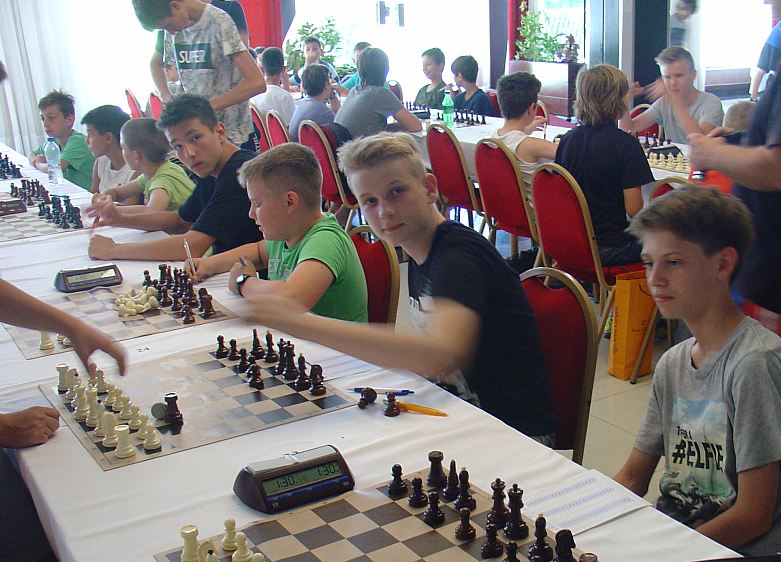 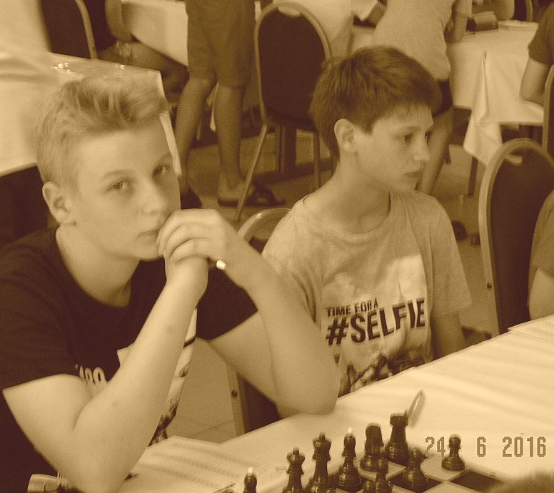  
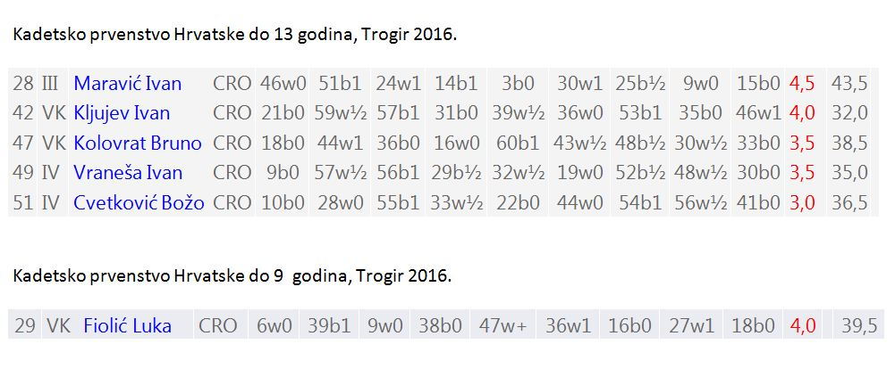 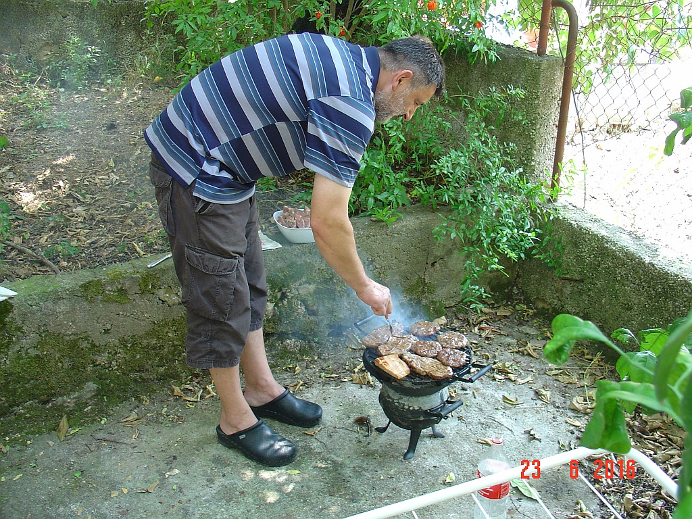 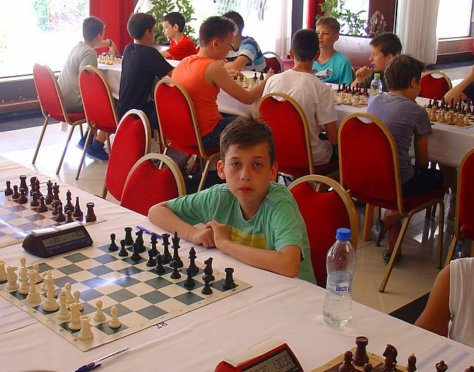 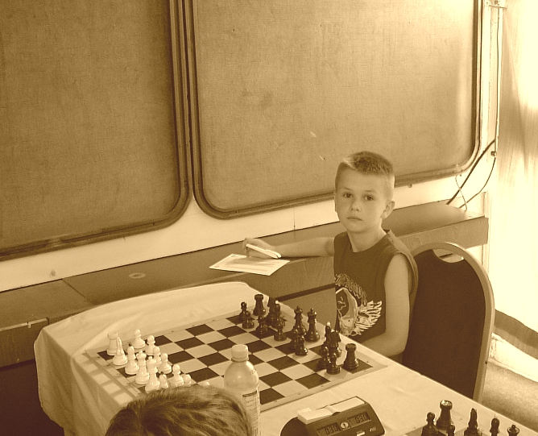

[Kadetsko prvenstvo Hrvatske do 13 – Trogir 2016](/files/wp/2016/06/Kadetsko-prvenstvo-Hrvatske-do-13-Trogir-2016.pdf)  [Kadetsko prvenstvo Hrvatske do 9 – Trogir 2016](/files/wp/2016/06/Kadetsko-prvenstvo-Hrvatske-do-9-Trogir-2016.pdf)

[Trogir 2016. – partije – do 13godina](/files/wp/2016/06/Trogir-2016.-partije-do-13godina.pgn)  , [Trogir 2016. – partije – do 9 i 11 godina](/files/wp/2016/06/Trogir-2016.-partije-do-9-i-11-godina.pgn)

[Trogir 2016. – partije – do 9 i 11 godina](./trogir-2016-partije-do-9-i-11-godina.pgn)

[Trogir 2016. – partije – do 13godina](./trogir-2016-partije-do-13godina.pgn)

darko
